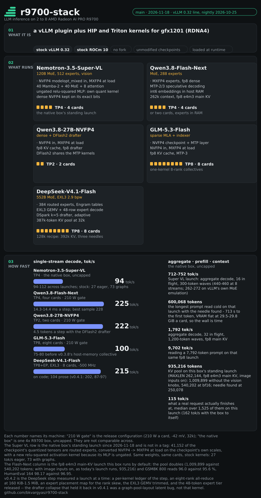
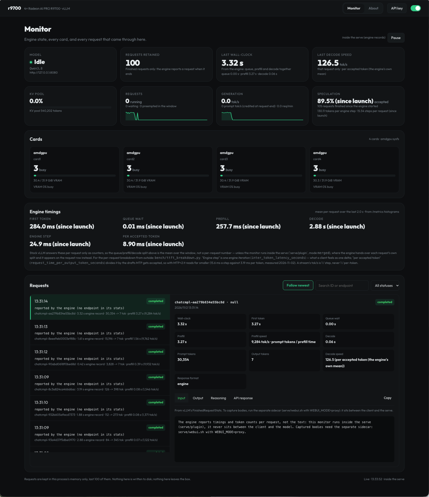
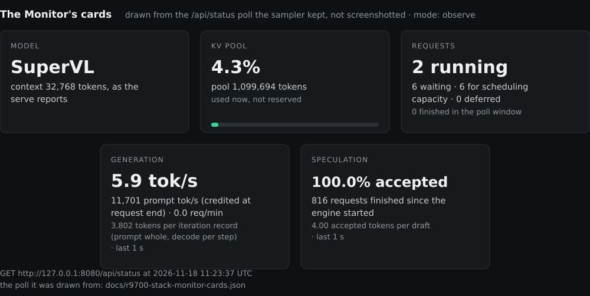

<p align="center">
  <picture>
    <source media="(prefers-color-scheme: dark)" srcset="docs/r9700-stack-lockup-dark.svg">
    
  </picture>
</p>

<div align="center">

**stock vLLM と stock ROCm のまま、AMD Radeon AI PRO R9700 で巨大なオープンモデルを速く動かす。**

gfx1201（RDNA4）向けの vLLM プラグインと HIP / Triton カーネルの集合。フォークなし、ソース改変なし、バイナリ同梱なし、
ウェイトの再量子化なし：すべて vLLM 自身の拡張点から実行時に読み込むので、vLLM と ROCm はそのうえでそのまま更新できる。

**日本語 | [English](README.md)**

[](https://github.com/bkvargyas/r9700-stack/releases/latest)


[](LICENSE)


</div>


> [!NOTE]
> ここにあるすべての数字は 2 台のマシンのどちらか由来で、表ごとにどちらかが明記されている——だが両者は同等ではない。
> 私たちの実測は**ネイティブ機**（R9700 ×4、Gen5 ホスト、docker なし、**電力上限なし**——実測はカードあたり約 299 W）
> で取ったもので、このフォークが日々動かしているマシンであり、どの表もその数字が先頭に立つ。もう 1 台は**アップストリームの
> リリースゲート**である **210 W ゲート機**（R9700 ×8、カードあたり 210 W 上限、-42 mV、エミュレートされた PCIe
> スイッチ付きの KVM ゲストで、その 120 V 給電が 8 カード運用を -500 MHz クロックオフセットに抑える）；その数字は
> 比較列としてだけ置いてあり、私たちの結果ではない。カード数はデプロイの形であってマシンではなく、210 W の数字は
> 電力上限なしの数字と決して比較できない。両マシンの設定と、唯一食い違っている箇所は
> <a href="#speed">速度</a>の冒頭にある。あなたの環境は違って当然で、serve スクリプトのすべての調整項目には根拠が併記されている。

<p align="center">
  <a href="docs/r9700-stack-page.png"></a>
  <br><sub>1 ページにまとめたリリース：このスタックが何か、スタックがサーブする 5 つのモデル構成、各バーにはその数字が出自の
 マシンがタグ付けされ、そして実行速度——下の表と同じ数字から <code>docs/summary-page.py</code> が描いたので、誰も描き直せない
 図が数字からズレることはない——どのバーがどのマシンで測ったかも含む。キャンバスは 1000 px で、github.com の約 980 px 幅の
 カラムに対して、一番小さい文字は 14 px に収まる；タグ自身の自描き <code>docs/r9700-stack-v0.4.3.svg</code> は同じ主張を
 1200 単位キャンバスに 11 px で載せているが、あのカラムでは 9.0 px に縮む——クリックして読むことになるから、この README が
 載せるのは生成ページの方だ。ピクチャは <code>docs/r9700-stack-page.png</code>（同じ図を 2000 × 3912 で）にリンクし、
 拡大できるようにしてある。すべてのバーがマシンを名乗る：<code>210 W gate</code> は**アップストリーム**のゲート機
 （カードあたり 210 W、-42 mV、32k）で、比較列として置いてある；<code>210 W gate, -500 MHz</code> はあのマシンの
 **8 カード**運用で、電力上限に加えて 120 V 給電が強制するクロックオフセットを載せている；<code>the native box,
 uncapped</code> はこのマシンの R9700 ×4、実測はカードあたり約 299 W——私たちの実測であり、表が先頭に置く数字だ。
 3 つのうち交わるものは一つもない。</sub>
</p>

<p align="center">
  <a href="#four-cards"><b>4 枚の実測</b></a> ·
  <a href="#what">何をやるか</a> · <a href="#features">特徴</a> ·
  <a href="#kernels">カーネル</a> ·
  <a href="#speed"><b>速度</b></a> ·
  <a href="#watching">監視する</a> · <a href="#deploying"><b>デプロイ</b></a> · <a href="#license">ライセンス</a>
</p>

<p align="center"><b>マシンを立ち上げるか、すでにこのリポジトリが動いているマシンを点検する：</b><br>
<code>./setup.sh --yes --launch native-flashnext.sh --webui same</code><br>
<sub>実際に配置された 32 GB BAR0 を持つカード、<code>/dev/kfd</code>、カーネルコマンドライン、memlock、docker か
ネイティブ経路か、各チェックポイントを報告し、ビルドして起動する。wheel もチェックポイントも一切取りに行かず
すでに動いている起動には触れない。イメージも含む両経路は
<a href="#deploying"><b>デプロイ</b></a>に。</sub></p>

<a id="four-cards"></a>

## 4 枚の実測：知っておくべき数字

**ネイティブ機（R9700 ×4、電力上限なし）で 2026-11-18 に実測：Nemotron-3.5-Super-VL-120B-A12B**（NVIDIA
NVFP4：**512 エキスパート**、トークンあたり 22 稼働、Mamba-2 40 + MoE 40 + 注意 8、ビジョン）を 4 カード、TP4、MTP-4、
カードあたり 18.5 GiB で。このモデルは 1 日だけ常駐起動としてカードを保有し、現在は再び退避して
いる——そこに至った作業はそのまま残っていて、`launches-available/supervl-32k.json` がフラグ 1 つで呼び戻す：

| | 実測 | 比較対象 |
|---|---:|---|
| **デコード、ストリーム 1 本** | **94-112 tok/s** | stock vLLM、同じウェイトと同じカード：**27**（eager）、graphs ありで **73**——差は読み込み時変換 |
| **デコード、8 / 16 ストリーム** | **440-460 / 712-752 tok/s** | 同じ起動を vLLM 自身の MoE エミュレーションで：**262-272**（8 ストリーム） |
| **品質、変換あり vs stock** | GSM8K **191/200** vs **190/200** | ニードルは 30k、150k、250k を両腕とも発見 |
| **コンテキスト** | **600,068 トークンをコールド読み** | 250k で最初のトークンまで 144 s、600k で 713 s、VRAM は一定——壁は時間。<code>CTX=32k \| 256k \| 1m</code> |
| **画像** | **1 枚あたり 256-3,328 トークン** | チェックポイントの patch バジェットで、調整項目ではない；混在ウェーブの約 1/3；crop を送ること |

完全な記録：[notes/nemotron-super-vl.md](notes/nemotron-super-vl.md)。

Qwen3.8-Flash-Next（MoE、512 エキスパート、MXFP4 エキスパート + fp8 dense）を Radeon AI PRO R9700 ×4、TP4、MTP-3、
カードあたり 31.9 GiB で——このフォークのカーネルが作られた対象の起動であり、2026-11-18 の夕方から
ネイティブ機が再びサーブしている起動：

| | 実測 | 出自 |
|---|---:|---|
| **デコード、ストリーム 1 本** | **186.7 tok/s**、このマシン、電力上限なし、1 ステップ 14.3 ms | アップストリームの 210 W ゲートはそこで **225** を読む（最良サンプル 228、v0.3.3；以降の 4 回のゲートは 221.4-222.9）——同じ 4 枚に上限をかけたもの；両者は食い違うが、調整ではなく記録してある |
| **デコード、32 ストリーム** | **1,823 tok/s** 集計（最良サンプル 1,836.3） | 1,200-token ウェーブ、`bench/probe32.sh`；ネイティブ機、電力上限なし。デフォルトになった fp8 主 KV の起動は同じプロトコルで **1,792**（1,789 / 1,796）を読み、2026-11-08 の常駐起動（vLLM 0.32、router cap 4、util 0.96、`PREFIX_CACHE=0`）は **1,767 / 1,780** を読んだ——その散布の内側なので、router cap はここで測れる代价を払っていない（notes/bug-router-gemm-oob.md） |
| **プロンプト読み込み** | **9,633 tok/s** | 7,789-token プロンプト、ネイティブ機で電力上限なし；比較のためにアップストリームのゲートは 210 W で 7,141 を読む；fp8 起動では **9,702**、7,792 トークン |
| **コンテキスト** | **262,144 トークン**、ニードルを 250,078 で発見 | チェックポイント自身の上限であり、このマシンが今日サーブしているウィンドウ；常駐起動（`MM_TP_MODE=data`、ビジョンタワー複製）は **797,453 トークン** を印字する（`Maximum concurrency for 262,144 tokens per request: 3.04x`）——同じ起動でタワーを rank に分割した版は **887,983**（3.39x）、その前は **902,153**（3.44x）——つまりプールは起動が印字したもので、設定の性質ではない（[notes/context-256k.md](notes/context-256k.md)、タワーの代价は [notes/multimodal-input.md](notes/multimodal-input.md)）—— fp8 e4m3 主 KV、画像入力 ON、`--gpu-memory-utilization 0.96`。0.97 なら同じ起動がビジョン調整項目ありで 935,216、なしで 1,009,899 を読んだ；bf16 主 KV では 540,202 |
| **デコード、実稼働で**（ベンチマークではない） | **162 tok/s**——マシンを独り占めなら、**115 tok/s**——リクエストが実際に終わるまで | fp8 起動のジャーナルから 10.25 h の実リクエスト 1,568 件、115 はトークンを >=40 生成した 1,525 件の中央値、プロンプト p50 52,083；上のベンチマーク行は誰も座っていないマシンの話 |

<sub>これらの表は**このマシン——ネイティブ機（R9700 ×4、電力上限なし、カードあたり約 299 W）での私たちの
実測**が先頭に立つ。私たちの数字の横に**アップストリームの 210 W ゲート機**の数字が引用されている箇所——1 行目と
3 行目の比較セル——では、行そのものがそう書いてあり、両者は交わらない：210 W の数字が電力上限なしの数字と
比較可能になることはない。Super VL の表はこのマシンだけ。速度セクションには 2 カードと 8 カードの形が残って
いるが、それはアップストリームのゲート機の形で、-500 MHz オフセットも載せている。最後の行はベンチマークでは
まったくない——動いている serve が他人のリクエストについて報告したもので、「リクエストがどう体感されるか」を
聞くなら信じるべき行だ。完全なプロトコル、サンプルリスト、試して却下された測定：<a href="#speed">速度</a>、
<a href="notes/native-4xr9700.md">notes/native-4xr9700.md</a>、
<a href="notes/context-256k.md">notes/context-256k.md</a>。</sub>

<a id="what"></a>

## 何をやるか

stock の vLLM ROCm イメージにこのプラグインを入れて動かす。そこから：

1. **読み込み。** プラグインは vLLM の platform、quantization、model、attention-backend の各エントリーポイント経由で登録し、
   自分のカーネルライブラリ（`libr9k`、HIP と Triton）を持ってくる。チェックポイントは公開されたものそのまま。
2. **読み込み時に変換。** NVFP4 ウェイトは MSE で探索したブロック指数つき MXFP4 になるか、宣言している
   スケールを使えばそれに乗せる（`modelopt_mixed`：宣言レイヤーエントリ 41,156 のうち 40,960 がルーティングエキスパート
   行列）；fp8 dense、ドラフター、lm-head の GEMM はトークンごと fp8 活性化を受け取る；KV キャッシュは fp8；
   大きなテーブル（Flash-Next のレイヤー別埋め込みを int6 で、DeepSeek の Engram テーブル）はピン留めホストメモリへ；
   EXL3 trellis ウェイト（2-6 bit）は exllamav3 の gfx1201 拡張と自作のバッチエキスパートカーネル経由でサーブされる。
3. **自作カーネルでデコード。** ルーティング・活性化・top-k 合計を融合した grouped MoE GEMM；活性化量子化を
   融合した WMMA weight-only GEMM；レイヤーごとに 1 つの融合 Gated DeltaNet コア；split-K カーネル上の
   sparse-MLA デコード；hyper-connection の接合部を 1 launch で；ドラフター（MTP、DFlash2、DSpark）は同じ
   カーネル上で、すべて HIP graph の内側。
4. **素の PCIe で話す。** 4 つの PCIe スイッチをまたぐ 2 / 4 / 8 カード用の単一カーネル all-reduce と
   all-gather（ペアは P2P で、スイッチ横断はピン留めホストメモリ経由）、prefill サイズのメッセージには
   圧縮 4/6-bit all-reduce、その上は RCCL。
5. **リリースを毎回ゲートする。** タグの前に全構成でカーネル単体ゲート、インストール済み vLLM との統合ゲート、
   `max_num_seqs` 超の strict sanity、混在長さのソーク、長文脈ニードルを通し、数値に対して GSM8K のペア比較
   （McNemar）と HumanEval を通す。

現行リリース：**v0.4.5**（2026-11-15）、[リリースノート](notes/release-v0.4.5.md)、[CHANGELOG.md](CHANGELOG.md)。
このフォークが動かしている 4 カードのネイティブ機では、主 KV キャッシュはデフォルトで fp8 e4m3——下の 256k の表を参照。

<a id="features"></a>

## 特徴

| | |
|---|---|
| 🧠 **5 つのモデル、無改造のチェックポイント** | DFlash2-FP8 ブロックドラフター付き **Qwen3.8-27B-NVFP4**（2 カード）；**Qwen3.8-Flash-Next**（MoE、512 エキスパート；4 カード、またはエキスパートをホスト RAM からストリームすれば 2 カード）；**GLM-5.3-Flash**（288 エキスパート MoE、sparse MLA + indexer、MTP レイヤー付き RedHat NVFP4；8 カード）；公開済み EXL3 2.9 bpw パック由来の **DeepSeek-V4.1-Flash**（552B MoE、384 エキスパート、Engram、DSpark；8 カード、テンソル + エキスパート並列）；NVIDIA の NVFP4 `modelopt_mixed` パック由来の **Nemotron-3.5-Super-VL-120B-A12B**（120B MoE、512 エキスパートで 22 稼働、Mamba-2 + 注意のハイブリッド、ビジョン；4 カード）。 |
| 🧮 **読み込み時に扱うウェイト形式** | NVFP4 → MXFP4（27B でビット一致、NVIDIA の `modelopt_mixed` パックは自身宣言のスケールでそのまま乗せ）、トークンごと活性化つき fp8 dense / ドラフター / lm-head、fp8 KV、ピン留めホスト RAM の int6 と fp8 テーブル、分割不能部分を bf16 に逆量子化して扱う EXL3 trellis。 |
| ⚡ **デコードカーネル** | 融合 MoE GEMM、WMMA weight-only GEMM、レイヤーあたり 1 つの GDN コア、RDNA4 調整の sparse-MLA デコード、1 launch の hyper-connection 接合、融合ルーティングと norm、複数行 EXL3 GEMV（1-48 行）とバッチ EXL3 エキスパートデコード。 |
| 🔗 **PCIe 上の集合通信** | 2 / 4 カードの one-shot / two-shot P2P；root complex を一度もまたがない 8-rank all-reduce と all-gather（ペアは P2P、横断はピン留めホストプール経由）；prefill 用の圧縮 4/6-bit all-reduce；その上は RCCL。 |
| 🎯 **全ファミリーの投機的デコード** | MTP-3（Flash-Next、GLM）、DFlash2（27B）、適応検証つき DSpark（DeepSeek）、ドラフトのメタデータと all-reduce は HIP graph の内側。 |
| 📏 **推測せず、測る** | DeepSeek のステップのカーネル別台帳（[notes/exl3-ledger.md](notes/exl3-ledger.md)）が何を作るかを決め、serve スクリプトの各デフォルトの隣にはその測定がある。 |
| 🧪 **ゲートされたリリース** | `max_num_seqs` 超の strict sanity、15 分の混在長さソーク、長文脈ニードル、タグ付きツリーごとの GSM8K ペア比較と HumanEval、DeepSeek 起動ごとのドラフター自己テスト（[notes/release-v0.4.2.md](notes/release-v0.4.2.md)）。 |
| 🧰 **ランチャーとベンチ** | 構成ごとに serve スクリプト 1 本（`serve/`）、warm-up・sanity・soak・eval・ニードルツール（`bench/`）、カーネル単体テスト（`tests/`）、`R9K_*=stock` でどのカーネルも vLLM 自身に戻せる。 |

<a id="speed"></a>

## 速度

これらの表の裏側には 2 つの電力設定があり、上限をかけた方は 2 台のホストをまたいでいる——だが私たちのマシンは
そのうち 1 台だけで、表もその順序で並べてある。マシンも電力も書いていない行は、使ってはいけない行だ：

| | **ネイティブ機——私たちの** | **210 W ゲート機——アップストリームのリリースゲート** |
|---|---|---|
| どんなマシンか | このフォークの日常マシン：R9700 ×4、Gen5 x16 ホスト、docker なし、venv の vLLM 0.32.0+rocm723 | アップストリームのリリースゲートマシン：R9700 ×8、エミュレートされた PCIe スイッチ付き KVM ゲスト、ピン留めされた stock ROCm 10 イメージ、vLLM 0.33.0 |
| 1 回の起動のカード数 | 4 | 2、4 または 8 |
| カードの電力 | **上限を設定せず**——`gpu_busy_percent` 100 で中央値 **299 W**（132 サンプル、179-303） | **カードあたり 210 W に上限**、-42 mV オフセットつき |
| クロック | stock | 120 V 給電が**8カード**運用を **-500 MHz** の SCLK オフセットに抑える |

ゲートの行にもう一つ注意：v0.4.x から、アップストリームのゲートは上記の 8 カードゲスト **VM100** で走る。比較セクションにまだ引用されている v0.3.2 と v0.3.3 の行は、同じ 210 W・-42 mV で古い**4 カード Gen3 テスト機**のゲートであり、2 カードの行は 2 台のホストで並べて測った——同じ上限、別の PCIe——だから 1 つの数字ではなく 122 と 143 と印字される。

このファイルが**このマシン**や**私たちのマシン**と言うときはネイティブ機を指す。ここから 3 つの規則が導かれ、下のどの表もそれに従う。**カード数はデプロイの形であってマシンではない**：同じ 4 カード起動も、アップストリームでは 210 W でゲートされ、このマシンでは電力上限なしで走る——そして両者は食い違う——このマシンで電力上限なし・ストリーム 1 本が **186.7** tok/s、ゲートでは **225**——調整せず記録してある。ホスト、給電、クロックが違い、210 W の数字はネイティブ機で一度も再測されていないからだ。**210 W の数字は電力上限なしの数字と比較できない。** そして 8 カードの数字はすべて、上限に加えて -500 MHz オフセットも載せている。

この節の冒頭を開く 4 つの小節は**このマシンでの私たちの実測**：このマシンが 11 月に走らせた 2 つ目のモデル（Super VL）、32k のレシピ、チェックポイント完全長の 262,144 トークンのコンテキスト、そして実トラフィック。3 つ目までは**ベンチマーク**——プロンプト長を固定し、等しい `max_tokens` のウェーブ、計測中はほかの何も割り込まない——実トラフィックのそれ**ではない**；そのデコード数字がベンチマークの約 1/3 になるのは意外でもなく説明のつく理由で、ユーザーが実際に何を得るかを読むならそちらだ。その後ろは**アップストリームのリリースゲート記録**で、210 W——このマシンが走らせない 4 / 2 / 8 カードの形——同じビルドを並べて読めるための比較列として置いてあり、私たちの数字と一つの数に混ぜることは絶対にない。

### ネイティブ機の 2 つ目のモデル：Nemotron-3.5-Super-VL-120B-A12B、512 エキスパート、4 カード、電力上限なし

2026-11-18 にこのマシンが 1 日だけ走らせたもの——現在は退避済みで、その過程で元に戻したものは何もない。このパックは `modelopt_mixed` の MIXED_PRECISION で、`hf_quant_config.json` が宣言する 41,156 のレイヤーエントリのうち **40,960 がルーティングエキスパート**；プラグインはこの量子化を初めて扱い、ROCm 上の stock vLLM は**エキスパートを 1 つずつ逆量子化**する。同じウェイト、同じカード、ウェーブの揺らぎ ±10%：

| 変えたもの | ストリーム 1 本 | 8 ストリーム波 |
|---|---:|---:|
| stock vLLM、`--enforce-eager`、stock の NVFP4 MoE エミュレーション | 26.9-27.5 | - |
| + HIP graphs | 73.0-73.4 | 306-328 |
| + libr9k MXFP4 grouped experts、MTP-2 | 86.2-89.6 | 442-462 |
| + ネイティブ dense NVFP4、MTP-4、16 ストリーム | **94-112** | **440-460**（16 で **712-752**） |

| 作る必要があったもの | |
|---|---|
| `quant/modelopt.py` | stock の名前を登録し、エキスパートを既存の NVFP4 → MXFP4 変換に乗せる——再導出ではなく**チェックポイント自身のスケール**で。落とし穴：ModelOpt は `scale_2` を掛けてくるが私たちのヘルパーは割るので、`1 / scale_2` を渡す——精確な逆量子化に対するプローブが差を名指しする：11% vs 2.4e11% |
| `r9k_relu2_quant_fp8` | このファミリーの MLP はゲートなし（`relu²`、エキスパートごと行列 1 つ）で、libr9k の MoE はこれを拒否した；新規カーネルの fp8 バイトは 4 形状で vLLM 自身の `RELU2_NO_MUL` 参照と一致 |
| graph sizes | デコードステップは `NSEQ x (k+1)` 行を運ぶ：8 ストリーム MTP-4 なら 40 で、キャプチャリストは 32 で打ち切られていたから毎ステップ 48 にパディングされていた。今は 40、80、160 |
| ロールバック | `R9K_DISABLE=nvfp4` で同じウェイトのまま stock カーネルに戻れる |

品質は仮定ではなく実測：GSM8K-200 **191/200 vs 190/200**（3.8 vs 7.1 分）、ニードルは 30k、150k、250k を両腕とも発見——n=200 は ±3 問しか解像しないから、重みはニードルの一致にある。

ステップは 16 ストリームで封底（約 70 ms）：grouped MoE GEMM 16.5 ms、MoE 非GEMM 5.2、Mamba 6.1、all-reduce ≤5.3、残りは注意、ドラフター、lm-head、サンプラとギャップ。**残ったどこにも約 5 ms を超える天井はないので、このモデルにはこれ以上カーネルを書かない**——先にそれを確定させたのは `tuning/decode_mamba_probe.py` と `tuning/decode_moe_glue_probe.py`。単独で graph 計測するプローブだけがここで使える測定器だ：torch profiler は MTP の途中で worker を止める。

画像は何ピクセルでも**256-3,328 トークン**で届く（チェックポイントの patch バジェット）、細かい字は上限で死ぬ、4 枚でデコード波の約 35%、比較の prefill 専用対照は約 28%。コンテキストはコールド読みで **600,068 トークン**、VRAM は 29.5-29.8 GiB で一定；1M は画像を切ったときだけ起動する——エンコーダキャッシュのバジェットがウィンドウに追従するからだ。`CTX=32k | 256k | 1m` は起動プロファイルで、常駐は 32k（256k = 262,144 tokens；このラベルは以前 "262k" と読まれていたが、あれは桁数を十進で丸めたもので、`CTX=262k` は今も動いて改訂を印字する）。数時間を食った落とし穴（`hf_quant_config.json` は省略不能；プラグインは `register()` の中で `modelopt_mixed` を登録するので、壊れた import は音もなく stock を給線する）：[notes/nemotron-super-vl.md](notes/nemotron-super-vl.md)。

### ネイティブ機：4 カード、電力上限なし、32k

同じ 4 枚で電力上限なし、コンテキストを引き上げる前にこのマシンが走っていたレシピ（`MAXLEN=32768 NSEQ=16`、vLLM 0.32.0+rocm723）：カードあたりウェイト 19.16 GiB、ドラフト受理率 56.1%（ステップあたり 2.68 トークン）。この README の冒頭ブロックにある prefill と集計の数字はここ由来で、サンプルリスト全体と再現帯は [notes/native-4xr9700.md](notes/native-4xr9700.md) にある。

| | |
|---|---:|
| ストリーム 1 本のデコード | 186.7 tok/s、1 ステップ 14.3 ms（4 / 8 ストリームで 18.1 / 22.6 ms） |
| 4 / 8 / 16 ストリームの集計（`bench/bench.py`、400-token ストリーム） | 372 / 841 / 1,164 tok/s |
| 集計、32 同時進行、300-token ウェーブ（`bench/probe32.sh`） | 1,600.1 / 1,586.5 / 1,598.0 -> 1,598 tok/s |
| 集計、32 同時進行、1,200-token ウェーブ | **1,836.3 / 1,808.8 -> 1,823 tok/s** |
| 集計、16 同時進行、200-token ウェーブ（`bench.py run`、記録されたプロトコル） | 1,210.9 / 1,231.2 / 1,168.4 / 1,185.9 -> 1,198 tok/s |
| 1,951 / 7,789 / 31,166 トークンのプロンプト処理 | **7,702 / 9,633 / 8,963 tok/s** |
| KV キャッシュ | 554,982 トークン |

この行と下に置くアップストリームの 210 W ゲート表が食い違っていることに注意：電力上限なしでは、ストリーム 1 本はこのマシンで **186.7 tok/s**走り、そちらの -42 mV オフセットつき上限は **225** を読む（出自は v0.3.3 のゲート；以降のゲートは 221.4-222.9）。これは記録であって調整ではない——2 台はホスト、給電、クロックが違い、210 W の数字はこちらで一度も再測されていない。

### ネイティブ機：4 カード、電力上限なし、チェックポイント完全長の 262,144 トークン

ネイティブ機（R9700 ×4、**電力上限なし**、venv の vLLM 0.32.0+rocm723）——だからこれらの数字は他のネイティブ機の行と比較すべきで、下に置くアップストリームの 210 W ゲート表ではない。同一モデル、TP4、MTP-3。行に別記がない限りこれが今日このマシンが走らせている起動：`MAXLEN=262144 NSEQ=32 NBT=8192`、`--gpu-memory-utilization 0.96`——0.97 は 31.86 GiB のカードに 30.90 GiB を要求するが、起動時の空き読みの振幅が 30.87-31.22 GiB なので、読みが低く出たとき 0.32 でも 0.33 でも拒否した—— regression ではなくコイン投げだ——そして 0.96 は、ここで見た最悪の読みに対し約 0.3 GiB の余裕を買うためにプールのおよそ 4-5% を払う。2026-11-04 までは `PREFIX_CACHE=0` でも走らせていたので、**この表の全数字はキャッシュ OFF の数字**：プレフィックスキャッシュはあの日に、アップストリームのデフォルトと揃えて入った（[notes/prefix-cache-decision.md](notes/prefix-cache-decision.md)）——それ以前の行は測定時レシピのまま残し、キャッシュ下での再測は想定せず未消化の負債として扱う。

| | |
|---|---:|
| MAXLEN=262,144 の KV キャッシュ | **540,202 トークン**、`Maximum concurrency for 262,144 tokens per request: 2.06x`——util 0.97 の bf16 主 KV 起動で、bf16 基線として置いてある；下の fp8 の行が実際にマシンが走らせているもので、このマシンの常駐起動は util 0.96・画像 ON で **902,153** を読み、同じコマンドの後日の起動で **887,983** |
| 同じ起動を **fp8 e4m3 主 KV** に（2026-11-03 からデフォルト：全注意 12 レイヤーを量子化、QSA 側キャッシュは bf16） | **1,009,899-1,021,931 トークン**、`3.85-3.90x`；注意ブロックサイズは 448 ではなく 880 |
| ——その fp8 起動の prefill | **2,614 / 7,886 / 9,702 / 8,965 / 8,282 tok/s、485 / 1,976 / 7,792 / 31,131 / 77,733 トークン**（bf16：2,586 / 7,938 / 9,705 / 8,928 / 8,252——変化なし） |
| ——その fp8 起動のデコード | 32 同時進行、1,200-token ウェーブ **1,789 / 1,796**（bf16 1,817 / 1,831）、300-token ウェーブ 1,511-1,563（bf16 1,594-1,640）；その 1.5-4% はベンチ自身のトラフィック下の MTP 受理率（ステップあたり 2.55 vs 2.61；この起動の実トラフィックは 2.33）——カーネルではなく、カーネルは測ると 7-11% 速い |
| ——品質、ペア | GSM8K 800 @8 **96.0 vs 95.6**、HumanEval 164 **98.17 vs 96.95**（McNemar b=2, c=0, p=0.50）、ニードルはコールド・ウォームとも 250,078 トークンまで無傷：[notes/kv-fp8-qsa.md](notes/kv-fp8-qsa.md) |
| MAXLEN=32,768 の KV キャッシュ（同じ起動形） | 497,588 トークン：コンテキストを 8 倍にするとプールは**大きくなる**——サイズ決めのランは MAXLEN ではなく `NBT` に縛られる |
| 60k / 120k / 180k の prefill と TTFT | 8,672-8,742 / 8,062-8,064 / 7,416-7,436 tok/s、最初のトークンまで 6.87-6.93 / 14.89 / 24.22-24.28 秒；ニードルは 60,061 / 120,066 / 180,070 で発見、各段をプレフィックスキャッシュなしで 2 回連続送信 |
| 完全コンテキストでの集計 | 32 同時進行、300-token ウェーブ **1,568.3 / 1,573.7 / 1,587.5**（32k の帯はインスタンス横断で 1,574-1,598 なので、完全コンテキストは測れる代价ゼロ）と 1,200-token ウェーブ 1,799.5 / 1,832.7（32k 帯 1,823）——`max_tokens` だけでこのプロトコルは 15% 動くから、集計の数字には必ずウェーブの長さを添う |
| VRAM / カード | 180k の各段まで 31.86 GiB のうち 30.3-30.5、余裕約 1.35 GiB |

**壁は KV キャッシュではない。** 全注意なのは 48 レイヤーのうち 12 だけ（トークンあたり 24 KiB、フル長シーケンス 1 本で 6.00 GiB）、だから 256k リクエスト 1 本はプール 1,230 ブロックのうち 586 を要求し、プールはその **2.06** 個分しか載せない——これは常駐の天井で、マシンが提供する同時数ではない：長い prefill は直列化するので、約 30k トークンを超えると「2 以上同時進行」はプールが一割しか埋まっていない段階でもうキュー待ちを意味する。`--long-prefill-token-threshold` は速度の調整項目ではなく公平性の調整項目として測られ、オフのまま。250,078 トークンまでの検索ランダー、キューと 250k-prefill の測定、この起動の常駐ゲート、`gpu_busy_percent` 100 のカードあたり中央値約 299 W、メトリクス読みの落とし穴：[notes/context-256k.md](notes/context-256k.md)。

### ベンチマークではなく、ネイティブ機での実トラフィック

この行より上はすべて、意図的にリクエストを送って測ったものだ：プロンプト長を固定し、`max_tokens` を等しくし、計測中はほかの何も割り込まない。ビルドを比べるには正しいが、「自分のリクエストは何をもらえるか」に答えるには間違っている。こちらは後者：fp8 主 KV 起動自身のリクエストジャーナルからの**1,568 の完了リクエスト**（`~/logs/requests-8080.jsonl`、完了したリクエストごとに fsync 済みの行 1 行；時刻とトークン数のみ、本文なし）、ネイティブ機の 4 カード・電力上限なし、`MAXLEN=262144 NSEQ=32 NBT=8192 PREFIX_CACHE=0 MTP=2`、2026-11-03 15:29 起動、**10.25 時間**のうち **29%**（10,818 秒）にトラフィックあり。各行の区間の和集合はもっと大きく——**10.62 時間のスパンのうち 4.97 時間、47%**——リクエストはキュー待ちの間も飛行中だからで、下のステップ演算がこの和集合を使う。プロンプト p50 **52,083** トークン（p90 149,572、p95 163,513、最大 **198,073**）、生成 p50 322（p95 1,853）。数字のために送ったリクエストは一つもない；`tools/watch-live.py` はサンプリングだけ、Monitor は `/metrics` を読むだけ。エンジン側のカウンタはジャーナルを 0.5% 未満で突合する：`prompt_tokens_total` 106,686,448 対 ジャーナルの 106,214,313、`generation_tokens_total` 877,747 対 874,128。

**「ストリーム 1 本はどれだけ速くデコードするか」に答える数字は 2 つ、どちらも正直：マシンを独り占めなら 162 tok/s、リクエストが実際に終わるまでなら 115 tok/s。** 差はデコード速度ではなく——prefill 律速のエンジンと共有することの代价。同時数は各行自身のスタンプから 1 Hz で再構成し、そのリクエストのデコード窓の**最大値**として取ってある。中点ではない：

| デコード中にいくつかのリクエストがエンジンを共有したか | 10,818 秒のビジー時間の内訳 | そのリクエスト自身のデコード、中央値 |
|---|---:|---:|
| 1——ストリームがマシンを独り占め | 47.5% | **162.0 tok/s**（585 件） |
| 2 | 25.1% | 114.5 tok/s（294） |
| 3〜4 | 24.8% | **41.0 tok/s**（423） |
| 5〜6 | 2.4% | 23.9 tok/s（127） |
| **トークンを >=40 生成した全 1,525 件** | — | **115.4 tok/s**（平均 100.9、p10 17.1、p90 171.1） |

**集計は分母が決める**ので 4 とおりの分母を全部記録する：壁時計全体で **23.7 tok/s**（その 71% はアイドル）、アクティブな秒だけで **80.8**、トークン重みで **42.1**（`Σgenerated / Σdecode_s`）、リクエスト別レートの中位で **115.4**——「自分のリクエストはどう体感されるか」に答える形は最後。ジャーナルではなくカウンタ由来だと同じ 2 つは **23.6** と **42.0** に出る。

**時間の行き先：このマシンが処理したトークンの 99.2% はプロンプトトークン**（生成 1 トークンにプロンプト 123 トークン）なので、秒の大半は prefill チャンクを乗せたステップ——**約 1.0 秒**——で、乗せないステップの **20.6 ms** に対して、デコード中のストリームはそのステップがどれだけ長くても受理は 1 ステップ 1 回分しか計上されない。だからストリーム 2 本と 3 本の間に断崖があり、これはカーネルではなくスケジューリング：調整項目は `--long-prefill-token-threshold` とステップの形で、デコード経路ではない。そう語るカウンタで排除した項目：プリエンプション（起動全体のジャーナル 1,600 行すべてで `num_preemptions_total` 0）、KV プール（15-30%、`waiting_by_reason` capacity 0・deferred 0——ここのキューはメモリ壁ではない）、fp8（ペア腕の集計 1,792 対 1,823）、受理長（受理されたドラフトトークン 1.33 対 1.55-1.62）、コンテキストの深さ（プロンプト 20k 未満で単独 182.6 tok/s に対し 80-160k で 150.0：**256k コンテキストはストリーム 1 本に約 13% の代价**）。

**そしてここで の 162 は、下のアップストリーム・ゲート表の 225 に対する regression ではない。** あちらは 210 W ゲート機の 32k で MTP-3・受理約 3.1 トークン/ステップ；この起動は MTP=2・2.33/ステップ、コンテキストは 20-200k。ストリーム 1 本のデコードを取り戻す調整項目はドラフターの深さ（`MTP=3`）で、注意経路ではない。

この前の bf16 起動（13.8 時間に 1,400 リクエスト、プロンプト p50 74,381、p90 同時数 6）は単独 157.7 tok/s、3〜4 同時で 22.8、全体で **60.8**——だがこの 2 窓は fp8 vs bf16 の比較**ではない**：トラフィック構成が違うし、断崖はその構成でできている。fp8 の管理された比較は [notes/kv-fp8-qsa.md](notes/kv-fp8-qsa.md) のペア腕だ。

方法、4 つの分母、プロンプトサイズ別 p10/p90 付き prefill 表、キューと 250k-prefill の測定、ドラフターの起動全体会計、そしてこの表の初版を誤りにした落とし穴（中点同時数は 361 件を「単独」とサンプリングして 137 tok/s と報告した）：[notes/context-256k.md](notes/context-256k.md)。

### 比較：アップストリームのリリースゲート——カードあたり 210 W、32k コンテキスト、4 / 2 / 8 カード

この小節のすべては**アップストリームのリリースゲート記録**で、210 W ゲート機で測られ、比較列としてだけ置いてあり、このマシンで測ったものは一つもない。行はリリースゲートで、裏側の記録はフルにゲートを回した最後のタグ——[notes/release-v0.4.3.md](notes/release-v0.4.3.md)；[notes/release-v0.4.4.md](notes/release-v0.4.4.md) と [notes/release-v0.4.5.md](notes/release-v0.4.5.md) は各々の説明で回していないと明言している。

各行はまたぐタグを名乗り、直近のゲートが太字の数字。ここはどれも単発のランではない：同じ設定はリリースごとに再ゲートされ、v0.3.3 から v0.4.3 まで横跨ぐ区間は、イメージのピン留め、`KVMEM` バジェット、GLM では測定器の変更まで跨いでいる。

| 設定、と行のまたぐゲート | ストリーム 1 本 | 集計 | プロンプト処理 | KV キャッシュ |
|---|---:|---:|---:|---:|
| **Qwen3.8-27B-NVFP4**、2 カード、DFlash2 — v0.3.3-v0.4.3 | **217.1 tok/s**（ゲート横断 217-222；ステップあたり 4.5 トークン） | 8 / 16 ストリームで 514 / 655 | 3,822 tok/s（8k プロンプト） | 367,494 トークン |
| **Qwen3.8-Flash-Next**、4 カード、MTP-3 — v0.3.3-v0.4.3 | **222.9 tok/s**（ゲート横断 221-225） | 8 / 16 で 469 / 912 | 6,743 tok/s（8k） | 472,025 トークン |
| **Qwen3.8-Flash-Next**、2 カード、エキスパートをホスト RAM に — v0.3.2 | 122（Gen3 テスト機）/ **143**（Gen5） | 8 ストリームで 177 / 257 | 2.6k / 3.7k | 221,184 トークン |
| **GLM-5.3-Flash**、8 カード、MTP-3 — v0.4.0-v0.4.3 | **97.5 tok/s**（88.1 / 93.2 / 95.1 / 97.5、デコードのみ中央値；v0.3.8 のゲートはプローブで **100.0** を読んだが、あれは同じ測定器ではない） | 4 ストリームでまず 173、のち 231 | 2.5-3.4k tok/s | `KVMEM 2.65` で **284,829**（v0.4.2 で 203,329、v0.4.1 で 176,443） |
| **DeepSeek-V4.1-Flash** EXL3 2.9 bpw、8 カード、DSpark k=5 — v0.4.2-v0.4.3 | **104 文章 / 215-222 コード**（v0.4.1：87-97 / 202） | 4 ストリームで 192-229 文章 / 413-422 コード、8 で 313-317 / 529-555 | 3.6k tok/s | 387,069（32k）/ 392,289（128k レシピ） |

両側にまたぐのは 4 カード Flash-Next の行だけ：このマシンの同じ起動の電力上限なしの数字はストリーム 1 本で **186.7**（上の 32k 表）で、ゲートの 221-225 の脇に、結論を下す比較ではなく食い違いの記録として置いてある。**ストリーム 1 本**列は Qwen の各行ではゲート・プローブが 4 種の提示タイプ（コード / 文章 / json / 数学、このリポジトリからではなくゲート機で実行）で取った平均で、v0.4.0 以降の GLM は**デコードのみ中央値**—— regression ではなくその測定器変更が、v0.3.8 の GLM を 100.0 に、v0.4.0 のそれを 88.1 に読ませている。KV 列はモデルではなく `KVMEM` と `UTIL` に動くので、各行は直近ゲートのバジェットを引用する。8 カードの行は 210 W 上限に VM100 の -500 MHz クロックオフセットを載せ、4 / 2 カードの行は同じマシンのカード 0-3 と 0-1。

ここにある唯一のサードパーティ行、位置合わせ用：TensorFold の DGX Spark ×2 が同じ DeepSeek パックをストリーム1本 81 文章 / 118 コード、4 ストリームで 154-166 でサーブしている。このスタックでの DeepSeek 精度：GSM8K 193-196 / 200、ニードル 9 / 9（28k まで）、126.7k トークン提示の検索、デコードはコンテキスト 28k まで一定。各数字の作りと、試して却下したものは [PROGRESS.md](PROGRESS.md) と `notes/`。

**ゲートの裏のリリース設定：Qwen3.8-Flash-Next（MXFP4 エキスパート、fp8 dense）、4 カード、TP4、MTP-3**——v0.3.3 のゲートをウォームキャッシュで、この README 冒頭ブロックが私たちの数字の隣の比較数字として引用しているのがこのランだから置いてある；v0.4.3 のゲートは VM100 の同じ 4 枚で 222.9 tok/s、プール 472,025 トークン。

| | |
|---|---:|
| ストリーム 1 本のデコード | **225 tok/s**、1 ステップ 14.3 ms（最良サンプル 228） |
| 1 / 2 / 4 / 8 ストリームの集計デコード（BetterBench） | 175 / 277 / 410 / 530 tok/s |
| 8 / 16 ストリームの集計デコード（プローブ） | 620 / 944 tok/s |
| 最初のトークンまで | 70-80 ms |
| 2k / 8k / 16k / 32k のプロンプト処理 | 5,175 / 7,141 / 7,489 / 7,233 tok/s |
| KV キャッシュ | 518,481 トークン |

<details>
<summary><b>同じモデルの 2 カード版と、27B の 2 カード版</b></summary>

**Qwen3.8-Flash-Next、2 カード、TP2、エキスパートをピン留めホストメモリに**——v0.3.2 のゲート、210 W の 2 台で測定：

| | PCIe Gen3 ホスト（テスト機） | PCIe Gen5 ホスト（プロダクション） |
|---|---:|---:|
| ストリーム 1 本のデコード | 122 tok/s | 143 tok/s |
| 8 / 16 ストリーム集計 | 177 / 163 | 257 / 245 |
| 8k プロンプト処理 | 2,594 | 3,724 |
| KV キャッシュ | 221,184 トークン | |

**Qwen3.8-27B-NVFP4、2 カード、TP2、DFlash2 投機的デコード**——v0.3.3 のウォームキャッシュ・ゲート（v0.4.3 が同じ 367,494 トークンのプールで 217.1 tok/s と再測）：

| | |
|---|---:|
| ストリーム 1 本のデコード | 222 tok/s（ステップあたり 4.5 トークン）、1 ステップ 22 ms |
| 8 / 16 ストリーム集計 | 527 / 640-658 tok/s（プローブ；同一プロンプトのバーストは前リリースと一致） |
| 8k プロンプト処理 | 3,901-4,143 tok/s |
| KV キャッシュ | 367,494 トークン |

</details>

**DeepSeek-V4.1-Flash EXL3 2.9 bpw、8 カード、TP8 + エキスパート並列、DSpark k = 5 適応**——**210 W ゲート機を -500 MHz クロックオフセットつきで**、`NSEQ 4`。ゲートの数字は上のゲート表の通り：ストリーム1本 104 文章 / 215 コード、4 ストリームで 199-221 文章 / 422 コード、8 で 317 / 555、`KVMEM 2.0` で **387,069 トークン**の KV プール。そこに至ったブリングアップ起動は [notes/exl3-serving.md](notes/exl3-serving.md) に表であって（v0.4.0 / v0.4.1、`KVMEM 1.7`：ストリーム1本 70-75 文章 / 158 コード、4 ストリームで 187 / 336、KV 329,008、GSM8K 195 / 200、ニードル 9 / 9（28k まで））、2 つはありのままに読むこと：デコードの差は Phase 4 のカーネルパッケージ（コード 158 -> 202 -> 215 tok/s）でクロックではなく——両腕ともオフセット下で測った——KV の差は `KVMEM` だけ（1.7 = 329,008 対 2.0 = 387,069、1.0 at 128k = 392,289）。

<a id="kernels"></a>

## カーネルは何をするか

- **MoE エキスパート**：grouped MXFP4 x fp8 GEMM で、ルーティング、活性化、トークンごとの量子化と top-k の合計をその周りに融合している；デバイス側の LRU エキスパートキャッシュつきで、エキスパートはピン留めホストメモリからストリーミングで送入される——Flash-Next の 2 カード構成用。
- **Dense 層**：WMMA 上の fp8 と NVFP4/MXFP4 weight-only GEMM で、デコードの幅では活性化の量子化を GEMM に融合；NVFP4 チェックポイントはロード時に MXFP4 へ変換される。
- **Hyper-connections**（Flash-Next）：行数がいくつでも、重みの fp8 コピー上で down + hc_silu と up + gated-mean の GEMM を走らせ、量子化後に bf16 コピーを解放する；prefill は combine-norm と gate-mix のカーネルを使う。
- **注意と再帰**：prefill には paged attention、query-sparse attention のインデクサと注意カーネル、層ごとに融合 Gated DeltaNet のデコードカーネル 1 つ（conv 更新、ゲーティング、再帰、norm）、投機的デコードではリクエストごとに GDN 状態ページ 1 枚。QSA の注意カーネルは RDNA4 上で **fp8 e4m3 主 KV キャッシュ**を読む（`r9k_qsa_attn_f8`）：インストール済みの vLLM の書き込み側はとっくにそれを量子化していて、欠けていたのは 3 か所の dtype ガードと読み出し経路だけ였고、K と V の descale は softmax のスケールと出力の正規化に折り込まれる——全注意 12 レイヤーの KV バイトの半分、そして注意側のキャッシュ（top-k 選択が読む圧縮 key）は bf16 のまま：[notes/kv-fp8-qsa.md](notes/kv-fp8-qsa.md)。
- **通信**：2 カードと 4 カードは PCIe の P2P all-reduce と all-gather（one-shot と two-shot、細かなメモリ、HIP-graph セーフ）；8 ランクのとき、all-gather 1 つと all-reduce 1 つは単一カーネルの内側に留まり、root complex を一度も cross しない（ペアは P2P、スイッチ跨ぎの一区間はピン留めホストメモリ経由のプール）、MoE combine は集合通信の第一段階に折り込まれる；prefill サイズのメッセージは圧縮した 4/6-bit の all-reduce、その上は RCCL。
- **投機的デコード**：MTP（Flash-Next）と DFlash2 ブロックドラフター（27B）は同じカーネル群を使い、ピン留めホストメモリに int6 の層別埋め込みテーブルを置く。
- **メモリ**：KV キャッシュは torch.compile の過渡分ではなくモデルの実使用量で枠を決める；cudagraphs は元を取れるところにだけ使う。

すべてのデフォルトはゲートを伴って出荷される：GSM8K 完走 1,319 問を前のビルドと一問ずつ対応させた比較（McNemar）、HumanEval、過積載下のシビアな sanity、構成ごとの 15 分まぜた長さのソーク（`bench/soak.py` のデフォルト `--seconds 900`）、マルチランクの通信テストとカーネルの単体ゲート。タグ付きツリーで完全な 8 カードゲートを最後に走らせたのは v0.4.3：GSM8K 195 / 200、`max_num_seqs` を超えた 105 項目のシビアな sanity で壊れた答え 0、ソーク 187 リクエスト 0 エラー（[notes/release-v0.4.3.md](notes/release-v0.4.3.md)）。v0.4.4 と v0.4.5 はそれぞれの説明でそのゲートを走らせていないと明言している。

<a id="architecture"></a>

## 全体構造

```
OpenAI-compatible clients ──▶ stock vLLM (ROCm 10 image, v0.33.0) ──▶ model classes, attention backends, quant methods
                                       │                                   registered by r9700_vllm at import
                                       ├──▶ libr9k.so (HIP) + Triton kernels      the decode / prefill / MoE / collective kernels
                                       ├──▶ exllamav3's gfx1201 extension         EXL3 trellis GEMV / GEMM (built into the image)
                                       ├──▶ pinned host memory                     offloaded experts, Engram and PLE tables, collective pools
                                       └──▶ 2 / 4 / 8 R9700s over PCIe switches   P2P pair stages, host-memory cross stage, RCCL above 2 MB
```

イメージはピン留めされた公式イメージにプラグインを足したもの（`docker/Dockerfile`）；プラグインのツリーは `/opt/r9700` にマウントされ、ソースがライブラリより新しければ serve スクリプトがカーネルを再構築する。すべてのカーネルの裏には `R9K_*` のノブで切り替わる公式のフォールバックがあり、どのツリーをサーブするよりも先に、統合ゲートがプラグインの依存する公式の入口をインストール済み vLLM に突き合わせる。

<a id="quick-start"></a>

## クイックスタート

Radeon AI PRO R9700 が 2、4 または 8 枚と、ホスト上の ROCm 10、`~/models` 下の重みが必要。docker は任意：イメージ経路ならビルドするが、**このマシンが実際に走っているネイティブ経路に docker はいらない**（下の*デプロイ*参照）。チェックポイントは `Qwen3.8-Flash-Next-MXFP4-FP8-GPTQ`、`Qwen3.8-27B-NVFP4` に `Qwen3.8-27B-DFlash2-FP8`、`GLM-5.3-Flash-NVFP4-RedHat`（8 カード）、`NVIDIA-Nemotron-3.5-Super-VL-120B-A12B-NVFP4`（4 カード、**`hf_quant_config.json` をスナップショットに残すこと**——ドラフターは量子化の設定を `config.json` ではなくそのファイルから読む）、DeepSeek-V4.1-Flash は EXL3 の重みパックのシャードと設定に、ベースのチェックポイント 2 つの Engram シャードとトークナイザを足して組んだディレクトリ（レシピは `serve/ds41-exl3.sh` のファイル頭に；主記憶約 200 GB）。これらはチェックポイント自身の名前；`~/models` の下のどのディレクトリに落ちるかは運用者の決めることで、`~/.config/r9700-stack/native.env` の `MODEL=` がそれを指す（このマシンは Nemotron パックを `~/models/Nemotron-Super-VL-120B-NVFP4` に置いている）。

**1. イメージをビルドする**（公式の vLLM ROCm 10 イメージにプラグインを足すもの；カーネルと exllamav3 の拡張は中でコンパイルされる）：

```sh
docker build -t r9700/vllm:dev docker/
```

ピン（`vllm/vllm-openai-rocm:v0.33.0-rocm100`：vLLM 0.33.0、torch 2.13）は `docker/Dockerfile` に；`--build-arg BASE=` で別のイメージや nightly に差し替えられる。

**2. serve を起動する。** すべてのスクリプトは実測済みのデフォルトを運び、ノブの一つひとつの横に理由が書いてある：

```sh
bash serve/27b.sh                                                  # Qwen3.8-27B-NVFP4、2 枚のカード
GPUS=0,1,2,3 TP=4 OFFLOAD_GB=0 NSEQ=16 bash serve/flashnext.sh     # Qwen3.8-Flash-Next、4 枚のカード
bash serve/flashnext.sh                                            # Qwen3.8-Flash-Next、2 枚のカード、エキスパートをピン留めホストメモリに
MODEL=/models/GLM-5.3-Flash-NVFP4-RedHat GPUS=0,1,2,3,4,5,6,7 TP=8 OFFLOAD_GB=0 EAGER=0 MTP=3 KVDTYPE=fp8 \
  MAXLEN=32768 NSEQ=4 NBT=8192 KVMEM=2.65 PREFIX_CACHE=0 VLLM_ROCM_USE_AITER=1 R9K_AG_MAX_KB=2048 \
  'SPEC_EXTRA="use_local_argmax_reduction": true' 'R9K_FP8_LINEARS=self_attn\.(in_proj_qkvbfg_a|o_proj|f_b_proj|g_b_proj)$' \
  bash serve/serve.sh                                               # GLM-5.3-Flash、8 枚のカード（notes/glm53.md）
bash serve/ds41-exl3.sh                                            # DeepSeek-V4.1-Flash EXL3、8 枚のカード（notes/exl3-plan.md）
bash serve/native-flashnext.sh                                     # このマシン、docker なし：native.env の名指すチェックポイント
```

OpenAI 互換の API はポート 8080 で応答し（`PORT=`）、モデル名は `Qwen3.8`（DeepSeek のランチャーは `DeepSeek-V4.1`）。このマシンのネイティブ起動は**一度に一つの名前にしか応答しない**——今日は `Qwen3.8`、別のチェックポイントがカードを持つ日は `SuperVL`——そして別名は意図的に置いていない：`bench/` と `tools/` の道具は一つを記憶する代わりに `/v1/models` を訪ねる（`bench/served_model.py`、`tests/test_served_names.py`）。`MAXLEN=131072 KVMEM=0.8` は DeepSeek の 128k レシピ。

機械ローカルなファイルに `GATEWAY_PORT` をセットしたマシンでは、8080 は `serve/gateway.py` のもの：パスでルーティングしてエンジン（`/v1/chat/completions`、`/metrics`）、CPU の embedding と rerank サービス（`/v1/embeddings`、`/v1/rerank`）と Monitor（`/monitor`）へ分け、その前で待つものはすべて loopback にしかバインドしない。それを貫いた実測：小さいリクエスト +0.8 ms、エンジンの ITL は不変（同時 1 で 13.0 -> 12.8 ms）——ボディを解析するプロキシは 2-3 ms を請求するので、リクエスト行を読むだけでバイトはパイプで流す。この約束は `tests/test_gateway.py` が守っている；数字と再起動の順序は [notes/embed-sidecar-box-test.md](notes/embed-sidecar-box-test.md)。

この通路はトポロジ全体でリクエスト**と**その応答を同時に握っている唯一のものでもあり、だからこそ Monitor のリクエスト単位のボディ捕獲はそこに掛かる：`GATEWAY_CAPTURE=<bytes>` にリクエストヘッダ `X-R9K-Capture: 1` を足すと、そのリクエストの両側それぞれ先頭 N バイトが直近 50 行のリングバッファに入り、メモリ上に置かれ、`/api/capture` から読む——鍵つきで、公開されない。あの行たちはプロンプトの文本だからだ。頼んでいないリクエストが払うのはヘッダの正規表現だけで、どこにも保存されない。これがないと、詳細パネルは自分に何がないかを言うしかない：エンジンの `FinishedRequestStats` の記録はタイミングとトークン数を運ぶけどボディは運ばない——パスもモデル名すら無い。

最後のその節がまさに「ゲートを決め事をする場所とみなす」理由で、2026-11-19 から二つの決定がそこに住んでいる。ゲートは**エンジンの制御面を転送しない**——23 のパス（`/sleep`、`/reset_prefix_cache`、`/collective_rpc`、重み更新の一族）で、vLLM 自分の `--api-key` は一度もそれらを守っていなかった：`GUARDED_PREFIX` は `/v1`、`/v2`、`/inference`、`/cohere` で、これは `/tokenize` と `/classify` も野ざらしにしている。それらはゲートで 404 に応答し、エンジンには連絡がいかない；`GATEWAY_ADMIN=1` がそれらを loopback の先に転送する。そして `GATEWAY_KEY` は**モデルのトラフィック**にパスごとに鍵をかける——開いているもの：`/health`、`/metrics`、Monitor とそのデータエンドポイント；鍵をかけるもの：モデルに届きうるすべて、それに `/api/notify`——遠隔の対向からのリクエストにだけ検証する。ローカルのプロセスはどうせ `127.0.0.1:8180` に届くからだ。アドミッションゲートと同じく**観測だけ**で出荷される：`/api/gate` で数え、鍵があったら断っていたものを名指しし、`GATEWAY_KEY_ENFORCE=1` がその独立したスイッチ。`serve/native-flashnext.sh` はエンジンをルーティング可能なアドレスにバインドすることを単純に拒否する（反対なら声に出して言ってほしい：`ALLOW_LAN_ENGINE=1`）、そして `tools/recipe-check.py` はLAN 面向きのソケットがどれかを報告する——以前 `HOST=0.0.0.0` と書いてあった機械ローカルなファイルを信用する代わりに。

エンジンの前で、ゲートは**アドミッションゲート**も走らせていて、2026-11-16 から**観測のみで手を打たない**：`GATE_POLICY=observe` はエンジンの傷害シグナルを読む——`num_preemptions_total` が**動いている**（走っているリクエストからブロックを回収する）か、プールが `GATE_KV_HIGH=0.92` に達したか——リングバッファもカウンタも Monitor のあれ一行も残すが、何も**保留せず**、拒まず、遅らせない。その前の二回の介入はどちらも純粋な遅延として測られた、別々の午後の数字で：v1 は 14 を保留して 9 を待ち受け、上限の 25 s を使い切った [notes/admission-gate.md](notes/admission-gate.md) §6、v2 は 28 を保留して 25 を待ち受け、自分の 5 s を使い切った——**ゲート越しに 5.019 s、エンジンに直接 0.002 s**——そして新しいのが待っていた KV を、すでに走っているリクエストが握っていた（§7）。カテゴリも逆に取り違えていた：あの日 902,153 トークンのプールを満たした 4 行は宣言されたボディが各約 1.2 KB で（`max_tokens` 未設定、だからそれらの約束は 262,144 トークンの窓の残り分）、小さいボディの出口を通過した；一方 973 の長いプロンプトリクエスト——94.8% がプレフィックスキャッシュヒット、各 7-37 s——は一度もプリエンプションされなかった。observe が数えて手を打たないもの：`gated_seen`、宣言サイズ別の内訳、`arrived_shut`（方針があったら動作していた新しいリクエスト）、それに `shut`——履歴リングで傷害シグナルが付いていた割合と最長の連続区間で、プログレスバーの 900 点が言えない数字（リングの 0.71、339 s、まだ続いている）。`GATE_POLICY=hold` が介入を再武装し、`GATE_DISABLE=1` が読み取りまで消す。その状態——理由、ゲージ、カウンタ、デューティサイクルと 900 回ポーリングの履歴帯——は Monitor の Recent 画面に、そして `GET /api/gate` にある。

**3. 確かめる。**

```sh
python3 bench/warmup.py                     # 最初の数プロンプト（Triton JIT、ドラフターのウォームアップ）
python3 bench/quality.py 100 8              # 常駐ゲート：GSM8K + ニードルのハイススタック
python3 bench/sanity_stress.py              # 負荷下のシビアな 8 路 sanity
python3 bench/soak.py http://localhost:8080 # まぜた長さのソーク
python3 bench/eval.py                       # ペアリングされた GSM8K；HumanEval は bench/humaneval.py
```

これは最短の順序に並べた短いリスト。完全なリストと、それぞれの走行が何を証明するかの横書きは*デプロイ*のステップ 3 にある。

ホストの注意：テンソル並列は同じ PCIe スイッチ下のカードを使う；エキスパートのオフロードはスイッチごとに 1 枚；模擬 PCIe スイッチつきの KVM ゲストには `overlay/emulated-switch` のオーバーレイ（`OVERLAYS=emulated-switch`、serve スクリプトのデフォルト）とゲストのカーネルパラメータが必要で、[notes/mes-timeouts.md](notes/mes-timeouts.md) 参照；2 カードの Flash-Next 構成は主記憶約 120 GB；120 V 給電の 8 カード運用はクロックのオフセットを要する（`host/`）。

<a id="watching"></a>

## 監視する：Monitor と About ページ

ページは四つの画面で、質問が出される順番に並んでいる（2026-11-15、運用者の復述で、`tests/test_webui.py` が固定）：

- **Now**——エンジンのカウンタと 4 つのレートのほか、同じ状態帯に一文ずつの状態 2 行（`Answering / Loading / Gone / Wedged` と `Door open / Door held`）、カウンタの下、この画面の 2 行目に、embedding と rerank サービスの 2 行。ここへ移したのは、「embedding はサーブしているか」が 4 つのレートと一息で尋ねられるから；各サービス行のメモリ半分は引き続き 4 画面目のカードグリルに対して読まれ、「2 行目」はテストだけが固定している——1 行目と 3 行目は同じ一つの主張に書いてあり、それで主張は 2 行目を意味するようになる。
- **Recent**——活動の波形、アドミッションゲートの 15 分履歴とカウンタ、最後のリクエストの数字、それから vLLM が平均値でしか報告しないリクエスト単位の平均。
- **Requests**——リストで、各行は行があるべきものだけを言う：時刻、その行自身の prefill とデコードの tok/s、`prompt → output` tokens、最初のトークンとリクエスト全体の秒数、id。秒計のスパンは詳細パネルに、状態はそうであるべき状態でないときにだけ印字し、混雑マーカーは 1.5 ストリームを超えたときだけ出る。
- **Hardware**——カードと各カードの裏のリンク、その下にエンジン状態と、ドライバの障害がどれの上に出ているか。アラートの行はここにある、読んでカードについての決断をするのであってリクエストについてではないから；レートの隣に留まるべき読みが一つある、エンジン状態で——2026-11-15 のあの日、`/health` が黙ったあとも 4 つの表題レートがもっともらしい数字をさらに 26 分間印字し続けて、3 ランクが各自約 29 GiB を握っていたからだ。サービス停止のバナー（`the serve behind this page is not answering — here is the command to bring it back`）は 1 画面目の上に吊がる；以前はリクエストリストがそれをほかの三画面の外に押し出していた。

Requests 画面の一番上に**コンテキスト 1 つはいくらするか**に答えるカードが置かれている、この serve は長のポリシーを一切課しておらず、それは遺漏ではなく選択だから：ポート 1 つ、プール 1 つ、`--max-model-len` が唯一の硬い境界で、前扉の長さ関連のルールはヘッダ読み 1 回だけ。だからコンテキストのサイズは**クライアント**の決断で、ページはサーバーにもう一つ上限を増やす代わりに代価を印字する。2 つのヒストグラムは目盛りを共用する——`prompt_tokens` と、`prompt_tokens - cached_tokens`——プロンプトのサイズは流量で、差のほうが仕事だから。ビルド時にネイティブ機で測った：186,739 トークンのコンテキスト 1 つの代価は**コールド 26.3 s、ホット 0.69 s**、約 165k のコールド prefill 3 本は**直列**に（最後の最初のトークンは 22 s、47 s、70 s；集計デコード 17 → 19 → 22 tok/s）、となりの短いリクエストは **0.8 s、23 s、45 s** を待った——プールは全区間最高で **18%**、プリエンプションゼロ。「上限を置く」への含み：起動は `GPU KV cache size: 902,153 tokens, Maximum concurrency for 262,144 tokens per request: 3.44x` を印字し、128k に上限を置いたクライアントは同じメモリで 6.88x になり、リクエストの最悪の約束は半分に。エンジンの `--max-model-len` を変えてもメモリは出ない（32k で 497,588 トークン、256k で 902,153——プールは空き HBM と `--max-num-batched-tokens` の決めるもので、MAXLEN ではない）、だから上限はクライアント側に置く。欠けている `cached_tokens` は miss と読まず別建てで数える；秒数の推定は各行自身の `prefill_s` から測り、スループット律速になりうる大きい行だけを使う（7,220-8,314 tok/s——全行をまとめて同じもので割ると 1,600-3,050 と読み、コールドのコンテキストを 2-5 倍過大評価する）。リストはエンジンのジャーナルにリアルタイムで追従する；起動時に ATTACHED のジャーナルを一括再生したことがあって、それは毎秒動く数字の下で 8.9 時間古くなった。

コンテキストをある*呼び出し元*に帰属するのは別の話で、思い込みではなく実測で出した：トラフィックは LiteLLM を貫くので全リクエストは同じアドレスから届く；そしてクライアントやプロキシの設定が送れるものの中で、このマシンに届く唯一のものは `litellm_params.extra_headers`——ボディの中の `user` フィールド、モデルの別名、カスタムのクライアントヘッダ、クライアントの bearer token は全部捨てられ、vLLM 自分の finished-request の記録には user を掛けるフィールドが無い。だからハンドルはヘッダ：[notes/who-sent-it.md](notes/who-sent-it.md)、プロキシのバージョンが変わるときは `tools/litellm-spy.py` で再測する。

<p align="center">
  <a href="docs/r9700-stack-monitor.png"></a>
  <br><sub>今日走っている起動の上の Monitor ページ：エンジン状態と KV プール、生成と投機、カードごとの busy% と VRAM、ポーリング窓上のエンジンタイミング、それにリクエストごとの壁時計・トークン数・prefill を運ぶリクエストリスト。枠は 1688 x 1953、ページのカラム幅で表示；クリックで生のピクセル。2026-11-05 より前の撮影で、のちに移除された独立した PCIe パネルをまだ連れている——今も各カードに残るのは一語のリンク（`Gen5 ×16`）で、下で説明する。</sub>
</p>

<p align="center">
  
  <br><sub>同じ 5 枚のカードを、スクリーンショットではなく描画したものの：`docs/monitor-cards.py`、標準ライブラリだけで、記録済みの `GET /api/status` 一回を描く（ポーリングそのものは脇に `docs/r9700-stack-monitor-cards.json` として存在し、だからこの絵は serve 無しで描き直して検算できる）。`bench/capture-cards.py` はこのマシンの常駐 Super VL 起動（窓 32,768）で、約 12,000 トークンのプロンプト 8 並行が始まって 3 秒後に取った：2 が走り、6 つが**スケジューリング容量待ち**で待機、deferred なし、プールは 4.3%しか積んでいない——メモリ壁ではなくキューで、だから Requests のカードはこの内訳を印字する。Model カードのコンテキストの行は、窓を一度も連れたことのない起動記録ではなく serve 自身の窓から取るようになった。絵のすべてのレートは、何を平均にしたかを明示する：Generation カードの 5.9 tok/s もその 3,802-token の iteration 記録も直近 1 秒の平均で、この組はエンジンが走っている 2 ストリームの詰まり目を丸ごと prefill として計上した——その窓に 11,701 prompt tok/s が入った。（この数字は `vllm:iteration_tokens_total`で、「tokens per engine step」と自称するが、このビルドではそうではない——chunked prefill 一回が単一の記録に計上され、NBT が 8,192なのに一回の記録に 29,969 トークン実測された。だからカードは "iteration record" と書く。）Speculation カードは受け入れ 100.0%、ドラフトごとに受理 4.00 を読む：少ないドラフトに対する 1 秒窓の話で、ドラフターの測定ではない——この起動の長時間運転では MTP-4 はドラフトごとに約 4.0トークンを受理する。上のスクショがこのカラム幅では 0.58 の縮尺に落ちて文字が読めないこと、広い横帯を切り抜いても各パネルは小さくなるだけで大きくは絶対無いことの絵；カラム幅が帯全体の上限だからだ。</sub>
</p>

二つの形、どのページも自分がどちらかを言う：

- **`WEBUI=1`、あるいはすでに起きている起動に `bash serve/webui.sh`**——標準ライブラリだけの sidecar（`serve/webui.py`：フレームワークなし、追加で何も入れない）が自分のポートで、走っている起動がどうせ公開しているものを読む（`/health`、`/v1/models`、`/metrics`、それにカードごとの amdgpu sysfs）。プロセスの外なので、エンジンが死んでも応答している；`WEBUI_MODE=proxy` ではクライアントと serve の間に座って各リクエストのボディをジャーナルする——実測代価はリクエストごとに 2-3 ms、プロンプトの長さと無関係（76-token のリクエスト +5.3%、4.4k-tokenのリクエスト +0.5%）。デフォルトの `observe` モードは推論パスの何も変えない。
- **`WEBUI=same`**——起動の中に自分のポートで組み込まれる（`serve/plugin`）：vLLM の endpoint と stat-logger のプラグイン群をマウントし、だからエンジンはリクエストごとの待ち/prefill/デコードの秒数とトークン数を差し出す——プロキシでは推論しえないもの；代価はページが起動と運命を共にすることで、ボディには永遠に届かない。`pip install -e serve/plugin` と、手書きではなく `serve/webui-plugins.py` が生成する `VLLM_PLUGINS` の許可リストが要る。

どちらもデフォルトではない：`WEBUI=` 無しではページそもそも起動しない。このマシンの常駐起動は**合併**の方、リクエストごとの待ち/prefill/デコードの秒数がちょうどリクエストリストの原料だから——**ただし 2026-11-15 から、前扉のページは独立の sidecar から出る**（機械ローカルの env ファイルの `PAGES=http://127.0.0.1:8181`、`JOURNAL_ATTACH` はエンジン自身のリクエストログの読み取り専用マウントを指す）：詰まった起動を報告しなければならないページは、詰まりを作ったプロセスであってはならない——そして詰まった serve は `:8180/monitor` を一緒に連れて沈む、2026-11-15 の 26 分間の詰まりが誰にも気づかれなかったまさにその理由だ。エンジンが生きている間 `:8180/monitor` は応答を続けて、そしてエンジンの**解析済み**設定を見せられる唯一のページのまま：sidecar にはそれを HTTP で読む道が無く（vLLM は `/api/config` をサーブしない）、だから About のカードは数字を捏造する代わりにレシピのファイルと `tools/recipe-check.py` を名指しする。あのカードは互いに食い違ってよい 三つの出所を並べる——レシピのファイル（ランチャーが要求したもの）、エンジン自身のタグ（解析したもの：公開 46、カードが読むのは 15）、それから `VLLM_*`/`R9K_*`/`R9700_*`/`WEBUI_*`/ランチャーの名前の**許可リスト**で `os.environ` ではない、ページはマシンのあらゆるインターフェースでサーブされるからだ；`R9K_` は名前空間まるごとでリスト入り、それらの名前は**どのカーネルが走るか**を決め、エンジンの設定には出てこないまま実測数字の意味を変える。資格情報に似る名前は `set · value withheld` と掲載する、env のブロックでも印字されたコマンドラインでも（`--api-key <withheld>`、フラグ自体は残す——フラグを落とした再起動の行は誰にも届かない serve を立ち上げる）、起動フラグは生きているプロセス自身の argv とトークンごとに突き合わせ、payload が何も運んでいないときは **UNPROVABLE** に組み替える。[notes/webui.md](notes/webui.md) がこの面を完全に受け持って、当初そのために書かれたマルチモダルのフラグも含む：画像は 2026-11-05 からデフォルトで ON（`MM=0` が戻る道）、できないことなど一度も無く、`vllm:*` のタグのどれひとつとして serve が `--language-model-only` 付きで立ったか否かを言わない——だから代価は推断されず [notes/multimodal-input.md](notes/multimodal-input.md) に記録されている（977,726 → 935,216 KV トークン、−4.35%、起動時間は不変）。2026-11-21 から、あれこれの議論の上限は 1 ターンの予算で画像ごとの予算ではなく、両端を測った**帯**：`MM_MAX_PIX` は最後に提出されたターンの画像**合計**の代価を 4,194,304 px ≈ 4,096 画像トークンに封じ、`MM_MIN_PIX` は画像ごとに 1,048,576 px ≈ 1,024 トークンの床を敷く。これはモデルの数字でマシンのものではない：約 1,024 トークンを下ると画像は滲んだストロークで届く（`i il i il i`、同じ画像が 3,062 トークンでは机器学习模型识别と読める——貼り付け画像を拡大縮小するクライアントが 450-800 トークンに放り込むものがそれ）、約 4,096 を超えるとこのチェックポイント自分の書いたことの繰り返しを始める。**この件のもう半分の滲みはのちにまったく別なものへ辿り着いた**（当日測出）：ビジョン塔が 4 つの TP ランクに分割されていた——vLLM デフォルトの `--mm-encoder-tp-mode weights`——各ランクは Qwen3-VL ViT の 4 分の 1 を数値的に等しくないまま握り、だから `MM_TP_MODE=data`（塔を複製し画像を分割）は同じリクエストを CER 32.3% から**崩れなしで 0.0%**へ連れてきた、代価はランクごと 0.65 GiB の KV。床は出荷時のまま；今は不要に見える、触る前にチェックポイント自身の `shortest_edge`で再測すべき。llama.cpp は同じ床を助言として印字し、同じベースモデルを GGUF でサーブするエンジンは画像 1 枚を 4,096 トークンに封じ、上限 300 トークンで CER 12.1%、1,024 で 1.66%と測った。k ≥ 2 の超大画像は代価を各約予算/k で分け、k=4 はちょうど各枚を床の下ではなく床上に着地させる（`R9K_MM_TOTAL_PIX` で上書き）。古い 16,777,216 px の天井——チェックポイント自身の——は最悪の場の 4 倍で、実測は良くならなかった；エンコーダの保持量半減は起動その行で元を取った：**16,384 → 8,192 トークン**。`r9700_vllm/compat/mm_last_turn.py`は下のほうで最後のターンルールを強制し、履歴の画像は何かが測る前に捨てられる——ルールが実用例を黙って食っていたので同日に例外が一つ増えた：答えられているターンが画像**一切**無し（クライアントがスクショを再生して質問が純粋なテキスト）のとき、最新に再生された画像は残す——デフォルト `R9K_MM_HISTORY_IMAGE=1`、`0` で厳格ルール——画像を 1 枚落としたメッセージは全部、言葉でそう説明する。設計ではなく実測：同じスクショと同じ質問で、メッセージ 1 つならプロンプト 232 トークン、1 ターン遅い再生は **84**——画像はプロンプトに存在しない——モデルは正直に言うか同族の字を発明するかのどちらか。（あの節の古い画像ごと 4,194,304 px の上限はスクショの中国語の細かい字が読めない理由では**ない**——同じ字は 16 pxでも 256 pxに描いても同じく読めず、スキャンは [notes/multimodal-input.md](notes/multimodal-input.md)；このチェックポイントが良く読むのは 14 px の一行のラテン文字、漢字については四択とピンインの提示——書き起こせないだけ。）

2026-11-15 から、ページはあと 3 つの質問にも答える、デバイス障害の切り分けが肝心な瞬間に答えられないもの（[notes/bug-causal-conv1d-oob.md](notes/bug-causal-conv1d-oob.md) §18）：**どのランクがどの物理カードを握るか**——カーネルドライバのプロセスごとの記録から読む、`/proc/<pid>/fd`ではない（各ランクは P2P のため 4 つの render node を全部開いていて、fd のリストでは何も識別できない）し起動順でもない——運用者が「障害はランクを追うかカードを追うか」を試すときに入れ替えるまさにそれ；**ドライバがカードごとに何度 `[gfxhub]` のページフォールトを記録したか**、boot 以来ではなく画面上のこの起動で数え、ログが読めないときはゼロではなく `unknown`と報告；それから**トラフィックがまだ障害を作るステップ形状を組み立てているか**——GDN のルーティング境界を越えたプロンプトの割合を、その境界の名前とともに印字する、大きい prefill がまだ入ってきていると誰も分からないなら「変更後の障害なし」は無価値だから。いっしょに：**`wedged`** を含む四状態のエンジン状態——「`/health` が黙って各ランクが約 30 GiBを握り続ける」は直し方のある状態だから。

About ページはどこに貼っても正しいクライアント設定を差し出す：各ポートが応答するモデルの一族の列（chat、embeddings、rerank）、設定フィールド 1 つに 1 行、読者のやっている比較は 1 行を左から右へ読むこと——一族 3 つ、ホスト 1 台、違うのは深さだけ。一族ごとに自分のモデル名と自分の curl がある、URL 1 つにプロセス 3 つが応答していて、embeddings のリクエストに chat の名前を貼るのは読者の見たことない名前の列挙された 404 を買うことになるからだ。base URL はこのページに応答したそのアドレス、API key は絶対に印字せず、reasoning parser は説明を添える（`--reasoning-parser qwen3` は reasoning のトークンを `max_tokens` に計上するので、小さい予算だと `content = None` で戻る）、そしてコピーすべきもののない Copy ボタンは空文字を書く代わりにそう言う。二つのページのヘッダーはこのチェックアウトの持つビルドではなく**応答している**ビルドを名指す——今日走っている起動では `vLLM 0.32.0 · plugin 0.4.4 · a3d1e53e*`、`*` は sidecar の起動時にツリーが cleanでなかったこと——要点はまさにそれ：「上の serve は新しいか」は以前 ssh と起動ログの確認を 1 回食っていた。

表題のレートはデフォルトで**15 分平均**、単一のポーリングではなく、窓は選べる（このポーリング / 1 分 / 15 分 / 1 時間）、6 ストリーム・90k トークンプロンプトの起動では単一ポーリングはコイン投げだから——notes/webui.md に前後 15 分が生成 51.7 tok/s・prefill 7,893 のあいだ 9.9 と 0 tok/s を読んだポーリングの組がある。スパンはエンジンの累計カウンタの差分で、1 s サンプリングの平均ではない（平均ならidle な秒と 6 ストリーム走行の秒を区別しないし）、ページがまだ十分溜めていないスパンは実際にどれだけ平均したかで注記する（`90s`、`2m`）。デコードのカードは**集計ではなくカウント**：1 枚目はエンジン起動以来の `generation_tokens_total` の合計を同じスパンの `prompt_tokens_total` と対で印字；2 枚目は**壁時計ではなくデコードの秒数**で割る——`inter_token_latency_seconds_sum`、`request_decode_time_seconds_sum` へ 0.08% 以内に収束する——そして prefill レートの分子は**読み込まれた**トークンで `prompt_tokens_total − prefix_cache_hits_total`、vLLM はキャッシュヒットのトークンをプロンプトのトークンとして数えるから、それで割るとレートはヒット率ぶんだけ高く出る。かつて 1 番目に座っていたのは集計を running のゲージで割ったもので、ページでいちばん誤読された数字：あのゲージは chunked prefill の途中のリクエストを running に数えるので、分母にまだトークンを産めないストリームが入り、読者はなぜ「全ストリーム」が 1 ストリーム単独より低いのかと当然聞く——[notes/context-256k.md](notes/context-256k.md) のステップ調査はなぜ低いかを量った、カウントならそういう誤読は無い。ストリーム単位の数字は引き続き公開（`generation_tok_s`、`decode_stream_tok_s`、`decode_streams`、積はテストベンチで検算）、各リクエスト行が印字するものもそのまま；表題から降りただけ。Requests のカードはキューをエンジン自身のタグで分割する——`N waiting · M for scheduling capacity · K deferred`——このモデルでは分割が話の要点：約 30,000 トークンのプロンプト 8本は `running 2 · waiting 6 · capacity 6 · deferred 0`、KV プール 8.8-10.2%で、メモリ壁ではなくキューに入った長い prefill がステップを 1 ブロックずつ占有している。

ページが捏造を拒むもの：vLLM は飛行中のリクエストについて何も公開しないので、prefill の進捗バーは無い——`prompt_tokens_total` はリクエストの終わりで計上され、長い prefill のあいだ生きてる信号は KV プールが埋まっていくことだけ（実測：単一 180,066-token のプロンプト、5.1% から 32.1%、3.0% の刻みで）。sysfs が `EBUSY` と答えるカードは 0% ではなく読めないと表示。各カードは自分のリンクを一語で言う（`Gen5 ×16`）：Monitor 自分の PCIe パネルは 2026-11-05 に移除した、このマシンでは通常の重みロードだけでカウンタが1 分に数十回動き、全ポートが自分の 32.0 GT/s 全速に安定していて、その頻度で光る色はもう誰も読まないからだ——カウンタは依然ポーリングごとに読み、payload、ジャーナル、`tools/journal-pcie.py` とともに運ぶ、カードのバッジをクリックするとリンクの コピー可能なリンクの会計がピン留めされる：ポートごとの定格、boot からの累計とこの窓の差分（tooltip はベンダーの報告に貼れない）。ページから出たのはアラートで、証拠ではない。

ページ自身の JavaScript が描くものは、ブラウザ無しで生きている serve に検算できる：`node tests/render-monitor.mjs` と `node tests/render-about.mjs` はスタブの DOM の中で `serve/web/monitor.js` と `about.js` をそのまま走らせ、カードとリクエスト行を印字する——合併ページの空の設定ブロックはそうやって見つかった（その serve のプロセス内プラグインはカードより前で、ソースツリーからは見えない）。`tests/test_webui.py` は payload の同一性と四画面の順序を固定し、`tests/test_readme.py`は上の図注のすべての数字が実際に描かれた絵に包含されているか検算する。CSS、フォントとレイアウトはどれもカバーしない——本物のブラウザが要る。二つのページの各数字の出所と、外からリクエスト単位で答えられないもの：[notes/webui.md](notes/webui.md)。

<a id="deploying"></a>

## デプロイ

要件：Radeon AI PRO R9700 が 2、4 または 8 枚、ホスト上の ROCm 10、`~/models` 下のモデル重み（`Qwen3.8-Flash-Next-MXFP4-FP8-GPTQ`、`Qwen3.8-27B-NVFP4` に `Qwen3.8-27B-DFlash2-FP8`、8 カードの `GLM-5.3-Flash-NVFP4-RedHat`；DeepSeek-V4.1-Flash は EXL3 重みパックのシャードと設定に、ベースのチェックポイント 2 つの Engram シャードとトークナイザを足して組んだディレクトリ——レシピは `serve/ds41-exl3.sh` のファイル頭に——プラス Engram テーブル分の主記憶約 200 GB）。走らせ方は二つ：イメージの中で（docker）、または**docker を一切使わず**（venv と、ホストでビルドした `libr9k.so` 1 台、`serve/native-flashnext.sh`）——後者はこの数字を出したマシンの走らせ方そのものだ。

0. **マシンをセットアップする、すでにこのリポジトリを走らせているマシンを点検する**：`./setup.sh`（ブートストラップ：まず pip つきの venv を作れる Python 3.10+ を見つけ、そのあとは `setup.py` に走らせる——点検は全部あれの手の中）。マシンを一通り回って、各要求がどのファイルの記述かを印字する：見たカードとその本来の 32 GB BAR0（`/sys/bus/pci/devices/*/resource`、ReBAR の宣言ではない）、`/dev/kfd`、カーネルコマンドライン、memlock、**docker かネイティブ経路か**、ピン留めのイメージとその nightly ピンが動いていないか、`serve.sh` がマウントする第二のチェックアウト、serve スクリプトが名指す各チェックポイント、それに GPU の要らないテスト。
   ```bash
   ./setup.sh --check                          # 報告だけ、何も変えない
   ```
   ```bash
   ./setup.sh --yes --launch native-flashnext.sh --webui same   # 点検してネイティブ起動を立てる
   ```
   ```bash
   ./setup.sh --docker --launch 27b            # コンテナ経路：頼まれれば通り、デフォルトは通さない
   ```
   ```bash
   ./setup.sh --config                         # 起動の質問に一度だけ答え、答えを書き残す
   ```
   ```bash
   ./setup.sh --config 256k                    # これ以降：保存された設定をその起動
   ```
   **起動の選択はファイルなので、ただ `./setup.sh` と打つだけなら何も聞かない**：レシピ、ページ、コンテナかネイティブか、tmux を使うか、それにランチャーの環境は、`native.env` の隣、`~/.config/r9700-stack/launches/` に保存される——理由も同じ：これらはマシンと運用者についての事実で、リポジトリについての事実ではない。そこにファイルが 1 つなら、読み込んで起動する、何も聞かずに；複数なら並べてどれか聞く（`--config NAME` で名指す；キーボードが繋がれていないときは推測せず拒否する）。`--config` は答えが変わったときにまた聞いて**新しい**ファイルを書く；`--save-config NAME` はフラグの言うことを記録する、スクリプトがまさにそのようにセットされたのだから。この走行で手打ちしたフラグはファイルに勝つ、**今回だけ勝ってファイルは書き換えない**——午後の実験が黙って翌日のマシンの起動になってはいけない——そしてファイルの `MAXLEN=` は shell に残った古い `export MAXLEN=` に打ち克ち、克ったと声に出して言う（[notes/launch-methodology.md](notes/launch-methodology.md) §12 に、なぜこれが見た目以上に大事かの説明がある）。
   ```bash
   ./update.sh                                 # ここで git pull（追跡された変更があれば拒否）、再点検
   ```
   ```bash
   ./stop.sh                                   # ただ一つの降り方：監視、ゲート、sidecar、エンジン——何を閉じたか数えるのも忘れず
   ```
   **ネイティブ経路がデフォルト；コンテナ経路は口に出して頼む唯一のもので、デフォルトの答えは no**（`--docker` が受け入れ、`--no-docker` はプロンプト無しで拒否し、`--yes` が代行して答えはしない）。うしろの各ステップはその答えに従う：コンテナ経路が切れていれば、イメージは点検されずビルドされず、`serve.sh` のマウントする第二のチェックアウトは clone されず、コンテナ専用レシピは起動リストで注記付きで並びだけ、欲しいチェックポイントも警告ではなく注記 1 行。その代わりにネイティブ側を点検する：venv が `serve/native-flashnext.sh` のセットする `LD_LIBRARY_PATH` の下で vLLM/torch/hip を import できるか（ROCm の wheel はアンパック済みの OpenMPI ランタイムをローカルに要求する、root は要らない）、それとホストビルドの `libr9k.so`——**存在ではなく鮮度で**——そのハッシュ、`kernels/build.sh` の書き出すコピーとランチャーが `R9K_LIB` で読み込むコピーが一致するか、どれかが一番新しい `.hip` より古くないか（1a のビルド行が `cp` で終わるのはそのため）。起動に対してやること：`tmux` で起動する（ssh セッションよりロードの 4 分長く生きていなければならない、ロード中はペインに attach できる、セッションはそのまま生存プローブ；`--no-tmux` は三つ全部を諦める）、GPU がまだ止まった起動に握られているとき、または `OFFLOAD_GB` の要求するロック量が `RLIMIT_MEMLOCK` を超えるときに事前に拒否し、死んだ起動に気づいて `/health` の 7 分間を乾待ちせず、ログの最後の数行と片付けの `STOP=1` を印字する。毎回の走行で venv、`libr9k.so` のハッシュと起動（レシピ、ログ、セッション）を `.r9700-state/` に記録する、次の走行がどこへドリフトしたかを報告できるように、そして「起動は死んだか、どのログを読むべきか」に答えられるように——方法全体、`STOP=1` の裏の `SIGTERM` の事実まで、[notes/launch-methodology.md](notes/launch-methodology.md) に。venv/pip/`hipcc` のコマンドを名指す、代行して走らせはしない：ROCm の wheel は約 20 GB、スクリプトが取得することは絶対にない、そしてここで `~/models`、起動キャッシュ、すでに立っている起動には何も触れない。ホスト側の BAR0/ACS/PCIe スイッチのスイッチは両方のスクリプトにも無い：あれは [host/README.md](host/README.md)。死骸が残すのは記憶ではなくファイル：`.r9700-state/faults.jsonl` は死ぬたびに fsync 済みの行 1 行を 얻る——裁定、署名、生存時間、前扉の in-flight とゲートのカウンタ、ドライバのページフォールトイベントとその PCI 機能と故障形状、再起動の決断——あらゆる再起動の**前**に書く、だから独りでに戻ってきた serve が後から「何も起きなかった」と言えない；`tools/fault-report.py` は後でそれを読み、日ごとの死の数、あいだの中央値生存時間、どのカードとどの故障形状が主導かを。カードごとの比は独立した宣言：ある PCI 機能が `HW_ALERT_WINDOW_S` 以内に `HW_ALERT_N` 回のページフォールトイベント（デフォルト 3 / 7 日）で、常駐の `ALERT.json` を起こし、`alerts.jsonl` に追記し、About ページの設定した webhook で**携帯に 1 回コール**し、Monitor の故障カードをカウントから指示に変える——*このカード、この回数、となりと入れ替えて故障が付いてくるか見ろ*。配達も宣言の一部：アラートファイルはロボットが何に答えたかを記録し、カードは `pinged` か `NOT pinged`と書き、`tools/fault-report.py --alert-test` はアラートを一切発火させずにもう一度尋ねる、DingDing は間違ったキーワードに HTTP 200 + JSON の `errcode`で返すからだ——「POST は 200 を返した」は誰かに通知された証拠ではない。`WATCH_RESTART=1` は低確率のクラッシュを人の待ちなしで自分でリセットさせる、`RESTART_WINDOW_S` 内の `RESTART_MAX` に封じられ、PCIe リンクが定格下で走っている間は再起動して突っ込むことを拒否する——退化しかけている GPU に再起動で突っ込むのは、直せるマシンを誰にも説明できない停止に変える。チェーン全体と、ダッシュボードのスキャンでなく携帯コールかの理由：[notes/supervision.md](notes/supervision.md)。

1a. **ネイティブ（docker なし）**。ホストで一度だけ；`./setup.sh --check` は欠けているものをコマンド付きで報告する（正確なバージョンと URL は [notes/native-4xr9700.md](notes/native-4xr9700.md)）。**コードブロックの下の説明を先に読んで：0.32 時代の wheel インデックスは一つも接続せず、これらの行はこのマシンが当時にどう立ち上がったかの記録——今日ゼロから venv を作り直す方法ではない。**
   ```bash
   python3 -m venv ~/venv-r9700
   ```
   ```bash
   ~/venv-r9700/bin/pip install vllm==0.32.0+rocm723 --extra-index-url https://wheels.vllm.ai/rocm/<pin>/rocm723/
   ```
   ```bash
   pip install -e .                            # r9700 プラグイン
   ```
   ```bash
   ~/venv-r9700/bin/pip install -e serve/plugin    # Monitor と About を serve の中に（WEBUI=same）
   ```
   ```bash
   cd kernels && HIPCFLAGS=-I$HOME/opt/rocm-dev/opt/rocm/core-10.1/include ./build.sh && cp libr9k.so ../r9700_vllm/kernels/
   ```
   torch 2.13.0+git733fca1 と triton 3.8.0 はあの wheel についてくる；インデックスは commit ごとで、古いピンは切れる（このリリースが掴んだものは 2026-11-02 時点で 404、vLLM 0.33 はフレーバーを `rocm72` に改名し、0.32 時代のピンは一つも online じゃない——六つかべった）、だから **venv こそがアーカイブ本体：置いて、再構築に望みをかけない**。[notes/vllm-0.33.md](notes/vllm-0.33.md) に 0.33.0 ゲートが二回——コンテナ線は v0.4.3 で `v0.33.0-rocm100` リリースイメージへ移り、この venv のペア再測は未消化、ついて行ってはいけない。上のビルド行はホストの `hipcc`、gfx1201、68 個全部のエクスポートチェック、そして最後に `cp`、ランチャーが読み込むのは `r9700_vllm/kernels/` の下のコピーだから。あの wheel は OpenMPI 4 にリンクしていてホストに無い：ランタイムを `dpkg-deb -x` で `~/opt/openmpi` にアンパック（root 不要、deb のマニフェストは説明に）、ランチャーの `OPENMPI=` の行が `LD_LIBRARY_PATH` に入れる。そのあとは serve の全ノブがコンテナとまったく同じに動く——ステップ 2 のあのブロックで `serve/serve.sh` を `serve/native-flashnext.sh` に換える——そしてこの経路が要らないのは dockerd/containerd、イメージ、`serve.sh` が `/opt/r9700` にマウントする第二のチェックアウト。256k 起動の主記憶（worker 4 つが各 12.5 GiB RSS、`Mlocked` は 0、4 カードではエキスパートが VRAM に住むから）、2 カードのオフロード構成の要求するもの（約 120 GB、うち 38.7 GiB は PLE テーブル——docker のクォータなど絶対に無縁）、[notes/native-4xr9700.md](notes/native-4xr9700.md) で全部実測；コンテナ層そのものの代価はここで量っていない、このマシンに docker のバイナリ自体が無いからだ。

1b. **イメージの中で**。一度ビルド（公式の vLLM ROCm 10 nightly にプラグイン；カーネルは中でコンパイル）：
   ```bash
   docker build -t r9700/vllm:dev docker/
   ```
   ピン（`vllm/vllm-openai-rocm:v0.33.0-rocm100`）は `docker/Dockerfile`（差し替えは `--build-arg BASE=`）、イメージは exllamav3 v1.6.6 の gfx1201 拡張もビルドする（EXL3 カーネル、MIT）。2026-11-09 から `serve.sh` は**ネイティブ・ランチャーと同じマルチモーダル・デフォルト**を渡す——その前はコンテナ経路がデフォルトの `--language-model-only` で純粋なテキストのみ、ネイティブ機は画像を受ける、二つのランチャーが呼ぶまさにあの種のドリフトだった。`serve.sh` はこのイメージを本リポジトリの第二のチェックアウトに対して走らせる（デフォルト `~/r9700-build/repo`、`/opt/r9700` にマウント）、走っているプラグインが再ビルド無しで編集できるコードになる；`./setup.sh` がそれを名指して clone を提案する。コンテナ専用レシピは `setup.py` の起動リストに注記付きで、ネイティブ経路の走行が其中一个を頼めば、差し替え可能な `--docker --launch <name>` 付きで拒否される。

2. **serve を起動する**（両側で同じノブ）：
   イメージの中では：
   ```bash
   bash serve/27b.sh                                # 27B-NVFP4、2 枚のカード
   ```
   ```bash
   GPUS=0,1,2,3 TP=4 OFFLOAD_GB=0 NSEQ=16 bash serve/flashnext.sh    # Flash-Next、4 枚のカード
   ```
   ```bash
   bash serve/flashnext.sh                          # Flash-Next、2 枚のカード、エキスパートをピン留めホストメモリに
   ```
   ```bash
   MODEL=/models/GLM-5.3-Flash-NVFP4-RedHat GPUS=0,1,2,3,4,5,6,7 TP=8 OFFLOAD_GB=0 EAGER=0 MTP=3 KVDTYPE=fp8 MAXLEN=32768 NSEQ=4 NBT=8192 PREFIX_CACHE=0 VLLM_ROCM_USE_AITER=1 R9K_AG_MAX_KB=2048 'SPEC_EXTRA="use_local_argmax_reduction": true' 'R9K_FP8_LINEARS=self_attn\.(in_proj_qkvbfg_a|o_proj|f_b_proj|g_b_proj)$' bash serve/serve.sh
   ```
   ```bash
   bash serve/ds41-exl3.sh                          # DeepSeek-V4.1-Flash EXL3、8 枚のカード（notes/exl3-plan.md）
   ```
   ネイティブ、コンテナ無し、そして素の起動コマンド 1 行が全部：チェックポイントは `~/.config/r9700-stack/native.env` の `MODEL=` から、だからスクリプト 1 つがマシンが今使っているどれでもサーブする。今日はまた **Qwen3.8-Flash-Next**；2026-11-18 の 1 日は **Nemotron-3.5-Super-VL-120B NVFP4**で、今は `~/.config/r9700-stack/launches-available/supervl-32k.json` に寝かせてある。ランチャーのファミリーブロックにはチェックポイントごとに実測済みの形が付いている（Super VL は：`MAXLEN=32768 NSEQ=16 NBT=8192 MTP=4`、cudagraph サイズは 160 まで、`nemotron_v3` reasoning、`pythonic` ツールコール、`--mm-processor-kwargs {}` を添える——プロセッサが Qwen の `size` キーワードを拒否するから）、人に記憶させるものが何もない。
   ```bash
   bash serve/native-flashnext.sh                          # native.env の MODEL、そのファミリーの実測ノブつき
   ```
   コンテキストの深さは名前つきレシピ、深さはあの数字以上で違う——**常駐は 32k**。`CTX=256k` は画像 ON、そして反直感的に KV プールを*大きく*する（2,846,376 トークン対 1,099,694：枠を決めるランは `MAXLEN` ではなく `NBT` に頭打ち）。`CTX=1m` はチェックポイント自身の `max_position_embeddings`、**画像を自分のほうから切る**：エンコーダキャッシュの予算が窓に追従するので、あの深さでは 1,046,529 トークンで init が worker を殺す——だからこのレシピはエンコーダを落として `NSEQ=1` で立ち、プール 3,482,333 トークン。二つの深さともメモリで律速じゃない（コールドのニードルは 30k から 600k までハズレ無し、VRAM は穏当）、壁は時間。完全記録：[notes/nemotron-super-vl.md](notes/nemotron-super-vl.md)。未知の `CTX` は 32k に黙って落ちず終了コード 2 で終わる。
   ```bash
   CTX=256k bash serve/native-flashnext.sh                 # 262,144 ウィンドウ、画像 ON、16 ストリーム
   ```
   それからチェックポイント自身の 1,048,576——画像 OFF、一度に 1 リクエスト：
   ```bash
   CTX=1m bash serve/native-flashnext.sh                   # 1,048,576：画像 OFF、NSEQ=1
   ```
   serve は**一度に一つの名前にしか応答しない**——今日は `Qwen3.8`、120B がカードを持つ日は `SuperVL`——そして一つから他への別名を意図的に置かない：このマシンが走らせていないモデル名を送り続けているクライアントは、実際には繋がっていないものに繋がっていると自分を信じ、vLLM の拒否（`The model \`X\` does not exist.`、何がサーブされているかのリスト付きではない）がその錯覚の正直な終点。bench も道具も全部 `/v1/models` を読んで訪ねる（`bench/served_model.py`）、`MODEL=<name>` は二台目のエンジンで A/B するときのオーバーライド；名前はソースファイルに一度も記憶されない（`tests/test_served_names.py`）。
   ```bash
   curl -s localhost:8080/v1/models | jq -r '.data[].id'   # 何を訪ねるか、serve に直接聞く
   ```
   あの起動——4 カード、チェックポイント完全長の 256k コンテキスト、ランチャーが今デフォルトの fp8 主 KV、Monitor と About を serve 自身のポートに引っ掛けた——が常駐起動（`256k.json`、`262k` からの改名、262,144 はちょうど 256 × 1024 だから）；Super VL の設定はわきに寝ていて、リポジトリには常駐がちょうど 1 個のまま。
   ```bash
   MODEL=$HOME/models/Nemotron-Super-VL-120B-NVFP4 bash serve/native-flashnext.sh   # 120B の帰り：ファミリーブロックがノブを設定する
   ```
   あの行のコマンドに無いマシンの事実が一つ、バインドアドレス。ランチャーの `HOST` デフォルトは `127.0.0.1`——上流自身のデフォルト——このマシンの `0.0.0.0` は `native.env` の出身で、ランチャーはデフォルト値として source する（`serve/lib/localenv.sh` が唯一の source 元、5 つのランチャー全部）、ログにも名指す。数字の意味を変えうるものはあのファイルに入らない（notes/launch-methodology.md §10）。
   `serve/native-flashnext.sh` はコンテナ無しランチャー（プラグインと vLLM は venv、`libr9k` はホスト `hipcc` ビルド、[notes/native-4xr9700.md](notes/native-4xr9700.md)）；`serve/serve.sh` と同じノブを受け入れ、2026-11-03 から `MAXLEN` をフルコンテキストにデフォルト。昔は 32,768 がデフォルトで、そのデフォルトは落とし穴だった：150 秒で `/health` に応答する起動は健康そう、実態はチェックポイントの宣言の一小部にしかサーブしていない（`text_config.max_position_embeddings = 262144`）、そしてこのマシンのアーカイブ台帳は 262,059-token のプロンプトまで走り p99 は 245,792——だから今 `setup.py` は走っている serve の `max_model_len` をチェックポイントと突き合わせて言う。
   OpenAI 互換 API はポート 8080（`PORT=`）、モデル名 `Qwen3.8`（DeepSeek のランチャーは `DeepSeek-V4.1`）。各 serve スクリプトは実測済みのデフォルトを運び、ノブの一つひとつの横に理由が書いてある；`R9K_*=stock` か `=0` でどのカーネルも vLLM 自身に戻せる。スクリプトに `WEBUI=1`、または `WEBUI=same` でページを起動自身のポートに——上の「監視する」参照。

3. **確かめる**（各項が何を証明するかの横書き付き；この順序で走る）：
   ```bash
   ~/venv-r9700/bin/python3 bench/warmup.py         # 起動が応答している；遅延 JIT のカーネルがここでコンパイル
   ```
   ```bash
   ~/venv-r9700/bin/python3 bench/quality.py 100 8  # 常駐ゲート：GSM8K + ニードルのハイススタック
   ```
   ```bash
   ~/venv-r9700/bin/python3 bench/sanity_stress.py  # max_num_seqs を超え、負荷下のシビアな 8 路 sanity
   ```
   ```bash
   ~/venv-r9700/bin/python3 bench/soak.py           # まぜた長さのソーク、ランダム長のプロンプト
   ```
   ```bash
   ~/venv-r9700/bin/python3 bench/eval.py selftest  # まず再現可能性を検証；そのあと `run NAME` / `compare A B`
   ```
   ```bash
   ~/venv-r9700/bin/python3 bench/humaneval.py      # HumanEval
   ```
   ```bash
   ~/venv-r9700/bin/python3 bench/needle_long.py    # チェックポイント自身の 256k までの検索
   ```
   ```bash
   ~/venv-r9700/bin/python3 bench/webui_ab.py       # Monitor のリレーが 1 リクエストにいくら請求するか（実測 2-3 ms）
   ```
   `needle_long.py` はトークン数をチェックポイントのトークナイザではかり、約 40 文ごとに nonce を 1 つ埋める、プレフィックスキャッシュがハイススタックを黙って運べないように；段ごとに VRAM の高水位を報告する。イメージの中で走るなら `~/venv-r9700/bin/` を外す。テストに対するカーネルは `tests/`、`bench/bringup-tests.sh` がその単独 GPU の組を走らせる。

ホストの注意：テンソル並列は同じ PCIe スイッチ下のカードを使う；エキスパートのオフロードはスイッチごとに 1 枚；模擬 PCIe スイッチつきの KVM ゲストには `overlay/emulated-switch` のオーバーレイ（`OVERLAYS=emulated-switch`、serve スクリプトのデフォルト）とゲストのカーネルパラメータが必要で、[notes/mes-timeouts.md](notes/mes-timeouts.md) 参照；2 カードの Flash-Next 構成は主記憶約 120 GB、4 カードのはピン留めホストメモリなどまったくない。リリースチェックリストと新しい vLLM nightly を拾い上げるアップグレードレシピは [notes/picking-up.md](notes/picking-up.md)。

## その上で開発する

- **カーネルを 1 つ切る：** どの `R9K_*` ノブも `stock` か `0` を受け入れ、serve スクリプトが並べてある。何も再ビルドせずに vLLM 自身のパスと A/B できる。
- **モデルを 1 つ足す：** `r9700_vllm/models/` のモデルクラスが手順を見せる（公式のクラスを継承し、ロード時に重みの名前を書き換え、フックをノブの裏に装飾する）；[notes/exl3-plan.md](notes/exl3-plan.md) は公に発表された重みパックからゲート通過のリリースまで、[notes/exl3-layer-map.md](notes/exl3-layer-map.md) は層ごとの地図。
- **カーネルを 1 つ足す：** `kernels/build.sh` がソースとエクスポートシンボルを列挙し、`tests/` は単体ゲート（torch のリファレンスにビット一致、グラフ再生と eager の一致）、[notes/kernel-inventory.md](notes/kernel-inventory.md) に今あるものとなぜか。
- **ピンを動かす：** [notes/picking-up.md](notes/picking-up.md) は新しい vLLM nightly のアップグレードレシピとリリースチェックリスト；[notes/vllm-0.33.md](notes/vllm-0.33.md) は最新の移動（v0.33.0 リリースイメージへ）、[notes/vllm-0.32.md](notes/vllm-0.32.md)はその前。
- **先に測る：** `bench/ds41/ledger/` はカーネルごとのステップ台帳；[notes/exl3-ledger.md](notes/exl3-ledger.md) に読み方の見本。

## ドキュメント

| | |
|---|---|
| [`CHANGELOG.md`](CHANGELOG.md)、[`notes/release-*.md`](notes/) | 各リリースで何を変えたかと、その完全な検証記録。 |
| [`PROGRESS.md`](PROGRESS.md)、[`PLAN.md`](PLAN.md) | 何を測り、何を試し、何を却下かの過程日誌；このプロジェクトの行く先。 |
| [`notes/exl3-plan.md`](notes/exl3-plan.md)、[`notes/exl3-ledger.md`](notes/exl3-ledger.md) | DeepSeek-V4.1-Flash、EXL3 パックから起步：アーキテクチャ、ブリングアップ、ステップ台帳、Phase 4 のカーネルパックとその結果。 |
| [`notes/glm53.md`](notes/glm53.md) | GLM-5.3-Flash：sparse-MLA のパス、8 ランクの集合通信、32k と長コンテキストのレシピ。 |
| [`notes/nemotron-super-vl.md`](notes/nemotron-super-vl.md) | Nemotron-3.5-Super-VL-120B：ロード時に MXFP4 へ変換する `modelopt_mixed` の NVFP4 エキスパート、ゲーティングなし MLP の活性化カーネル、それと 3 倍を隠したあのフラグ。 |
| [`notes/kernel-inventory.md`](notes/kernel-inventory.md)、[`notes/decode-step.md`](notes/decode-step.md) | カーネルの一つひとつ、何が置き換えたか、デコードステップ 1 つの解剖。 |
| [`notes/picking-up.md`](notes/picking-up.md) | リリースチェックリストと新しい vLLM nightly のアップグレードレシピ。 |
| [`notes/native-4xr9700.md`](notes/native-4xr9700.md)、[`notes/context-256k.md`](notes/context-256k.md)、[`notes/kv-fp8-qsa.md`](notes/kv-fp8-qsa.md) | 二台目のマシン：docker なしの 4x R9700、エンドツーエンドで量り切った 262,144 トークンのコンテキスト、そのマシンが今デフォルトで走らせる fp8 主 KV キャッシュ。 |
| [`notes/webui.md`](notes/webui.md) | Monitor と About ページ：各数字の出所、ページが捏造を拒むもの、ブラウザ無しのページテスト。 |
| [`CREDITS.md`](CREDITS.md)、[`notes/independence.md`](notes/independence.md) | カーネル構造の出所と、このプロジェクトがどのライブラリから育ったか。 |
| [`docs/`](docs/) | リlease グラフィックとそれを描くスクリプト。 |

## コード構造

```
r9700_vllm/      the plugin: models/ quant/ moe/ attn/ comm/ at the top, the entry points in __init__.py
kernels/         the HIP sources and build.sh (libr9k.so); Triton kernels live next to their Python callers
serve/           one launcher per configuration, serve.sh underneath them
bench/           warm-up, sanity, soak, eval, needle, profiling and ledger tools (bench/ds41/ for DeepSeek)
tests/           kernel unit gates (bit-exact references, graph replay) and the integration gate
docker/          the image: the pinned stock vLLM image, the plugin, exllamav3's gfx1201 extension
overlay/ host/   the emulated-switch overlay for KVM guests; host-side clock and power helpers
notes/ docs/     the written record, the graphics
```

タグを打つ前に、各構成に同じツリー・同じイメージで同じゲートを通過させる：カーネルの単体テスト（`bench/bringup-tests.sh` がイメージの中で単独 GPU の組を走らせる）、統合ゲート、`max_num_seqs` を超えたシビアな sanity、15 分まぜた長さのソーク、長コンテキストのニードル、ペアリングの評価。ベンチの数字を良くするだけの変更は出荷しない；直近 8 リリースのうち 3 つは数字ではなくソークか sanity のステップで自分のバグを見つけた。

## フィードバック

質問、違う見え方のマシン、再現できない数字：[issue を開く](https://github.com/bkvargyas/r9700-stack/issues)。

<a id="license"></a>

## ライセンス

Apache-2.0（[LICENSE](LICENSE)、[NOTICE](NOTICE)）。カーネル構造の出所とこのプロジェクトがどのライブラリから育ったかは [CREDITS.md](CREDITS.md) と [notes/independence.md](notes/independence.md) に列挙している。
