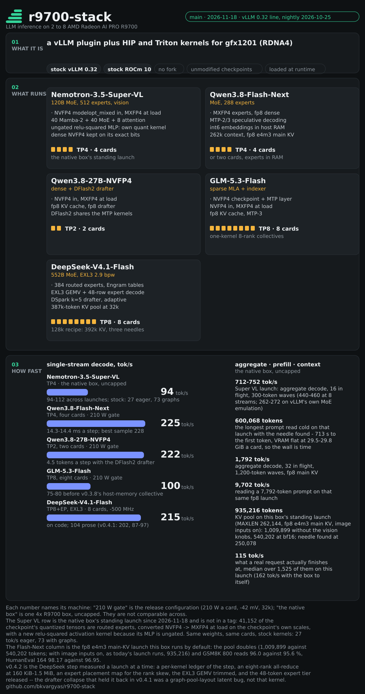
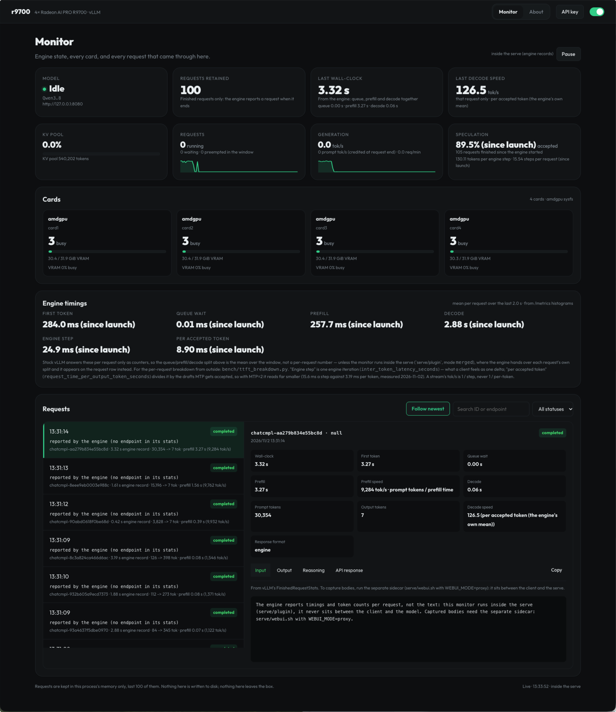
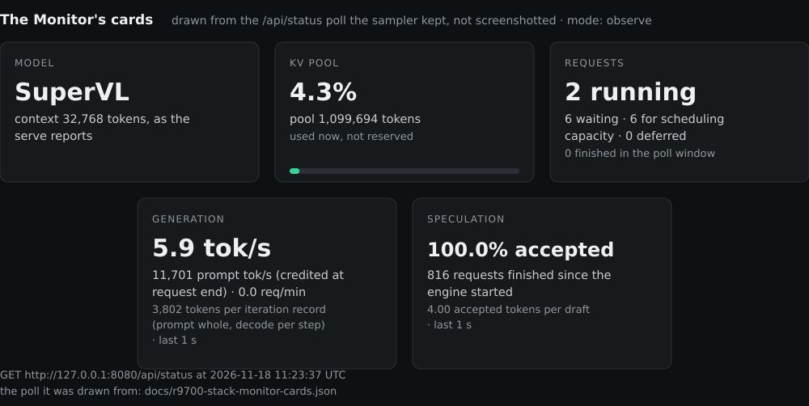

<p align="center">
  <picture>
    <source media="(prefers-color-scheme: dark)" srcset="docs/r9700-stack-lockup-dark.svg">
    
  </picture>
</p>

<div align="center">

**Big open models, fast, on AMD Radeon AI PRO R9700 cards, on stock vLLM and stock ROCm.**

A vLLM plugin and a set of HIP / Triton kernels for gfx1201 (RDNA4). No fork, no patched source, no vendored binaries,
no re-quantised weights: everything loads at runtime through vLLM's own extension points, so vLLM and ROCm update
underneath it.

[](https://github.com/bkvargyas/r9700-stack/releases/latest)


[](LICENSE)


</div>


> [!NOTE]
> Every number here came from one of two machines, and every table names which: **the 210 W gate box** (eight R9700,
> 210 W cap a card, -42 mV, a KVM guest with emulated PCIe switches whose 120 V feed holds eight-card runs to a
> -500 MHz clock offset) or **the native box** (four R9700, Gen5 host, no docker, **no power cap** — ~299 W a card in
> practice). Card count is a deployment shape, not a machine, and a 210 W number is never comparable with an uncapped
> one. The legend with both boxes' settings, and the one place where they disagree, are at the top of
> <a href="#speed">Speed</a>. Your rig will differ; the serve scripts carry every knob with the reason next to it.

<p align="center">
  <a href="docs/r9700-stack-page.png"></a>
  <br><sub>The release on one page: what the stack is, the five model configurations the stack serves, each bar tagged with the box its number came from, and how fast they run —
drawn by <code>docs/summary-page.py</code> from the same numbers the tables below carry, so a figure nobody can
re-draw cannot drift from them — including which box each bar was measured on. Its canvas is 1000 px against github.com's ~980 px column, so the smallest type on
it lands at 14 px; the tag's own hand-drawn <code>docs/r9700-stack-v0.4.3.svg</code> carries the same claims at
11 px on a 1200-unit canvas, which measures out at 9.0 px in that column — clicked-to-read, so the generated page
is what this README carries. The picture links to <code>docs/r9700-stack-page.png</code>, the same drawing at
2000 × 3840, for zooming. Every bar names its machine: <code>210 W gate</code> is the gate box (210 W a card, -42 mV,
32k); <code>210 W gate, -500 MHz</code> is that box's **eight-card** runs, which sit at the clock offset its 120 V
feed forces on top of the cap; <code>the native box, uncapped</code> is this box's four R9700 at ~299 W a card in
practice. None of the three crosses.</sub>
</p>

<p align="center">
  <a href="#four-cards-the-numbers-worth-knowing"><b>Four cards</b></a> ·
  <a href="#what-it-does">What it does</a> · <a href="#features">Features</a> ·
  <a href="#what-the-kernels-do">Kernels</a> ·
  <a href="#speed"><b>Speed</b></a> ·
  <a href="#watching-it-the-monitor-and-about-pages">Watching it</a> ·
  <a href="#deploying-it"><b>Deploying it</b></a> · <a href="#license">License</a>
</p>

<p align="center"><b>Bring a box up, or check one that already runs this repo:</b><br>
<code>./setup.sh --yes --launch native-flashnext.sh --webui same</code><br>
<sub>It reports the cards with their 32 GB BAR0 actually placed, <code>/dev/kfd</code>, the kernel cmdline,
memlock, docker or the native path, every checkpoint, then builds and starts. Nothing here fetches a wheel or a
checkpoint, and a launch that is already running is left alone. Both paths, image included:
<a href="#deploying-it"><b>Deploying it</b></a>.</sub></p>

## Four cards, the numbers worth knowing

**Measured on the native box (four R9700, uncapped) on 2026-11-18: Nemotron-3.5-Super-VL-120B-A12B** (NVIDIA
NVFP4: **512 experts, 22 active per token**, 40 Mamba-2 + 40 MoE + 8 attention, vision) on four cards, TP4, MTP-4,
18.5 GiB a card. It held the
cards for a day as the standing launch and is now parked again - the work to get it there stands, and
`launches-available/supervl-32k.json` brings it back with one flag:

| | measured | against what |
|---|---:|---|
| **decoding, one stream** | **94-112 tok/s** | stock vLLM, same weights and cards: **27** eager, **73** with graphs - the gap is the load-time conversion |
| **decoding, 8 and 16 streams** | **440-460 / 712-752 tok/s** | same launch on vLLM's own MoE emulation: **262-272** at 8 streams |
| **quality, converted vs stock** | GSM8K **191/200** vs **190/200** | needles found at 30k, 150k and 250k in both arms |
| **context** | **600,068 tokens** read cold | 144 s to the first token at 250k, 713 s at 600k, VRAM flat - the wall is time. `CTX=32k \| 256k \| 1m` |
| **images** | **256-3,328 tokens each** | the checkpoint's patch budget, not a knob; ~1/3 of a mixed wave; send crops |

Full record: [notes/nemotron-super-vl.md](notes/nemotron-super-vl.md).

Qwen3.8-Flash-Next (MoE, 512 experts, MXFP4 experts plus fp8 dense) on four Radeon AI PRO R9700, TP4, MTP-3,
31.9 GiB a card — the launch this fork's kernels were built for, and the one the native box serves again since
2026-11-18 evening:

| | measured | where it came from |
|---|---:|---|
| **decoding, one stream** | **225 tok/s** (best sample 228) | 14.3-14.4 ms a step; **the 210 W gate box**, four cards, 32k, the v0.3.3 gate — the four gates since read 221.4-222.9 |
| **decoding, 32 streams** | **1,823 tok/s** aggregate (best sample 1,836.3) | 1,200-token waves, `bench/probe32.sh`; the native box, uncapped. The fp8 main-KV launch it now defaults to reads **1,792** (1,789 / 1,796) at the same protocol, and the 2026-11-08 standing launch (vLLM 0.32, router cap 4, util 0.96, `PREFIX_CACHE=0`) read **1,767 / 1,780** — inside that spread, so the router cap costs nothing measurable here (notes/bug-router-gemm-oob.md) |
| **reading a prompt** | **9,633 tok/s** | 7,789-token prompt, the native box uncapped (7,141 at the 210 W gate); **9,702** on the fp8 launch, 7,792 tokens |
| **context** | **262,144 tokens**, needle found at 250,078 | the checkpoint's own ceiling, and the window this box serves at today; KV pool **902,153 tokens** (`Maximum concurrency for 262,144 tokens per request: 3.44x`) on the standing launch — and a later boot of the byte-identical command printed **887,983** (3.39x), so the pool is what a launch printed, not a property of the config ([notes/context-256k.md](notes/context-256k.md)) — fp8 e4m3 main KV, image inputs on, `--gpu-memory-utilization 0.96`. At 0.97 the same launch read 935,216 with the vision knobs and 1,009,899 without them; 540,202 at bf16 main KV |
| **decoding, in real work** (not a benchmark) | **162 tok/s** with the box to yourself, **115 tok/s** as a request actually finishes | 1,568 real requests off the fp8 launch's journal over 10.25 h, the 115 being the median of the 1,525 that generated >=40 tokens, prompts p50 52,083; the benchmark rows above describe a machine nobody sits on |

<sub>Two boxes, two power settings, and these tables do not cross: the second table's first row is the **210 W gate
box** and the rest is the **native box uncapped** (~299 W a card), each row naming which, and the Super VL table is
the native box alone. The rows further down add the two-card and eight-card shapes, and the eight-card ones carry the
gate box's -500 MHz offset too. The last row is not a benchmark at all — it is what the running serve reported about
other people's requests, and it is the row to believe when asking what a request will feel like. Full protocols,
sample lists and the measurements that were tried and rejected: <a href="#speed">Speed</a>,
<a href="notes/native-4xr9700.md">notes/native-4xr9700.md</a>,
<a href="notes/context-256k.md">notes/context-256k.md</a>.</sub>

## What it does

You run the stock vLLM ROCm image with this plugin installed. From there:

1. **Load.** The plugin registers through vLLM's platform, quantization, model and attention-backend entry points and
   brings its own kernel library (`libr9k`, HIP and Triton). The checkpoints are the published ones, unmodified.
2. **Convert at load.** NVFP4 weights become MXFP4 with MSE-searched block exponents, or on the checkpoint's own
   scales where it declares them (`modelopt_mixed`: 41,156 declared layer entries, of which 40,960 are routed-expert
   matrices); fp8 dense, drafter and lm-head GEMMs take
   per-token fp8 activations; the KV cache is fp8; large tables (Flash-Next's per-layer embedding as int6,
   DeepSeek's Engram tables) go to pinned host memory; EXL3 trellis weights (2-6 bits) serve through exllamav3's gfx1201
   extension and our own batched expert kernel.
3. **Decode on our kernels.** Grouped MoE GEMMs with routing, activation and top-k sum fused around them; WMMA
   weight-only GEMMs with the activation quant fused in; one fused Gated DeltaNet core per layer; sparse-MLA decode
   on split-K kernels; the hyper-connection seams in one launch; the drafters (MTP, DFlash2, DSpark) on the same kernels,
   all inside HIP graphs.
4. **Talk over plain PCIe.** One-kernel all-reduce and all-gather for two, four and eight cards across four PCIe
   switches (pair stages over P2P, the cross-switch stage through pinned host memory), a compressed 4/6-bit all-reduce
   for prefill-sized messages, RCCL above that.
5. **Gate every release.** Kernel unit gates, the integration gate against the installed vLLM, strict sanity above
   `max_num_seqs`, mixed-length soaks and long-context needles on every configuration before a tag; paired GSM8K
   (McNemar) and HumanEval on the numerics.

Current release: **v0.4.5** (2026-11-15), [release notes](notes/release-v0.4.5.md), [CHANGELOG.md](CHANGELOG.md).
On the four-card native box this fork runs, the main KV cache is fp8 e4m3 by default - see the 256k table below.

## Features

| | |
|---|---|
| 🧠 **Five models, unmodified checkpoints** | **Qwen3.8-27B-NVFP4** with the DFlash2-FP8 block drafter (two cards); **Qwen3.8-Flash-Next** (MoE, 512 experts; four cards, or two with the experts streamed from host RAM); **GLM-5.3-Flash** (288-expert MoE, sparse MLA + indexer, RedHat NVFP4 with its MTP layer; eight cards); **DeepSeek-V4.1-Flash** (552B MoE, 384 experts, Engram, DSpark) from the published EXL3 2.9 bpw pack (eight cards, tensor + expert parallel); **Nemotron-3.5-Super-VL-120B-A12B** (120B MoE, 512 experts with 22 active, hybrid Mamba-2 + attention, vision) from NVIDIA's NVFP4 `modelopt_mixed` pack (four cards). |
| 🧮 **Weight formats handled at load** | NVFP4 → MXFP4 (bit-exact on the 27B, and NVIDIA's `modelopt_mixed` pack carried across on its own declared scales), fp8 dense / drafter / lm-head with per-token activations, fp8 KV, int6 and fp8 tables in pinned host RAM, EXL3 trellis with the unshardable pieces dequantized to bf16. |
| ⚡ **Decode kernels** | Fused MoE GEMMs, WMMA weight-only GEMMs, one GDN core per layer, RDNA4-tuned sparse-MLA decode, one-launch hyper-connection seams, fused routing and norms, a multi-row EXL3 GEMV (1-48 rows) and a batched EXL3 expert decode. |
| 🔗 **Collectives over PCIe** | One-shot / two-shot P2P for 2 and 4 cards; an eight-rank all-reduce and all-gather that never cross a root complex (pairs over P2P, the cross stage through pinned host pools); compressed 4/6-bit all-reduce for prefill; RCCL above. |
| 🎯 **Speculative decoding on every family** | MTP-3 (Flash-Next, GLM), DFlash2 (27B), DSpark with adaptive verification (DeepSeek), draft metadata and all-reduces inside the HIP graphs. |
| 📏 **Measured, not guessed** | A per-kernel ledger of the DeepSeek step ([notes/exl3-ledger.md](notes/exl3-ledger.md)) decides what gets built; every serve script's default has its measurement next to it. |
| 🧪 **Gated releases** | Strict sanity above `max_num_seqs`, 15-minute mixed-length soaks, long-context needles, paired GSM8K and HumanEval on every tagged tree, a drafter self-test after every DeepSeek launch ([notes/release-v0.4.2.md](notes/release-v0.4.2.md)). |
| 🧰 **Launchers and benches** | One serve script per configuration (`serve/`), warm-up, sanity, soak, eval and needle tools (`bench/`), kernel unit tests (`tests/`), `R9K_*=stock` to switch any kernel back to vLLM's. |

## Speed

Two power settings sit behind these tables, and the capped one spans two hosts. A row that names neither its machine
nor its power is a row you cannot use:

| | **the 210 W gate box** | **the native box** |
|---|---|---|
| what it is | the release-gate machine: eight R9700 in a KVM guest with emulated PCIe switches, the pinned stock ROCm 10 image, vLLM 0.33.0 | this repo's day-to-day machine: four R9700 on a Gen5 x16 host, no docker, venv vLLM 0.32.0+rocm723 |
| cards in a launch | 2, 4 or 8 | 4 |
| power a card | **capped at 210 W**, with a -42 mV offset | **no cap set** — median **299 W** at `gpu_busy_percent` 100 (132 samples, 179-303) |
| clocks | its 120 V feed holds **eight-card** runs to a **-500 MHz** SCLK offset | stock |

One more thing the gate rows carry: from v0.4.x the gate box is **VM100**, the eight-card guest above. The v0.3.2 and
v0.3.3 rows still quoted below were gated on the older **four-card Gen3 test box** at the same 210 W and -42 mV, and
the two-card row was measured on both hosts side by side — same cap, different PCIe, which is why it prints 122 and
143 instead of one number.

Where this file says **this box**, it means the native box. Three rules follow, and every table below applies them.
**Card count is a deployment shape, not a machine**: the same 4-card launch has been gated on the first box at 210 W
and run on the second uncapped, and the two disagree — 225 tok/s single stream at the gate against 186.7 uncapped,
recorded rather than reconciled, because host, pin and clocks differ and the 210 W figure has never been re-measured
on the native box. **Nothing at 210 W is comparable with anything uncapped.** And every eight-card number carries the
-500 MHz offset as well as the cap.

### The gate table: 210 W a card, 32k context, single stream unless said otherwise

The rows are the release gate, and the record behind them is the tag that last ran a full one —
[notes/release-v0.4.3.md](notes/release-v0.4.3.md); [notes/release-v0.4.4.md](notes/release-v0.4.4.md) and
[notes/release-v0.4.5.md](notes/release-v0.4.5.md) say in their own words that they did not re-run it.

Each row names the tags its range spans, and the newest gate is the number in bold. Nothing here is one run: the
same configuration is re-gated at every release, and a range that spans v0.3.3 to v0.4.3 is a range across image
pins, `KVMEM` budgets and, for GLM, an instrument change.

| configuration, and the gates the row spans | single stream | aggregate | prompt processing | KV cache |
|---|---:|---:|---:|---:|
| **Qwen3.8-27B-NVFP4**, 2 cards, DFlash2 — v0.3.3-v0.4.3 | **217.1 tok/s** (217-222 across the gates; 4.5 tokens a step) | 514 / 655 at 8 / 16 streams | 3,822 tok/s (8k prompt) | 367,494 tokens |
| **Qwen3.8-Flash-Next**, 4 cards, MTP-3 — v0.3.3-v0.4.3 | **222.9 tok/s** (221-225 across the gates) | 469 / 912 at 8 / 16 | 6,743 tok/s (8k) | 472,025 tokens |
| **Qwen3.8-Flash-Next**, 2 cards, experts in host RAM — v0.3.2 | 122 (Gen3 test box) / **143** (Gen5) | 177 / 257 at 8 streams | 2.6k / 3.7k | 221,184 tokens |
| **GLM-5.3-Flash**, 8 cards, MTP-3 — v0.4.0-v0.4.3 | **97.5 tok/s** (88.1 / 93.2 / 95.1 / 97.5, decode-only medians; v0.3.8's gate read **100.0** on the probe, which is not the same instrument) | 173 then 231 at four streams | 2.5-3.4k tok/s | **284,829** at `KVMEM 2.65` (203,329 at v0.4.2, 176,443 at v0.4.1) |
| **DeepSeek-V4.1-Flash** EXL3 2.9 bpw, 8 cards, DSpark k=5 — v0.4.2-v0.4.3 | **104 prose / 215-222 code** (v0.4.1: 87-97 / 202) | 192-229 prose / 413-422 code at 4 streams, 313-317 / 529-555 at 8 | 3.6k tok/s | 387,069 (32k) / 392,289 (128k recipe) |

The **single stream** column is the gate probe's mean over its four prompt types (code / prose / json / math, run on
the box rather than from this repo) for the Qwen rows, and the **decode-only median** for GLM from
v0.4.0 on — that instrument change, not a regression, is why v0.3.8's GLM reads 100.0 and v0.4.0's reads 88.1. The KV
column moves with `KVMEM` and `UTIL`, not with the model, so each row quotes the newest gate's budget. The eight-card
rows carry VM100's -500 MHz clock offset on top of the 210 W cap; the four- and two-card rows are cards 0-3 and 0-1 of
the same box.

Two DGX Sparks on TensorFold serve the same DeepSeek pack at 81 prose / 118 code single stream and 154-166 at four
streams. DeepSeek accuracy on this stack: GSM8K 193-196 / 200, needles 9 / 9 to 28k and retrieval at 126.7k-token
prompts, decode flat to 28k of context. How each number was produced, and what was tried and rejected:
[PROGRESS.md](PROGRESS.md) and `notes/`.

Each subsection below carries its box in the heading. The first is a different model from the gate table; the
second is the 210 W gate box again; the next two are the native box uncapped, the same recipe at 32k and then at the
checkpoint's full 262,144 tokens. All of those are **benchmarks**: fixed prompt lengths, equal `max_tokens` waves,
nothing else arriving while you measure. The last is **not** a benchmark — it is 1,568 real requests that arrived at
the running serve, plus a 1,400-request window on the launch before it, kept for comparison — and its decode numbers
are roughly a third of the benchmark ones for reasons that are understood rather than surprising. Read the benchmark
tables for what the kernels can do; read the real-traffic one for what a user gets.

### Nemotron-3.5-Super-VL-120B-A12B, 512 experts: the native box, four cards, uncapped

What this box ran for a day in 2026-11-18 - parked now, and none of it reverted. The pack is `modelopt_mixed`
MIXED_PRECISION and **40,960 of
the 41,156 layer entries its `hf_quant_config.json` declares are routed experts**; the plugin had never seen that
quantization, and stock on ROCm **dequantizes expert by expert**. Same weights, same cards, wave noise ±10%:

| what changed | one stream | 8-stream wave |
|---|---:|---:|
| stock vLLM, `--enforce-eager`, stock NVFP4 MoE emulation | 26.9-27.5 | - |
| + HIP graphs | 73.0-73.4 | 306-328 |
| + libr9k MXFP4 grouped experts, MTP-2 | 86.2-89.6 | 442-462 |
| + native dense NVFP4, MTP-4, 16 streams | **94-112** | **440-460** (**712-752** at 16) |

| what had to be built | |
|---|---|
| `quant/modelopt.py` | registers the stock name and routes the experts through the existing NVFP4 → MXFP4 conversion, with the **checkpoint's own scales** rather than re-derived ones. The trap: ModelOpt multiplies by `scale_2` where our helper divides, so it is fed `1 / scale_2` - a probe names the difference, 11% vs 2.4e11% against an exact dequant |
| `r9k_relu2_quant_fp8` | the family's MLP is ungated (`relu²`, one matrix per expert) and libr9k's MoE refused it; the new kernel's fp8 bytes match vLLM's own `RELU2_NO_MUL` reference at four shapes |
| graph sizes | a decode step carries `NSEQ x (k+1)` rows: 8 streams at MTP-4 is 40, and the capture list stopped at 32, so every step padded to 48. Now 40, 80, 160 |
| rollback | `R9K_DISABLE=nvfp4` puts the model back on stock kernels with the same weights |

Quality measured rather than assumed: GSM8K-200 **191/200 vs 190/200** (3.8 vs 7.1 min) and needles found at 30k,
150k and 250k in both arms - n=200 resolves ±3 questions, so the needle agreement is the part that matters.

The step is closed at 16 streams (~70 ms): grouped MoE GEMMs 16.5 ms, MoE non-GEMM 5.2, Mamba 6.1, all-reduce ≤5.3,
the rest attention, drafter, lm-head, sampler and gaps. **Nothing left has a ceiling above ~5 ms, so no more kernels
were written for this model** - `tuning/decode_mamba_probe.py` and `tuning/decode_moe_glue_probe.py` established that
first. Standalone graph-timed probes are the only instrument that works here: the torch profiler stops a worker mid-MTP.

Images arrive as **256-3,328 tokens** whatever the pixels (the checkpoint's patch budget), fine print dies at the cap,
and four of them cost ~35% of a decode wave against a ~28% prefill-only control. Context reads to **600,068 tokens**
cold with VRAM flat at 29.5-29.8 GiB; 1M boots only with images off, because the encoder-cache budget follows the
window. `CTX=32k | 256k | 1m` are launch profiles and 32k stands (256k = 262,144 tokens; the label used to read
"262k", which rounded the count in decimal, and `CTX=262k` still works, printing the rename). The gotchas that cost
hours (`hf_quant_config.json`
is not optional; the plugin registers `modelopt_mixed` inside `register()`, so a broken import quietly serves stock):
[notes/nemotron-super-vl.md](notes/nemotron-super-vl.md).

### The release configurations: the 210 W gate box, four / two / eight cards, 32k

**Qwen3.8-Flash-Next (MXFP4 experts, fp8 dense), four cards, TP4, MTP-3** — the v0.3.3 gate with a warm cache, kept
because it is the run the block at the top of this README quotes; v0.4.3's gate on the same four cards of VM100 reads
222.9 tok/s into a 472,025-token pool.

| | |
|---|---:|
| single-stream decode | **225 tok/s**, 14.3 ms a step (best sample 228) |
| aggregate decode at 1 / 2 / 4 / 8 streams (BetterBench) | 175 / 277 / 410 / 530 tok/s |
| aggregate decode at 8 / 16 streams (probe) | 620 / 944 tok/s |
| time to first token | 70-80 ms |
| prompt processing at 2k / 8k / 16k / 32k | 5,175 / 7,141 / 7,489 / 7,233 tok/s |
| KV cache | 518,481 tokens |

<details>
<summary><b>The same model on two cards, and the 27B on two cards</b></summary>

**Qwen3.8-Flash-Next, two cards, TP2, experts in host RAM** — the v0.3.2 gate, measured on two hosts at 210 W:

| | PCIe Gen3 host (test box) | PCIe Gen5 host (production) |
|---|---:|---:|
| single-stream decode | 122 tok/s | 143 tok/s |
| aggregate at 8 / 16 streams | 177 / 163 | 257 / 245 |
| prompt processing at 8k | 2,594 | 3,724 |
| KV cache | 221,184 tokens | |

**Qwen3.8-27B-NVFP4, two cards, TP2, DFlash2 speculative decoding** — v0.3.3 warm-cache gate (v0.4.3 re-ran it at
217.1 tok/s into the same 367,494-token pool):

| | |
|---|---:|
| single-stream decode | 222 tok/s (4.5 tokens a step), 22 ms a step |
| aggregate at 8 / 16 streams | 527 / 640-658 tok/s (probe; equal-prompt bursts match the previous release) |
| prompt processing at 8k | 3,901-4,143 tok/s |
| KV cache | 367,494 tokens |

</details>

**DeepSeek-V4.1-Flash EXL3 2.9 bpw, eight cards, TP8 + expert parallel, DSpark k = 5 adaptive** — the **210 W gate
box at its -500 MHz clock offset**, `NSEQ 4`. The gate numbers are the Speed row above: 104 prose / 215 code single
stream, 199-221 prose / 422 code at four streams, 317 / 555 at eight, and a **387,069-token** KV pool at
`KVMEM 2.0`. The bring-up launch that got there is tabulated in [notes/exl3-serving.md](notes/exl3-serving.md)
(v0.4.0 / v0.4.1, `KVMEM 1.7`: 70-75 prose / 158 code single stream, 187 / 336 at four streams, 329,008 KV tokens,
GSM8K 195 / 200, needles 9 / 9 to 28k). Read the two as what they are: the decode gap is the Phase 4 kernel packages
(code 158 -> 202 -> 215 tok/s), not the clock — both arms were measured at the offset — and the KV gap is `KVMEM`
alone (1.7 = 329,008 against 2.0 = 387,069, and 1.0 at 128k = 392,289).

### The native box, four cards, uncapped, at 32k

The same four cards uncapped, on the recipe the box ran before the context was raised (`MAXLEN=32768 NSEQ=16`,
vLLM 0.32.0+rocm723): 19.16 GiB of weights a card, draft acceptance 56.1% (2.68 tokens a step). This is where the
prefill and aggregate numbers in the block at the top of this README come from;
[notes/native-4xr9700.md](notes/native-4xr9700.md) has every sample list and the bands they repeat to.

| | |
|---|---:|
| single-stream decode | 186.7 tok/s, 14.3 ms a step (18.1 / 22.6 ms at 4 / 8 streams) |
| aggregate at 4 / 8 / 16 streams (`bench/bench.py`, 400-token streams) | 372 / 841 / 1,164 tok/s |
| aggregate, 32 in flight, 300-token waves (`bench/probe32.sh`) | 1,600.1 / 1,586.5 / 1,598.0 -> 1,598 tok/s |
| aggregate, 32 in flight, 1,200-token waves | **1,836.3 / 1,808.8 -> 1,823 tok/s** |
| aggregate, 16 in flight, 200-token waves (`bench.py run`, the recorded protocol) | 1,210.9 / 1,231.2 / 1,168.4 / 1,185.9 -> 1,198 tok/s |
| prompt processing at 1,951 / 7,789 / 31,166 tokens | **7,702 / 9,633 / 8,963 tok/s** |
| KV cache | 554,982 tokens |

Note that this row and the 210 W gate table disagree: uncapped, a single stream runs at **186.7 tok/s** here, while
the cap with a -42 mV offset read **225** there (v0.3.3's gate, the run that figure comes from; the gates since read
221.4-222.9). That is recorded, not reconciled — the two boxes differ in host, pin and clocks, and the 210 W figure
has never been re-measured on this one.

### The native box, four cards, uncapped, at the checkpoint's full 262,144 tokens

The native box (four R9700, **uncapped**, vLLM 0.32.0+rocm723 in a venv), so compare these against the other native-box
rows and not against the 210 W gate tables. Same model, TP4, MTP-3. Except where a row says otherwise this is the
launch the box runs today: `MAXLEN=262144 NSEQ=32 NBT=8192` at `--gpu-memory-utilization 0.96` — 0.97 asks for
30.90 GiB of a 31.86 GiB card against a free-at-startup reading that ranged 30.87-31.22 GiB, so it refused at both
0.32 and 0.33 whenever the reading landed low, a coin flip rather than a regression, and 0.96 costs about 4-5% of the
pool to buy 0.3 GiB of margin over the worst reading seen here. Until 2026-11-04 it also ran `PREFIX_CACHE=0`, which
is why **every number in this table is a cache-off number**: the prefix cache went on that day, aligned with
upstream's default ([notes/prefix-cache-decision.md](notes/prefix-cache-decision.md)), rows from before it stand for
the recipe they were measured on, and re-measuring them under the cache is owed rather than assumed.

| | |
|---|---:|
| KV cache at MAXLEN=262,144 | **540,202 tokens**, `Maximum concurrency for 262,144 tokens per request: 2.06x` — a bf16 main-KV launch at util 0.97, kept as the bf16 baseline; the fp8 row below is what the box runs, and the standing launch on this box read **902,153** at util 0.96 with images
on, a later boot of the same command **887,983** |
| the same launch with an **fp8 e4m3 main KV** (the default since 2026-11-03: 12 full-attention layers quantized, the QSA side caches left bf16) | **1,009,899-1,021,931 tokens**, `3.85-3.90x`; attention block size 880 instead of 448 |
| — prefill on that fp8 launch | **2,614 / 7,886 / 9,702 / 8,965 / 8,282 tok/s at 485 / 1,976 / 7,792 / 31,131 / 77,733 tokens** (bf16: 2,586 / 7,938 / 9,705 / 8,928 / 8,252 — flat) |
| — decode on that fp8 launch | 32 in flight, 1,200-token waves **1,789 / 1,796** (bf16 1,817 / 1,831) and 300-token waves 1,511-1,563 (bf16 1,594-1,640); that 1.5-4% is MTP acceptance under the bench's own traffic (2.55 against 2.61 tokens a step; real traffic on this launch runs 2.33) — not the kernel, which measures 7-11% faster |
| — quality, paired | GSM8K 800 @8 **96.0 against 95.6**, HumanEval 164 **98.17 against 96.95** (McNemar b=2, c=0, p=0.50), needle intact cold and warm to 250,078 tokens: [notes/kv-fp8-qsa.md](notes/kv-fp8-qsa.md) |
| KV cache at MAXLEN=32,768 (same launch shape) | 497,588 tokens: raising context 8x made the pool **bigger**, because the sizing run is bounded by `NBT`, not by MAXLEN |
| prefill and TTFT at 60k / 120k / 180k | 8,672-8,742 / 8,062-8,064 / 7,416-7,436 tok/s against 6.87-6.93 / 14.89 / 24.22-24.28 s to first token, needle found at 60,061 / 120,066 / 180,070, each tier sent twice back to back with no prefix cache to help it |
| aggregates at the full context | 32 in flight, 300-token waves **1,568.3 / 1,573.7 / 1,587.5** (the 32k band is 1,574-1,598 across instances, so the full context costs nothing measurable) and 1,200-token waves 1,799.5 / 1,832.7 (32k band 1,823) — `max_tokens` alone moves this protocol by 15%, which is why a wave length belongs beside every aggregate number |
| VRAM per card | 30.3-30.5 of 31.86 GiB at every tier up to 180k, ~1.35 GiB spare |

**The limit is not the KV cache.** Only 12 of 48 layers do full attention (24 KiB a token, 6.00 GiB per full-length
sequence), so one 256k request wants 586 of the pool's 1,230 blocks and the pool holds **2.06** of them — a residency
ceiling, not the concurrency the box serves: long prefills serialize, so above roughly 30k tokens "more than 2 in
flight" already means queueing while the pool sits a tenth full. `--long-prefill-token-threshold` measured as a
fairness knob, not a speed one, and stays off. The retrieval ladder to 250,078 tokens, the queue and 250k-prefill
measurements, the standing gate on this launch, the ~299 W median a card at `gpu_busy_percent` 100, and the
metric-reading traps: [notes/context-256k.md](notes/context-256k.md).

### Real traffic on the native box, not a benchmark

Everything above this line was measured by sending requests on purpose: fixed prompt lengths, equal `max_tokens`,
and nothing else arriving while the meter runs. That is the right way to compare builds and the wrong way to answer
"what will my request get". This is the other one: **1,568 completed requests** out of the fp8 main-KV launch's own
request journal (`~/logs/requests-8080.jsonl`, one fsynced row per finished request; timings and token counts only,
no bodies), four cards on the native box uncapped, `MAXLEN=262144 NSEQ=32 NBT=8192 PREFIX_CACHE=0 MTP=2`, started
2026-11-03 15:29, over **10.25 h** of which **29%** (10,818 s) had traffic in them. The interval union of the rows is
larger — **4.97 h of a 10.62 h span, 47%** — because a request is in flight while it queues, and that union is what
the step arithmetic below uses. Prompts p50 **52,083** tokens (p90 149,572, p95 163,513, max **198,073**), generated
p50 322 (p95 1,853). Nothing was sent to make these numbers; `tools/watch-live.py` only samples and the Monitor only
reads `/metrics`. The engine's counters cross-check the journal to under 0.5%: `prompt_tokens_total` 106,686,448
against the journal's 106,214,313, `generation_tokens_total` 877,747 against 874,128.

**Two numbers answer "how fast does one stream decode", and both are honest: 162 tok/s with the box to yourself,
115 tok/s as a request actually finishes.** The gap is not decode speed — it is what sharing a prefill-bound engine
costs. Concurrency is rebuilt from each row's own stamps at 1 Hz and taken as the **maximum** over that request's
decode window, not its midpoint:

| how many requests shared the engine during its decode | share of the 10,818 busy seconds | its own decode, median |
|---|---:|---:|
| one — the stream had the box to itself | 47.5% | **162.0 tok/s** (585 requests) |
| two | 25.1% | 114.5 tok/s (294) |
| three to four | 24.8% | **41.0 tok/s** (423) |
| five to six | 2.4% | 23.9 tok/s (127) |
| **all 1,525 requests generating >=40 tokens** | — | **115.4 tok/s** (mean 100.9, p10 17.1, p90 171.1) |

**The denominator decides any aggregate**, so all four are recorded: **23.7 tok/s** over the whole wall clock (71% of
it an idle box), **80.8** over active seconds only, **42.1** token-weighted (`Σgenerated / Σdecode_s`), and **115.4**
as the median of per-request rates — the last is the shape that answers "what will my request feel like". From the
counters rather than the journal the same two come out at **23.6** and **42.0**.

**Where the time goes: 99.2% of the tokens this box processed were prompt tokens** (one generated token cost 123
prompt tokens), so most of its seconds are steps carrying a prefill chunk — **~1.0 s** each against **20.6 ms** for
one that does not — and a decoding stream is credited one acceptance per step however long that step ran. Hence the
cliff between two and three streams, and it is scheduling, not kernels: the knob is `--long-prefill-token-threshold`
and the step shape, not the decode path. Ruled out with the counters that say so: preemption
(`num_preemptions_total` 0 across all 1,600 journal rows of the whole boot), the KV pool (15-30%,
`waiting_by_reason` capacity 0 and deferred 0 — the queue is never a memory wall here), fp8 (paired arms 1,792
against 1,823 aggregate), acceptance length (1.33 against 1.55-1.62 drafted tokens accepted) and context depth
(182.6 tok/s alone under 20k prompt against 150.0 at 80-160k: **a 256k context costs one stream ~13%**).

**And 162 here is not a regression against the 225 in the gate table.** That one is MTP-3 at ~3.1 accepted tokens a
step at 32k on the 210 W gate box; this launch is MTP=2 at 2.33 a step, on contexts of 20-200k. If single-stream
decode is wanted back, the knob is drafter depth (`MTP=3`), not the attention path.

The bf16 launch before this one (1,400 requests over 13.8 h, prompts p50 74,381, p90 concurrency 6) reads 157.7
tok/s alone, 22.8 at three-to-four, **60.8** overall — and the two windows are **not** an fp8-vs-bf16 comparison:
the traffic mix differs, and the mix is the term the cliff is made of. The controlled fp8 comparison is the paired
arms in [notes/kv-fp8-qsa.md](notes/kv-fp8-qsa.md).

Method, the four denominators, the prefill-by-prompt-size table with its p10/p90, the queue and 250k-prefill
measurements, the drafter's whole-launch accounting, and the trap that made the first version of this table wrong
(midpoint concurrency sampled 361 requests as "alone" and reported 137 tok/s):
[notes/context-256k.md](notes/context-256k.md).

## What the kernels do

- **MoE experts**: grouped MXFP4 x fp8 GEMMs with the routing, activation, per-token quant and top-k sum fused
  around them; a device LRU expert cache with the experts streamed from pinned host memory for the two-card
  Flash-Next configuration.
- **Dense layers**: fp8 and NVFP4/MXFP4 weight-only GEMMs on WMMA, the activation quant fused into the GEMM at
  decode widths; NVFP4 checkpoints converted to MXFP4 at load.
- **Hyper-connections** (Flash-Next): the down + hc_silu and up + gated-mean GEMMs on fp8 copies of the weights at
  every row count, the bf16 copies freed after quantisation; combine-norm and gate-mix kernels for prefill.
- **Attention and recurrence**: paged attention for prefill, the query-sparse attention indexer and attention
  kernels, one fused Gated DeltaNet decode core per layer (conv update, gating, recurrence, norm), one GDN state
  page per request under speculative decoding. The QSA attention kernel reads an **fp8 e4m3 main KV cache** on
  RDNA4 (`r9k_qsa_attn_f8`): the writer in the installed vLLM already quantized it, so what was missing was three
  dtype guards and the read path, with the K and V descales folded into the softmax scale and the output
  normalizer - half the KV bytes of the twelve full-attention layers, and the attention side caches (the compressed
  keys the top-k selection reads) left in bf16: [notes/kv-fp8-qsa.md](notes/kv-fp8-qsa.md).
- **Communication**: P2P all-reduce and all-gather over PCIe for 2 and 4 cards (one-shot and two-shot, fine-grained
  memory, HIP-graph safe); for eight ranks, an all-gather and an all-reduce that stay inside one kernel and never
  cross a root complex (pairs over P2P, the cross-switch stage through pinned host pools), with the MoE combine
  folded into the collective's first phase; a compressed 4/6-bit all-reduce for prefill-sized messages, RCCL above.
- **Speculative decoding**: MTP (Flash-Next) and the DFlash2 block drafter (27B) on the same kernels, with an int6
  per-layer-embedding table in pinned host memory.
- **Memory**: the KV cache sized from what the model actually uses, not torch.compile's transients; cudagraphs
  only where they pay.

Every default ships gated: the full 1,319-question GSM8K set paired per question against the previous numerics
(McNemar), HumanEval, strict sanity under overload, a 15-minute mixed-length soak on every configuration
(`bench/soak.py` defaults to `--seconds 900`), the multi-rank communication tests and the kernel unit gates. The last
full eight-card gate on a tagged tree is v0.4.3's: GSM8K 195 / 200, 0 bad answers in 105 strict-sanity checks above
`max_num_seqs`, 187 soak requests with 0 errors ([notes/release-v0.4.3.md](notes/release-v0.4.3.md)). v0.4.4 and
v0.4.5 say in their own notes that they did not run that gate.

## How it fits together

```
OpenAI-compatible clients ──▶ stock vLLM (ROCm 10 image, v0.33.0) ──▶ model classes, attention backends, quant methods
                                       │                                   registered by r9700_vllm at import
                                       ├──▶ libr9k.so (HIP) + Triton kernels      the decode / prefill / MoE / collective kernels
                                       ├──▶ exllamav3's gfx1201 extension         EXL3 trellis GEMV / GEMM (built into the image)
                                       ├──▶ pinned host memory                     offloaded experts, Engram and PLE tables, collective pools
                                       └──▶ 2 / 4 / 8 R9700s over PCIe switches   P2P pair stages, host-memory cross stage, RCCL above 2 MB
```

The image is the pinned stock image plus the plugin (`docker/Dockerfile`); the plugin tree is mounted at `/opt/r9700`
and its kernels are rebuilt by the serve scripts when a source is newer than the library. Every kernel has a stock
fallback behind an `R9K_*` knob, and the integration gate checks the stock entry points the plugin depends on against
the installed vLLM before a tree is served.

## Quick start

You need 2, 4 or 8 Radeon AI PRO R9700s, ROCm 10 on the host, and the weights under `~/models`. Docker is optional:
the image path builds it, the **native path this box actually runs needs none** (*Deploying it* below). The
checkpoints are `Qwen3.8-Flash-Next-MXFP4-FP8-GPTQ`, `Qwen3.8-27B-NVFP4` with `Qwen3.8-27B-DFlash2-FP8`,
`GLM-5.3-Flash-NVFP4-RedHat`
(eight cards), `NVIDIA-Nemotron-3.5-Super-VL-120B-A12B-NVFP4` (four cards, and **keep `hf_quant_config.json` in the
snapshot** - the drafter reads its quant config from that file, not from `config.json`), and for DeepSeek-V4.1-Flash a
directory composed of the EXL3 pack's shards and config plus the base checkpoint's two Engram shards and tokenizer
(`serve/ds41-exl3.sh`'s header has the recipe; about 200 GB of host RAM). Those are the checkpoints' own names; the
directory each lands in under `~/models` is the operator's, and `~/.config/r9700-stack/native.env`'s `MODEL=` is what
points at it (this box keeps the Nemotron pack at `~/models/Nemotron-Super-VL-120B-NVFP4`).

**1. Build the image** (the stock vLLM ROCm 10 image plus the plugin; the kernels and exllamav3's extension compile inside):

```sh
docker build -t r9700/vllm:dev docker/
```

The pin (`vllm/vllm-openai-rocm:v0.33.0-rocm100`: vLLM 0.33.0, torch 2.13) is in `docker/Dockerfile`; `--build-arg BASE=` picks another image or nightly.

**2. Serve.** Each script carries the measured defaults with the reason next to every knob:

```sh
bash serve/27b.sh                                                  # Qwen3.8-27B-NVFP4, two cards
GPUS=0,1,2,3 TP=4 OFFLOAD_GB=0 NSEQ=16 bash serve/flashnext.sh     # Qwen3.8-Flash-Next, four cards
bash serve/flashnext.sh                                            # Qwen3.8-Flash-Next, two cards, experts in host RAM
MODEL=/models/GLM-5.3-Flash-NVFP4-RedHat GPUS=0,1,2,3,4,5,6,7 TP=8 OFFLOAD_GB=0 EAGER=0 MTP=3 KVDTYPE=fp8 \
  MAXLEN=32768 NSEQ=4 NBT=8192 KVMEM=2.65 PREFIX_CACHE=0 VLLM_ROCM_USE_AITER=1 R9K_AG_MAX_KB=2048 \
  'SPEC_EXTRA="use_local_argmax_reduction": true' 'R9K_FP8_LINEARS=self_attn\.(in_proj_qkvbfg_a|o_proj|f_b_proj|g_b_proj)$' \
  bash serve/serve.sh                                               # GLM-5.3-Flash, eight cards (notes/glm53.md)
bash serve/ds41-exl3.sh                                            # DeepSeek-V4.1-Flash EXL3, eight cards (notes/exl3-plan.md)
bash serve/native-flashnext.sh                                     # this box, no docker: the checkpoint native.env names
```

An OpenAI-compatible API answers on port 8080 (`PORT=`), model name `Qwen3.8` (`DeepSeek-V4.1` for the DeepSeek
launcher). This box's native launch answers **one name at a time** - `Qwen3.8` today, `SuperVL` for the day the other
checkpoint held the cards - with no aliases by decision: the tools in `bench/`
and `tools/` ask `/v1/models` instead of remembering one (`bench/served_model.py`, `tests/test_served_names.py`). `MAXLEN=131072 KVMEM=0.8` is DeepSeek's 128k recipe.

On a box that sets `GATEWAY_PORT` in its machine-local file, 8080 belongs to `serve/gateway.py` instead: it routes
by path to the engine (`/v1/chat/completions`, `/metrics`), the CPU embedding and reranking serves
(`/v1/embeddings`, `/v1/rerank`) and the Monitor (`/monitor`), and everything it fronts binds loopback. Measured
through it: +0.8 ms on a small request, engine ITL unchanged (13.0 -> 12.8 ms at concurrency 1) — it reads the
request line and pipes bytes, because a proxy that parses bodies costs 2-3 ms. `tests/test_gateway.py` keeps that
promise; [notes/embed-sidecar-box-test.md](notes/embed-sidecar-box-test.md) has the numbers and the restart order.

That pipe is also the only thing on the topology that ever holds a request *and* its answer, which is why the
Monitor's per-request body capture hangs off it: `GATEWAY_CAPTURE=<bytes>` plus the request header
`X-R9K-Capture: 1` keeps that request's first N bytes per side in a ring of the last 50 rows, in RAM, readable at
`/api/capture` — keyed, never open, since those rows are prompt text. A request that does not ask pays one header
regex and is stored nowhere. Without it the detail pane has to say what it does not have: the engine's
`FinishedRequestStats` record carries timings, token counts, and no body — not even a path or a model name.

That last clause is what makes the door the place to decide things, and since 2026-11-19 two decisions live there.
It does not forward the **engine's control plane** — 23 paths (`/sleep`, `/reset_prefix_cache`, `/collective_rpc`,
the weight-update family) that vLLM's own `--api-key` never guarded: `GUARDED_PREFIX` is `/v1`, `/v2`, `/inference`,
`/cohere`, which also leaves `/tokenize` and `/classify` unguarded. They answer 404 from the door with the engine
never contacted; `GATEWAY_ADMIN=1` forwards them to a loopback peer. And `GATEWAY_KEY` keys **model traffic by
path** — open: `/health`, `/metrics`, the Monitor and its data endpoints; keyed: everything that reaches a model,
plus `/api/notify` — asked of remote peers, since a local process already reaches `127.0.0.1:8180` anyway. It ships
**observing** like the gate does: it counts and names at `/api/gate` what a key would have refused, and
`GATEWAY_KEY_ENFORCE=1` is the separate switch. `serve/native-flashnext.sh` refuses to bind the engine to a routable
address at all (`ALLOW_LAN_ENGINE=1` says otherwise out loud), and `tools/recipe-check.py` reports which of our
sockets face the LAN rather than trusting the machine-local file that used to say `HOST=0.0.0.0`.

In front of the engine it also runs an **admission gate**, and since 2026-11-16 it **observes rather than acts**:
`GATE_POLICY=observe` reads the engine's harm signals — `num_preemptions_total` **moving** (blocks taken back from a
running request) or the pool reaching `GATE_KV_HIGH=0.92` — keeps the ring, the counters and the Monitor row, and
holds, refuses and delays **nothing**. Both of the interventions that came before it were measured as pure delay, by
two different afternoons of numbers: v1's held 14 requests with 9 waiting out the whole 25 s ceiling
[notes/admission-gate.md](notes/admission-gate.md) §6, and v2's held 28 with 25 waiting out its 5 s — **5.019 s
through the door against 0.002 s direct to the engine** — while the KV those arrivals were waiting for was held by
requests already running (§7). It also had the classes backwards: the four rows that filled the 902,153-token pool
that day declared ~1.2 KB bodies each (`max_tokens` unset, so their commitment was the rest of the 262,144-token
window) and passed the small-body escape, while 973 long-prompt requests — 94.8% prefix-cached, 7-37 s each — were
never preempted once. What observe counts instead of doing: `gated_seen`, the declared-size split, `arrived_shut`
(the arrivals a policy would have acted on), and `shut` — the fraction of the history ring the harm signal was on
and the longest unbroken span, which is the number the strip's 900 dots could not say (0.71 of the ring, 339 s and
still running). `GATE_POLICY=hold` re-arms the intervention, `GATE_DISABLE=1` removes the reading as well. Its
state — reason, gauges, counters, duty cycle and a 900-poll history strip — is on the Monitor's Recent screen and
at `GET /api/gate`.

**3. Check it.**

```sh
python3 bench/warmup.py                     # the first prompts (Triton JITs, the drafter's warm-up)
python3 bench/quality.py 100 8              # the standing gate: GSM8K + the needle ladder
python3 bench/sanity_stress.py              # strict 8-way sanity under load
python3 bench/soak.py http://localhost:8080 # mixed-length soak
python3 bench/eval.py                       # paired GSM8K; bench/humaneval.py for HumanEval
```

That is the short list in the short order. The full one, with what each run proves next to it, is step 3 of
*Deploying it*.

Notes for the host: cards on the same PCIe switch for tensor parallelism, one card per switch for offloaded experts; a
KVM guest with an emulated PCIe switch needs the overlay in `overlay/emulated-switch` (`OVERLAYS=emulated-switch`, the
serve scripts' default) and the guest kernel flags in [notes/mes-timeouts.md](notes/mes-timeouts.md); the two-card
Flash-Next configuration needs about 120 GB of host RAM; eight-card runs on a 120 V feed need a clock offset
(`host/`).

## Watching it: the Monitor and About pages

The page is in four screens, in the order the questions get asked (2026-11-15, restated by the operator and pinned by
`tests/test_webui.py`):

- **Now** — the engine's counters and the four rates, with two one-line states in the same strip as the freshness
  stamp (`Answering / Loading / Gone / Wedged` and `Door open / Door held`), and below the counters, as this screen's
  second row, the embeddings and rerank serve rows. They moved there because "is the embedder answering" is asked in
  the same breath as the four rates; the memory half of each serve row is still read against the card grid on the
  fourth screen, and "second" is pinned only by the tests — row 1 and row 3 are named in the same claim, which is what
  makes the claim mean second.
- **Recent** — the activity waveforms, the admission gate's 15-minute history and counters, the last request's
  numbers, and the per-request means vLLM only reports as averages.
- **Requests** — the list, and each row says only what a row has to: time, its own prefill and decode tok/s,
  `prompt → output` tokens, first token and whole-request seconds, and its id. Spans in seconds live in the detail
  pane, a status prints only when it is not what it should be, and the crowding chip appears only above 1.5 streams.
- **Hardware** — the cards with the chain behind each, and below them engine state and what the driver has faulted
  on. The alarm row is here because it is read to decide about a card, not about a request; the one read that had to
  stay where the rates are is the engine's state, because on 2026-11-15 the four headline rates went on printing
  plausible numbers for 26 minutes after `/health` went silent while three ranks held ~29 GiB each. The serve-down
  banner (`the serve behind this page is not answering — here is the command to bring it back`) sits above the first
  screen, where the request list used to put it three screens down.

At the top of the Requests screen sits the card that answers **what a context costs**, because this serve imposes no
length policy and that is a choice, not an omission: one port, one pool, `--max-model-len` is the only hard edge, and
the front door's single length-adjacent rule is a header read. So the size of a context is the **client's** decision,
and the page prints the cost instead of the server gaining a limit. Two histograms share their bands —
`prompt_tokens`, and `prompt_tokens - cached_tokens` — because prompt size is traffic and the difference is work.
Measured on the native box while building it: one 186,739-token context cost **26.3 s cold and 0.69 s warm**, three
cold prefills of ~165k **serialize** (last first token at 22 s, 47 s, 70 s; aggregate decode 17 → 19 → 22 tok/s), and
the short requests beside them waited **0.8 s, 23 s, 45 s** — all of it with the pool peaking at **18%** and zero
preemptions. What that says about a cap: the launch boots printing `GPU KV cache size: 902,153 tokens, Maximum
concurrency for 262,144 tokens per request: 3.44x`, and a client capped at 128k turns the same memory into 6.88x while
halving the worst-case per-request commitment. Changing the engine's `--max-model-len` buys no memory (497,588 tokens
at 32k, 902,153 at 256k — the pool is free HBM and `--max-num-batched-tokens`, not MAXLEN), so the cap belongs on the
client. A missing `cached_tokens` is counted apart rather than read as a miss, and the seconds estimate is measured
from the rows' own `prefill_s` over only the rows big enough to be throughput-bound (7,220-8,314 tok/s — over all rows
the same division reads 1,600-3,050 and would overstate a cold context by 2-5x). The list follows the engine's journal
live; replaying an ATTACHED journal once at startup had left it 8.9 hours old under numbers that moved every second.

Attributing a context to a *caller* is a separate question, and it was measured rather than assumed: every request
arrives from one address because traffic comes through LiteLLM, and of everything a client or a proxy config can send,
the only thing that reaches this box is `litellm_params.extra_headers` — the body `user` field, the model alias, a
custom client header and the client's bearer token are all dropped, and vLLM's own finished-request records carry no
user field to hang one on. That is why the handle is a header: [notes/who-sent-it.md](notes/who-sent-it.md), with
`tools/litellm-spy.py` to re-measure it when the proxy version moves.

<p align="center">
  <a href="docs/r9700-stack-monitor.png"></a>
  <br><sub>The Monitor page on the launch that runs today: engine state and the KV pool, generation and speculation,
  every card's busy% and VRAM, the engine's timings over the poll window, and the request list carrying each
  request's own wall clock, token counts and prefill. The frame is 1688 x 1953, shown as wide as the page column;
  click it for the pixels. Captured before 2026-11-05, so it still shows the standalone PCIe panel that has since
  been removed - the link is one word on each card now (`Gen5 ×16`), described below.</sub>
</p>

<p align="center">
  
  <br><sub>The same five cards drawn rather than screenshotted: `docs/monitor-cards.py`, stdlib, drawing one
  recorded `GET /api/status` (the poll itself is committed next to it as `docs/r9700-stack-monitor-cards.json`, so
  the figure can be re-drawn and checked without a serve). `bench/capture-cards.py` caught it 3 seconds into eight
  concurrent ~12,000-token prompts on this box's standing Super VL launch, window 32,768: two run, six wait **for
  scheduling capacity**, none deferred, and the pool is only 4.3% full — a queue, not a memory wall, and the reason
  the Requests card prints the split. The Model card's context line now comes from the serve's own window rather than
  from a launch record that never carried one. Every rate on the figure says what it was averaged over: the Generation
  card's 5.9 tok/s and its 3,802-token iteration record are both means of the last 1 s, and that pair is the engine
  crediting whole prefills while its two running streams sit behind a backlog — 11,701 prompt tok/s went in during
  that window. (That number is `vllm:iteration_tokens_total`, which calls itself "tokens per engine step" and is not
  one on this build — a chunked prefill is credited in a single record, measured at 29,969 tokens in one record
  against NBT 8,192. The card says "iteration record" for that reason.) The Speculation card reads 100.0% accepted at
  4.00 accepted tokens per draft: that is a one-second window over a handful of drafts, not a measurement of the
  drafter, which on long runs of this launch accepts about 4.0 tokens a draft at MTP-4. Drawn because the screenshot
  above lands at 0.58 scale inside this
  column and its text is unreadable, and a cropped wide strip would be smaller per panel, not larger: the column
  width is the limit for the whole strip.</sub>
</p>

Two shapes, and each page says which one it is:

- **`WEBUI=1`, or `bash serve/webui.sh` against a launch that is already up** — a stdlib sidecar
  (`serve/webui.py`: no framework, nothing extra to install) on its own port, reading what a running launch already
  publishes (`/health`, `/v1/models`, `/metrics`, plus the amdgpu sysfs of every card). It is out of process, so it
  keeps answering after the engine dies, and in `WEBUI_MODE=proxy` it sits between client and serve and records every
  request body — which costs a measured 2-3 ms a request, flat in prompt length (+5.3% of a 76-token request, +0.5%
  of a 4.4k-token one). The default `observe` mode changes nothing in the inference path.
- **`WEBUI=same`** — merged into the launch, on its own port (`serve/plugin`): hooks vLLM's endpoint and stat-logger
  plugin groups, so the engine hands over each request's own queue / prefill / decode seconds and token counts, which
  no proxy can infer; the price is a page that dies with the launch and never sees a request body. It needs
  `pip install -e serve/plugin` and a `VLLM_PLUGINS` allowlist generated by `serve/webui-plugins.py`, not written by
  hand.

Neither is the default: a launch with no `WEBUI=` starts no page at all. The standing launch on this box is the
**merged** one, because those per-request queue / prefill / decode seconds are what the request rows are built from —
**but since 2026-11-15 the front door serves the pages from a standalone sidecar**
(`PAGES=http://127.0.0.1:8181` in the machine-local env file, `JOURNAL_ATTACH` pointed at the engine's own request
journal read-only): the page that has to report a wedged launch cannot be the process that wedges, and a wedged serve
takes `:8180/monitor` down with it — which is exactly how the 2026-11-15 wedge went unnoticed for 26 minutes.
`:8180/monitor` still answers while the engine is up and remains the only page that can show the engine's **resolved**
config: a sidecar has no HTTP way to read it (vLLM serves no `/api/config`), so its About card names the recipe row
and `tools/recipe-check.py` instead of inventing numbers. That card lists three sources that are allowed to disagree —
the recipe file (what the launcher asked for), the engine's own labels (what it resolved: 46 published against the 15
the cards read), and a **whitelist** of `VLLM_*`/`R9K_*`/`R9700_*`/`WEBUI_*`/launcher names, not `os.environ`, because
the page is served on every interface of the box; `R9K_` is listed as a whole namespace because those names pick
**which kernel runs**, so they change what a measured number means while staying absent from the engine's config. A
name that looks like a credential is listed as `set · value withheld`, in the env block and in the printed command
line alike (`--api-key <withheld>`, flag kept — a restart line that drops the flag starts a serve nobody can reach),
and the launch flags get compared token by token against the live process's own argv, or called **UNPROVABLE** when a
payload carries none. [notes/webui.md](notes/webui.md) carries that face in full, including the multimodal flag it was
written for: images are ON by default since 2026-11-05 (`MM=0` is the way back), they were never impossible, and no
`vllm:*` label says whether the serve came up `--language-model-only` — which is why the cost is recorded in
[notes/multimodal-input.md](notes/multimodal-input.md) (977,726 → 935,216 KV tokens, −4.35%, boot unchanged) instead
of being inferred. Since 2026-11-21 the cap that paragraph argues about is a turn budget, not a per-image one:
`MM_MAX_PIX` bounds what the last submitted turn's pictures cost **together**, at the checkpoint's own 16,777,216 px
≈ 16,384 image tokens — one screenshot takes it whole and is never resampled (the old 4,194,304 px per-image cap is
what blurred a low-resolution screenshot's small Chinese text; the text came back readable at full resolution), and
k ≥ 2 oversized ones share it ~budget/k each — worst case the same 16,384 tokens, now paid jointly
(`R9K_MM_TOTAL_PIX` overrides; `r9700_vllm/compat/mm_last_turn.py` enforces the last-turn rule underneath, so
history images are dropped before anything measures them).

Since 2026-11-15 the page also answers three questions the device-fault hunt could not answer at the moment they
mattered ([notes/bug-causal-conv1d-oob.md](notes/bug-causal-conv1d-oob.md) §18): **which physical card each rank
owns** — from the kernel driver's per-process records, not `/proc/<pid>/fd` (every rank holds all four render nodes
open for P2P, so the fd list identifies nothing) and not from launch order, which is precisely what an operator
permutes when testing whether a fault follows the rank or the card; **how many `[gfxhub]` page faults the driver has
logged against each card**, counted for the launch on screen rather than since boot, with an unreadable journal still
reporting `unknown` rather than zero; and **whether the traffic still builds the step shape that faults** — the share
of finished requests whose prompt clears the GDN routing bound, printed with that bound named, because "no faults
since the change" is worth nothing if nobody knows big prefills are still arriving. With them: the four-way engine
state including **`wedged`**, since "/health silent while the ranks go on holding ~30 GiB each" is a state with a fix.

The About page hands out client config that is right where you paste it: one column per model family the port answers
(chat, embeddings, rerank), one row per config field, so the comparison a reader is making is a row read left to
right — three families, one host, and the only depths that differ. Each family gets its own model name and its own
curl, because one URL is answered by three processes and pasting the chat name into an embeddings request buys a 404
listing names the reader has never seen. The base URL is the address that answered the page, the API key is never
printed, the reasoning parser is accounted for (`--reasoning-parser qwen3` makes reasoning tokens count against
`max_tokens`, so a small budget returns `content = None`), and a Copy button with nothing to copy says so instead of
writing an empty string. Both pages' headers name the build that **answered**, not the build this checkout holds — on
the launch running today, `vLLM 0.32.0 · plugin 0.4.4 · a3d1e53e*`, the `*` the tree being dirty at sidecar start —
which is the point: "is the live serve the new one?" used to cost an ssh and a look at the launch log.

The headline rates default to a **15 minute mean**, not the poll, and the window is selectable (this poll / 1 min /
15 min / 1 h), because on a launch with six streams and 90 k-token prompts a single poll is a coin toss — notes/webui.md
has the pair of polls that read 9.9 and 0 tok/s with a quarter hour of 51.7 tok/s of generation and 7,893 of prefill
around them. The spans are deltas of the engine's cumulative counters, not means of the 1 s samples (averaging those
weights an idle second the same as a second with six streams running), and a span the page has not had time for is
labelled with what it actually averaged (`90s`, `2m`). The decode cards are **counts, not per-stream averages**: the
first shows `generation_tokens_total` summed since the engine started against `prompt_tokens_total` over the same
span, and the second divides by **decode time, not wall time** — `inter_token_latency_seconds_sum`, which sums to
within 0.08% of `request_decode_time_seconds_sum` — while the prefill rate's numerator is **read** tokens,
`prompt_tokens_total − prefix_cache_hits_total`, because vLLM counts cached prefix tokens as prompt tokens and a rate
over them is high by the hit rate. What used to sit in the first slot was the aggregate divided by the running gauge,
and it was the most misread number on the page: that gauge counts a request in the middle of a chunked prefill as
running, so the divisor included streams that cannot produce a token yet, and readers reasonably asked why "all
streams" came out below what one stream gets alone — the step census in [notes/context-256k.md](notes/context-256k.md)
measures why it comes out below, and a count cannot be misread that way. The per-stream figure is still published
(`generation_tok_s`, `decode_stream_tok_s`, `decode_streams`, with the product checked by the harness) and still what
each request row prints; it just no longer gets a headline. The Requests card splits the queue the way the engine
labels it — `N waiting · M for scheduling capacity · K deferred` — and on this model the split is the whole point:
eight ~30,000-token prompts measured `running 2 · waiting 6 · capacity 6 · deferred 0` with the KV pool at 8.8-10.2%,
a queue of long prefills taking the step one chunk at a time rather than a memory wall.

What the pages refuse to invent: vLLM publishes nothing about a request while it is in flight, so there is no prefill
progress bar — `prompt_tokens_total` is credited when a request ends, and the one live signal during a long prefill is
the KV pool filling (measured: 5.1 → 32.1% in 3.0% steps for a single 180,066-token prompt). Cards whose sysfs answers
`EBUSY` are shown as unread rather than as 0%. A card states its link in one word (`Gen5 ×16`): the Monitor's own
PCIe panel was removed on 2026-11-05, because the counters on this box move by the dozen a minute through an ordinary
weight load while every port holds its full 32.0 GT/s, and colour that fires on that rate stops being read — but the
counters are still read every poll and ride the payload, the journal and `tools/journal-pcie.py`, and clicking a
card's badge pins a copyable account of the chain, each port's rating, the totals since boot and this window's delta
(a tooltip cannot be pasted into a vendor report). What left the page is the alarm, not the evidence.

What the page's own JavaScript renders can be checked against a live serve without a browser:
`node tests/render-monitor.mjs` and `node tests/render-about.mjs` run `serve/web/monitor.js` and `about.js` unmodified
in a stub DOM and print the cards and the request rows — that is how the merged page's empty configuration sections got
found (the in-process plugin in that serve predated the card, which the source tree cannot show). `tests/test_webui.py`
pins the payload identities and the four-screen order, and `tests/test_readme.py` checks that every number in the
figure captions above is a number the drawn figure actually contains. None of it covers CSS, fonts or layout, which
need a real browser. Where every number on the two pages comes from, and what cannot be answered per request from
outside: [notes/webui.md](notes/webui.md).

## Deploying it

Requirements: 2x, 4x or 8x Radeon AI PRO R9700, ROCm 10 on the host, the model weights under `~/models`
(`Qwen3.8-Flash-Next-MXFP4-FP8-GPTQ`, `Qwen3.8-27B-NVFP4` with `Qwen3.8-27B-DFlash2-FP8`,
`GLM-5.3-Flash-NVFP4-RedHat` for eight cards; for DeepSeek-V4.1-Flash a directory composed of the EXL3 pack's shards and
config plus the base checkpoint's two Engram shards and tokenizer — `serve/ds41-exl3.sh`'s header has the recipe — and
about 200 GB of host RAM for the Engram tables). Two ways to run it: in the image (docker), or with **no docker at
all** (a venv plus a `libr9k.so` built on the host, `serve/native-flashnext.sh`), which is what the box behind
these numbers runs.

0. **Set the box up, or check one that already runs this repo**: `./setup.sh` (bootstrap: it finds a Python 3.10+
   that can make a venv with pip, then runs `setup.py`, which holds the checks). It walks the box and prints the
   file each requirement came from: cards seen with their 32 GB BAR0 actually placed (`/sys/bus/pci/devices/*/resource`,
   not a ReBAR claim), `/dev/kfd`, kernel cmdline, memlock, **docker or the native path**, the pinned image and
   whether its nightly pin moved, the second checkout `serve.sh` mounts, every checkpoint the serve scripts name,
   and the tests that need no GPU.
   ```bash
   ./setup.sh --check                          # report only, changes nothing
   ```
   ```bash
   ./setup.sh --yes --launch native-flashnext.sh --webui same   # check, then start the native launch
   ```
   ```bash
   ./setup.sh --docker --launch 27b            # the container path: asked for, default no
   ```
   ```bash
   ./setup.sh --config                         # answer the launch questions ONCE, and write down the answers
   ```
   ```bash
   ./setup.sh --config 256k                    # from now on: start that stored configuration
   ```
   **The launch choices are a file, so a bare `./setup.sh` asks nothing**: recipe, pages, container or native, tmux or not,
   and the launcher's environment, under `~/.config/r9700-stack/launches/` next to `native.env` and for the same reason —
   facts about this box and this operator, not about the repository. One file there and it loads and launches without a
   question; several and it lists them and asks which (`--config NAME` picks one; with no keyboard attached it refuses
   instead of guessing). `--config` re-asks and writes a **new** file when the answers differ; `--save-config NAME`
   records what the flags say, which is how a script sets it. A flag typed this run beats the file **for that run and does
   not rewrite it** — an afternoon of hand-typed experiments cannot quietly become what the box starts tomorrow — and the
   file's `MAXLEN=` outranks a stale `export MAXLEN=` in the shell, saying out loud that it does
   ([notes/launch-methodology.md](notes/launch-methodology.md) §12 is why that matters more than it looks).
   ```bash
   ./update.sh                                 # git pull here (refuses on tracked edits), re-check
   ```
   ```bash
   ./stop.sh                                   # one way down: monitors, then the door, then the sidecars, then
                                               # the engine -- and an honest count of what is left
   ```
   **The native path is the default; the container path is the one thing asked for, with a default of no** (`--docker`
   takes it, `--no-docker` declines without the prompt, `--yes` does not answer it). Every later step follows that answer:
   with the container path off, the image is not inspected or built, the second checkout `serve.sh` mounts is not cloned,
   the container recipes are labelled in the launch list rather than offered, and a checkpoint only they want is a note
   instead of a warning. What it checks natively instead: the venv importing vLLM/torch/hip under the same
   `LD_LIBRARY_PATH` `serve/native-flashnext.sh` sets (the ROCm wheels need a locally unpacked OpenMPI runtime, no root),
   and the host-built `libr9k.so` **as freshness, not existence** — its hash, whether the copy `kernels/build.sh` wrote
   and the copy the launcher loads through `R9K_LIB` agree, and whether either is older than the newest `.hip` it came
   from (step 1a's build line ends in a `cp` for that reason). What it does with a launch: starts it inside `tmux` (it has
   to outlive the ssh session by four minutes of loading, there is a pane to attach to while it loads, and the session is
   then the liveness probe; `--no-tmux` gives all three up), refuses up front when the GPUs are still held by a stopped
   launch or when `OFFLOAD_GB` wants more pinned memory than `RLIMIT_MEMLOCK` allows, notices a launch that died instead
   of waiting out the 7-minute `/health` window, and prints that log's last lines plus the `STOP=1` that clears the ranks.
   Each run records the venv, the `libr9k.so` hash and the launch (recipe, log, session) under `.r9700-state/`, so the
   next run reports drift and answers "did my launch die, and which log do I read" — the whole method, including the
   `SIGTERM` fact behind `STOP=1`, is [notes/launch-methodology.md](notes/launch-methodology.md). It names the
   venv/pip/`hipcc` commands rather than running them: the ROCm wheels are ~20 GB, are never fetched by a script, and
   nothing here touches `~/models`, the launch caches, or a launch that is already up.
   The host-side BAR0/ACS/PCIe-switch setup is in neither script: that is [host/README.md](host/README.md).
   What a death leaves behind is a file, not a memory: `.r9700-state/faults.jsonl` gets one fsynced line per death —
   verdict, signature, uptime, the front door's in-flight and gate counters, the driver's page-fault events with their PCI
   functions and fault shapes, the restart decision — written **before** any relaunch, so a serve that came back by itself
   cannot later claim nothing happened; `tools/fault-report.py` reads it later for deaths per day, median uptime between
   them, and which cards and fault shapes dominate. A per-card rate becomes a claim on its own: `HW_ALERT_N` page-fault
   events on one PCI function inside `HW_ALERT_WINDOW_S` (3 / 7 days by default) raises a standing `ALERT.json`, appends
   `alerts.jsonl`, **pings a phone** through the webhook configured on the About page, and turns the Monitor's fault card
   from a count into an instruction — *this card, this many times, swap it with a neighbour and see whether the faults
   move*. The delivery is part of the claim: the alert file records what the robot answered, the card says `pinged` or
   `NOT pinged`, and `tools/fault-report.py --alert-test` re-asks without raising anything, because DingTalk refuses a
   wrong keyword with HTTP 200 plus a JSON `errcode` and "the POST returned 200" is not evidence that a human was told.
   `WATCH_RESTART=1` lets a low-probability crash reset itself instead of waiting for a human, bounded by `RESTART_MAX`
   per `RESTART_WINDOW_S` and refused into a PCIe link running below rating — restarting into a degrading GPU turns a
   repairable machine into an outage nobody can explain. The whole chain, and why the phone is pinged rather than the
   dashboard polled: [notes/supervision.md](notes/supervision.md).

1a. **Native (no docker)**. One-time on the host; `./setup.sh --check` reports each missing piece with the command
   to run (the exact versions and URLs live in [notes/native-4xr9700.md](notes/native-4xr9700.md)). **Read the note
   under the block first: no 0.32-era wheel index is live any more, so these lines record what the box was built
   with — they are not a way to rebuild the venv from scratch today.**
   ```bash
   python3 -m venv ~/venv-r9700
   ```
   ```bash
   ~/venv-r9700/bin/pip install vllm==0.32.0+rocm723 --extra-index-url https://wheels.vllm.ai/rocm/<pin>/rocm723/
   ```
   ```bash
   pip install -e .                            # the r9700 plugin
   ```
   ```bash
   ~/venv-r9700/bin/pip install -e serve/plugin    # Monitor and About inside the serve (WEBUI=same)
   ```
   ```bash
   cd kernels && HIPCFLAGS=-I$HOME/opt/rocm-dev/opt/rocm/core-10.1/include ./build.sh && cp libr9k.so ../r9700_vllm/kernels/
   ```
   torch 2.13.0+git733fca1 and triton 3.8.0 come with that wheel; the index is per-commit and old pins expire (the one this
   release fetched 404s as of 2026-11-02, vLLM 0.33 renamed the flavor to `rocm72`, and no 0.32-era pin is live any more —
   six checked), so **the venv is the artifact of record: keep it, don't plan to rebuild it**.
   [notes/vllm-0.33.md](notes/vllm-0.33.md) has both 0.33.0 gates — the container line moved to the `v0.33.0-rocm100`
   release image at v0.4.3, and this venv's paired re-measurement is owed before it follows. The build line above is host
   `hipcc`, gfx1201, all 68 export checks, and it ends in the `cp` because the launcher loads the copy under
   `r9700_vllm/kernels/`. Those wheels link OpenMPI 4, which the host does not have: unpack the runtime with `dpkg-deb -x`
   under `~/opt/openmpi` (no root; the deb list is in the note) and the launcher's `OPENMPI=` line puts it on
   `LD_LIBRARY_PATH`. Every serve knob then works exactly as in the container — step 2's block with
   `serve/native-flashnext.sh` in place of `serve/serve.sh` — and what this path does not need is dockerd/containerd, an
   image, or the second checkout `serve.sh` mounts at `/opt/r9700`. Host RAM on the 256k launch (four workers at 12.5 GiB
   RSS each, `Mlocked` 0, because on four cards the experts live in VRAM), and what the two-card offload configuration
   wants instead (about 120 GB, 38.7 GiB of it the PLE table — never a docker allowance), are both measured in
   [notes/native-4xr9700.md](notes/native-4xr9700.md); what the container layer itself costs is unmeasured here, because
   this box has no docker binary on it.

1b. **In the image**. Build it once (stock vLLM ROCm 10 nightly plus the plugin; the kernels compile inside):
   ```bash
   docker build -t r9700/vllm:dev docker/
   ```
   The pin (`vllm/vllm-openai-rocm:v0.33.0-rocm100`) is in `docker/Dockerfile` (`--build-arg BASE=` for another), and the
   image also builds exllamav3 v1.6.6's extension for gfx1201 (the EXL3 kernels, MIT). Since 2026-11-09 `serve.sh` passes
   the **same multimodal defaults the native launcher has** — until then the container path was the text-only one
   (`--language-model-only` by default) while the native box accepted pictures, which is the sort of drift two launchers
   invite. `serve.sh` runs the image against a second checkout of this repo (default `~/r9700-build/repo`, mounted at
   `/opt/r9700`) so the running plugin is code you can change without rebuilding; `./setup.sh` names it and offers to
   clone it. Container-only recipes are labelled in `setup.py`'s launch list, and asking for one on a run that took the
   native path is refused with the `--docker --launch <name>` that would take it.

2. **Serve** (the same knobs either way):
   In the image:
   ```bash
   bash serve/27b.sh                                # 27B-NVFP4, two cards
   ```
   ```bash
   GPUS=0,1,2,3 TP=4 OFFLOAD_GB=0 NSEQ=16 bash serve/flashnext.sh    # Flash-Next, four cards
   ```
   ```bash
   bash serve/flashnext.sh                          # Flash-Next, two cards, experts in host RAM
   ```
   ```bash
   MODEL=/models/GLM-5.3-Flash-NVFP4-RedHat GPUS=0,1,2,3,4,5,6,7 TP=8 OFFLOAD_GB=0 EAGER=0 MTP=3 KVDTYPE=fp8 MAXLEN=32768 NSEQ=4 NBT=8192 PREFIX_CACHE=0 VLLM_ROCM_USE_AITER=1 R9K_AG_MAX_KB=2048 'SPEC_EXTRA="use_local_argmax_reduction": true' 'R9K_FP8_LINEARS=self_attn\.(in_proj_qkvbfg_a|o_proj|f_b_proj|g_b_proj)$' bash serve/serve.sh
   ```
   ```bash
   bash serve/ds41-exl3.sh                          # DeepSeek-V4.1-Flash EXL3, eight cards (notes/exl3-plan.md)
   ```
   Native, no container, and a bare launch is the whole command: the checkpoint comes from
   `~/.config/r9700-stack/native.env`'s `MODEL=`, so one script serves whatever the box is on. Today that is
   **Qwen3.8-Flash-Next** again; for one day in 2026-11-18 it was **Nemotron-3.5-Super-VL-120B NVFP4**, now parked in
   `~/.config/r9700-stack/launches-available/supervl-32k.json`. Each family block in the launcher carries that
   checkpoint's measured shape (for Super VL: `MAXLEN=32768 NSEQ=16 NBT=8192 MTP=4`, cudagraph sizes through 160,
   `nemotron_v3` reasoning, `pythonic` tool calls, and `--mm-processor-kwargs {}` because that processor refuses Qwen's
   `size` kwarg), so nothing has to be remembered by hand.
   ```bash
   bash serve/native-flashnext.sh                          # native.env's MODEL, with that family's measured knobs
   ```
   Context depth is a named profile, because the depths differ in more than the number — **32k standing**. `CTX=256k`
   keeps images on and, counter-intuitively, makes the KV pool *bigger* (2,846,376 tokens against 1,099,694: sizing is
   bounded by `NBT`, not `MAXLEN`). `CTX=1m` is the checkpoint's own `max_position_embeddings`, and it **turns images off
   by itself**: the encoder-cache budget follows the window, and at that depth it comes up at 1,046,529 tokens, which
   kills a worker at init — so the profile drops the encoder and boots at `NSEQ=1` with a 3,482,333-token pool. Neither
   depth is memory-limited (a cold needle hits from 30k to 600k with VRAM flat); the wall is time. Full record:
   [notes/nemotron-super-vl.md](notes/nemotron-super-vl.md). An unknown `CTX` exits 2 rather than quietly falling through
   to 32k.
   ```bash
   CTX=256k bash serve/native-flashnext.sh                 # 262,144 window, images on, 16 streams
   ```
   And the checkpoint's own 1,048,576 - images off, one request at a time:
   ```bash
   CTX=1m bash serve/native-flashnext.sh                   # 1,048,576: images off, NSEQ=1
   ```
   The serve answers **one name at a time** — `Qwen3.8` today, `SuperVL` for the day the 120B held the cards — and
   there is deliberately no alias from one to the other: a client still sending a name for a model this box does not
   run believes it is wired to something it is not, and vLLM's refusal (`The model \`X\` does
   not exist.`, with no list of what it does serve) is the honest end of that. Every bench and tool asks by reading
   `/v1/models` (`bench/served_model.py`), with `MODEL=<name>` as the override for an A/B against a second engine; the
   name is never remembered in a source file (`tests/test_served_names.py`).
   ```bash
   curl -s localhost:8080/v1/models | jq -r '.data[].id'   # what to ask for, straight from the serve
   ```
   That launch — four cards, the checkpoint's full 256k context, the fp8 main KV the launcher now defaults, Monitor and
   About on the serve's own port — is the standing one (`256k.json`, renamed from `262k` because 262,144 is 256 × 1024);
   the Super VL config sits parked beside it, so the store still holds exactly one standing launch.
   ```bash
   MODEL=$HOME/models/Nemotron-Super-VL-120B-NVFP4 bash serve/native-flashnext.sh   # the 120B back: family block sets its knobs
   ```
   One box fact is not in that line: the bind address. The launcher's `HOST` default is `127.0.0.1` — upstream's own — and
   this machine's `0.0.0.0` comes from `native.env`, which the launcher sources as a default (`serve/lib/localenv.sh` is
   the one place that sources it, for all five launchers) and names in the log. Nothing that changes what a number means
   goes in that file (notes/launch-methodology.md §10).
   file.
   `serve/native-flashnext.sh` is the container-free launcher (plugin and vLLM in a venv, `libr9k` built with the host
   `hipcc`, [notes/native-4xr9700.md](notes/native-4xr9700.md)); it takes the same knobs as `serve/serve.sh` and, since
   2026-11-03, defaults `MAXLEN` to the full context. It used to default to 32,768, and that default was a trap: a launch
   answering `/health` in 150 s looked healthy while serving a fraction of what the checkpoint declares
   (`text_config.max_position_embeddings = 262144`) on a box whose kept ledger runs to 262,059-token prompts with a p99
   of 245,792 — so `setup.py` now compares the running serve's `max_model_len` against the checkpoint and says so.
   OpenAI-compatible API on port 8080 (`PORT=`), model name `Qwen3.8` (`DeepSeek-V4.1` for the DeepSeek launcher). Every serve script carries the measured
   defaults with the reason next to each knob; `R9K_*=stock` or `=0` switches any kernel back to vLLM's.
   `WEBUI=1` on any of them, or `WEBUI=same` to put the pages on the launch's own port: "Watching it" above.
3. **Check it** (what each one proves is next to it; run them in this order):
   ```bash
   ~/venv-r9700/bin/python3 bench/warmup.py         # the launch answers; the lazily-JIT'd kernels are compiled in
   ```
   ```bash
   ~/venv-r9700/bin/python3 bench/quality.py 100 8  # the standing gate: GSM8K + the needle ladder
   ```
   ```bash
   ~/venv-r9700/bin/python3 bench/sanity_stress.py  # strict 8-way sanity above max_num_seqs, under load
   ```
   ```bash
   ~/venv-r9700/bin/python3 bench/soak.py           # mixed-length soak, prompts of a random length
   ```
   ```bash
   ~/venv-r9700/bin/python3 bench/eval.py selftest  # reproducibility first; then `run NAME` / `compare A B`
   ```
   ```bash
   ~/venv-r9700/bin/python3 bench/humaneval.py      # HumanEval
   ```
   ```bash
   ~/venv-r9700/bin/python3 bench/needle_long.py    # retrieval to the checkpoint's own 256k
   ```
   ```bash
   ~/venv-r9700/bin/python3 bench/webui_ab.py       # what the Monitor's relay costs a request (2-3 ms, measured)
   ```
   `needle_long.py` measures its token counts against the checkpoint's tokenizer and plants a nonce every ~40
   sentences, so a prefix cache cannot carry the haystack; it reports per-card VRAM high-water per tier.
   Inside the image, drop the `~/venv-r9700/bin/`. Kernel unit tests are in `tests/`, and
   `bench/bringup-tests.sh` runs the single-GPU set of them.

Notes for the host: cards on the same PCIe switch for tensor parallelism, one card per switch for offloaded
experts; a KVM guest with an emulated PCIe switch needs the overlay in `overlay/emulated-switch`
(`OVERLAYS=emulated-switch`, the serve scripts' default) and the guest kernel flags in
[notes/mes-timeouts.md](notes/mes-timeouts.md); the two-card Flash-Next configuration needs about 120 GB of host RAM,
the four-card one needs no pinned host RAM at all. The release checklist and the upgrade recipe for a newer vLLM
nightly are in [notes/picking-up.md](notes/picking-up.md).

## Build on it

- **Switch a kernel off:** every `R9K_*` knob takes `stock` or `0`; the serve scripts list them. A/B a change against
  vLLM's own path without rebuilding anything.
- **Add a model:** the model classes in `r9700_vllm/models/` show the pattern (subclass stock's class, rewrite the
  weight names at load, install hooks behind knobs); [notes/exl3-plan.md](notes/exl3-plan.md) is the worked example
  from a published pack to a gated release, [notes/exl3-layer-map.md](notes/exl3-layer-map.md) the layer-by-layer map.
- **Add a kernel:** `kernels/build.sh` lists the sources and the exported symbols, `tests/` the unit gates
  (bit-exact against a torch reference, graph replay equal to eager), [notes/kernel-inventory.md](notes/kernel-inventory.md)
  what exists and why.
- **Move the pin:** [notes/picking-up.md](notes/picking-up.md) is the upgrade recipe for a newer vLLM nightly and the
  release checklist; [notes/vllm-0.33.md](notes/vllm-0.33.md) the last move (to the v0.33.0 release image), [notes/vllm-0.32.md](notes/vllm-0.32.md) the one before.
- **Measure first:** `bench/ds41/ledger/` is the per-kernel step ledger; [notes/exl3-ledger.md](notes/exl3-ledger.md)
  shows how it reads.

## Documentation

| | |
|---|---|
| [`CHANGELOG.md`](CHANGELOG.md), [`notes/release-*.md`](notes/) | What each release changed, and its full validation record. |
| [`PROGRESS.md`](PROGRESS.md), [`PLAN.md`](PLAN.md) | The running log of what was measured, tried and rejected; where the program is going. |
| [`notes/exl3-plan.md`](notes/exl3-plan.md), [`notes/exl3-ledger.md`](notes/exl3-ledger.md) | DeepSeek-V4.1-Flash from the EXL3 pack: architecture, bring-up, the step ledger, the Phase 4 kernel packages and their results. |
| [`notes/glm53.md`](notes/glm53.md) | GLM-5.3-Flash: the sparse-MLA path, the eight-rank collective, the 32k and long-context recipes. |
| [`notes/nemotron-super-vl.md`](notes/nemotron-super-vl.md) | Nemotron-3.5-Super-VL-120B: `modelopt_mixed` NVFP4 experts converted to MXFP4 at load, the ungated-MLP activation kernel, and the flag that was hiding 3x. |
| [`notes/kernel-inventory.md`](notes/kernel-inventory.md), [`notes/decode-step.md`](notes/decode-step.md) | Every kernel, what it replaces, and the anatomy of a decode step. |
| [`notes/picking-up.md`](notes/picking-up.md) | The release checklist and the upgrade recipe for a new vLLM nightly. |
| [`notes/native-4xr9700.md`](notes/native-4xr9700.md), [`notes/context-256k.md`](notes/context-256k.md), [`notes/kv-fp8-qsa.md`](notes/kv-fp8-qsa.md) | The second machine: the docker-free 4x R9700 box, the 262,144-token context measured end to end, and the fp8 main KV cache that box now runs by default. |
| [`notes/webui.md`](notes/webui.md) | The Monitor and About pages: where each number comes from, what the pages refuse to invent, and how a page with no browser gets tested. |
| [`CREDITS.md`](CREDITS.md), [`notes/independence.md`](notes/independence.md) | Provenance of the kernel structures and the libraries this grew out of. |
| [`docs/`](docs/) | The release graphics and the script that draws them. |

## Development

```
r9700_vllm/      the plugin: models/ quant/ moe/ attn/ comm/ at the top, the entry points in __init__.py
kernels/         the HIP sources and build.sh (libr9k.so); Triton kernels live next to their Python callers
serve/           one launcher per configuration, serve.sh underneath them
bench/           warm-up, sanity, soak, eval, needle, profiling and ledger tools (bench/ds41/ for DeepSeek)
tests/           kernel unit gates (bit-exact references, graph replay) and the integration gate
docker/          the image: the pinned stock vLLM image, the plugin, exllamav3's gfx1201 extension
overlay/ host/   the emulated-switch overlay for KVM guests; host-side clock and power helpers
notes/ docs/     the written record, the graphics
```

Before a tag, every configuration runs the same gate on the same tree and image: the kernel unit gates
(`bench/bringup-tests.sh` runs the single-GPU set in the image), the integration gate, strict sanity above
`max_num_seqs`, a 15-minute mixed-length soak, the long-context needles, and the paired evals. A change that only
improves a benchmark does not ship; three of the last eight releases found their bugs in the soak or the sanity run,
not in the numbers.

## Feedback

Questions, rigs that behave differently, numbers that do not reproduce: [open an issue](https://github.com/bkvargyas/r9700-stack/issues).

## License

Apache-2.0 ([LICENSE](LICENSE), [NOTICE](NOTICE)). The kernel structures' provenance and the libraries this grew out of
are listed in [CREDITS.md](CREDITS.md) and [notes/independence.md](notes/independence.md).
