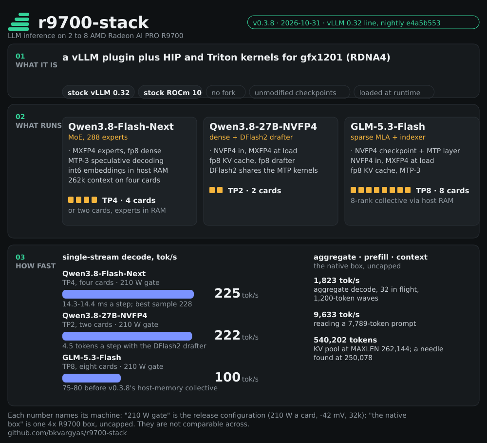

# r9700-stack

Tuned GPU kernels and a vLLM plugin that make **Qwen3.8** and **GLM-5.3-Flash** run fast on **AMD Radeon AI PRO R9700**
cards (gfx1201 / RDNA4) on **stock vLLM and stock ROCm**. No fork, no patched source, no vendored binaries, no
re-quantised weights: everything loads at runtime through vLLM's own extension points, so vLLM and ROCm update
underneath it.

Current release: **v0.3.8** (2026-10-31, the vLLM 0.32 line), [release notes](notes/release-v0.3.8.md),
[CHANGELOG.md](CHANGELOG.md).



[What it gives you](#what-v038-gives-you) · [What the kernels do](#what-the-kernels-do) · [Speed](#speed) ·
[Watching it](#watching-it-the-monitor-and-about-pages) · [Deploying it](#deploying-it) ·
[Licence and credits](#licence-and-credits)

## What v0.3.8 gives you

- **Stock vLLM 0.32 on stock ROCm 10.** Pinned to the 2026-10-25 ROCm 10 nightly (vLLM 0.32.1rc1, torch 2.13); the
  plugin registers through vLLM's platform, quantization, model and attention-backend entry points and carries its
  own kernels (`libr9k`, HIP and Triton). Five compatibility fixes for the 0.32 line are in this release.
- **Three models, unmodified checkpoints:**
  - **Qwen3.8-27B-NVFP4** (dense) with the **DFlash2-FP8** block drafter: two cards, TP2.
  - **Qwen3.8-Flash-Next** (MoE, 288 routed experts, MXFP4 experts + fp8 dense): four cards TP4, or two cards with the
    experts streamed from pinned host RAM through a device LRU cache. On four cards it runs at the checkpoint's own
    **262,144-token** context, and what limits long context there is prefill scheduling, not the KV cache
    ([notes/context-262k.md](notes/context-262k.md)).
  - **GLM-5.3-Flash** (sparse MLA with the DeepSeek-V3.2-style indexer, RedHat NVFP4 checkpoint with its MTP layer):
    eight cards TP8, 32k production recipe; 262k launches retrieve correctly to ~75k tokens on this nightly (216k on
    the previous pin, see the release notes).
- **Weight formats, handled at load:** NVFP4 checkpoints converted to MXFP4 with MSE-searched block exponents (folded
  exponent, bit-exact on the 27B); fp8 dense, drafter and lm-head GEMMs with per-token fp8 activations; fp8 KV cache;
  the Flash-Next per-layer-embedding table as int6 in pinned host memory; MXFP4 x fp8 grouped MoE GEMMs with routing,
  activation and top-k sum fused around them.
- **Speed at a 210 W cap per card (single stream / aggregate / prompt processing):**
  - Qwen3.8-27B TP2: **216 tok/s** (4.5 tokens a step with the drafter), 527 / 640 tok/s at 8 / 16 streams, 3.9k tok/s
    on an 8k prompt, 367k-token KV cache.
  - Qwen3.8-Flash-Next TP4: **210-225 tok/s** (MTP-3), 913-944 tok/s at 16 streams, 6.8-7.5k tok/s on an 8k prompt,
    70-80 ms to first token, ~480k-token KV cache.
  - GLM-5.3-Flash TP8: **100 tok/s** (MTP-3; 75-80 before v0.3.8's host-memory collective), 161 tok/s at four streams,
    3.1-3.4k tok/s prompt processing at 2k-32k, needles found at 12.7k / 30k / 67k tokens on this nightly (216k on the previous pin).
- **Speculative decoding on both families:** MTP-3 for Flash-Next and GLM, the DFlash2 drafter for the 27B, all on the
  same kernels, with the draft metadata, indexer logits and all-reduces inside the HIP graphs.
- **Multi-card communication over plain PCIe:** P2P one-shot / two-shot all-reduce and all-gather for 2 and 4 cards,
  a hierarchical 8-rank all-reduce across four PCIe switches, a compressed 4/6-bit all-reduce for prefill-sized
  messages, RCCL above that.
- **Gated like a release, every time:** kernel unit gates, the integration gate against the installed vLLM, strict
  sanity above `max_num_seqs`, mixed-length soaks and long-context needles on every configuration before a tag;
  paired GSM8K (1,319 questions, McNemar) and HumanEval on the numerics (27B: GSM8K 95.75%, HumanEval 162/164;
  GLM: GSM8K 97/100).

## What the kernels do

- **MoE experts**: grouped MXFP4 x fp8 GEMMs with the routing, activation, per-token quant and top-k sum fused
  around them; a device LRU expert cache with the experts streamed from pinned host memory for the two-card
  Flash-Next configuration.
- **Dense layers**: fp8 and NVFP4/MXFP4 weight-only GEMMs on WMMA, the activation quant fused into the GEMM at
  decode widths; NVFP4 checkpoints converted to MXFP4 at load.
- **Hyper-connections** (Flash-Next): the down + hc_silu and up + gated-mean GEMMs on fp8 copies of the weights at
  every row count, the bf16 copies freed after quantisation; combine-norm and gate-mix kernels for prefill.
- **Attention and recurrence**: paged attention for prefill, the query-sparse attention indexer and attention
  kernels, one fused Gated DeltaNet decode core per layer (conv update, gating, recurrence, norm), one GDN state
  page per request under speculative decoding.
- **Communication**: P2P all-reduce and all-gather over PCIe for 2 and 4 cards (one-shot and two-shot, fine-grained
  memory, HIP-graph safe), a compressed 4/6-bit all-reduce for prefill-sized messages, RCCL above that.
- **Speculative decoding**: MTP (Flash-Next) and the DFlash2 block drafter (27B) on the same kernels, with an int6
  per-layer-embedding table in pinned host memory.
- **Memory**: the KV cache sized from what the model actually uses, not torch.compile's transients; cudagraphs
  only where they pay.

Every default ships gated: the full 1,319-question GSM8K set paired per question against the previous numerics
(McNemar), HumanEval, strict sanity under overload, a 25-minute mixed-length soak on every configuration, the
multi-rank communication tests and the kernel unit gates. v0.3.2 kernels (unchanged in v0.3.3): GSM8K 95.75% (paired
p = 1.00 against v0.3.1), HumanEval 162 / 164; v0.3.3 validation: 0 bad answers in 5,060 strict-sanity checks,
0 errors in 1,224 soak requests.

## Speed

Two different machines below, and they are not comparable across: the first three tables are the release
configuration, a 210 W cap per card with a -42 mV offset and 32k context (v0.3.8's gate numbers are in the release
notes); the last table is a native box with the cards uncapped, running the checkpoint's full 262,144-token context.

### The release configuration: four and two cards, 210 W cap, 32k context

**Qwen3.8-Flash-Next (MXFP4 experts, fp8 dense), four cards, TP4, MTP-3**

| | |
|---|---:|
| single-stream decode | 225 tok/s, 14.3 ms a step |
| aggregate decode at 1 / 2 / 4 / 8 streams (BetterBench) | 175 / 277 / 410 / 530 tok/s |
| aggregate decode at 8 / 16 streams (probe) | 620 / 944 tok/s |
| time to first token | 70-80 ms |
| prompt processing at 2k / 8k / 16k / 32k | 5,175 / 7,141 / 7,489 / 7,233 tok/s |
| KV cache | 518,481 tokens |

**Qwen3.8-Flash-Next, two cards, TP2, experts in host RAM**

| | PCIe Gen3 host (test box) | PCIe Gen5 host (production) |
|---|---:|---:|
| single-stream decode | 122 tok/s | 143 tok/s |
| aggregate at 8 / 16 streams | 177 / 163 | 257 / 245 |
| prompt processing at 8k | 2,594 | 3,724 |
| KV cache | 221,184 tokens | |

**Qwen3.8-27B-NVFP4, two cards, TP2, DFlash2 speculative decoding**

| | |
|---|---:|
| single-stream decode | 222 tok/s (4.5 tokens a step), 22 ms a step |
| aggregate at 8 / 16 streams | 527 / 640-658 tok/s (probe; equal-prompt bursts match the previous release) |
| prompt processing at 8k | 3,901-4,143 tok/s |
| KV cache | 367,494 tokens |

How each number was produced, and what was tried and rejected: [PROGRESS.md](PROGRESS.md) and `notes/`.

### Uncapped cards, the checkpoint's full 262,144-token context

The native 4x R9700 box: vLLM 0.32.0+rocm723 in a venv, cards uncapped, so compare it against the uncapped numbers
in [notes/native-4xr9700.md](notes/native-4xr9700.md), not against the 210 W tables above. Same model, four cards,
TP4, MTP-3. Except where a row names another launch, this is the launch that runs on this box today
(`MAXLEN=262144 NSEQ=32 NBT=8192 PREFIX_CACHE=0`), re-measured after a restart.

| | |
|---|---:|
| KV cache at MAXLEN=262,144 | **540,202 tokens**; vLLM: `Maximum concurrency for 262,144 tokens per request: 2.06x` |
| KV cache at MAXLEN=32,768 (same launch shape) | 497,588 tokens: raising context 8x made the pool **bigger**, because the sizing run is bounded by `NBT`, not by MAXLEN |
| prompt processing at 60k / 120k / 180k | 8,672-8,742 / 8,062-8,064 / 7,416-7,436 tok/s, each tier sent twice back to back with no prefix cache to help it |
| time to first token at 60k / 120k / 180k | 6.87-6.93 / 14.89 / 24.22-24.28 s, needle found at 60,061 / 120,066 / 180,070 tokens |
| the same 60k prefill as the engine measures it | **8,908-8,917 tok/s**: that request's own 60,061 prompt tokens over its own 6.74 s of prefill (the Monitor's per-request row, `FinishedRequestStats`) |
| retrieval ladder, a `PREFIX_CACHE=1` launch: 30,070 / 67,063 / 150,057 / 250,078 tokens | found at every tier (30-70% depth): TTFT 4.25 / 7.73 / 19.32 / **36.52 s**, prefill 7,068 / 8,671 / 7,768 / 6,847 tok/s, and **0.28-0.70 s** for a context the prefix cache has already seen |
| prompt processing at 30k / 250k, prefix cache off | 9,097 (the 8 x 30k wave) / 6,832 (a needle run) tok/s -- **-25% for 8x the context**, which is what 12 of 48 layers attending plus the QSA indexer buys |
| decode at depth (400 tokens inside a 250k context) | 141 tok/s single stream, on a repetitive haystack, so high draft acceptance |
| 32 in flight, 300-token waves (`bench/probe32.sh`) | **1,568.3 / 1,573.7 / 1,587.5 tok/s**; the 32k recipe's band at this protocol is 1,574-1,598 across instances, so the full context costs nothing measurable |
| 32 in flight, 1,200-token waves | 1,799.5 / 1,832.7 (32k band: 1,823) -- `max_tokens` alone moves this protocol by 15%, so a wave length belongs next to every aggregate number |
| 16 in flight, 300-token waves | 1,133.1 / 1,135.8 / 1,142.7 (32k band: 1,107) |
| 32 concurrent 300-token requests, wall clock from one process | 3.7-4.0 s: all 32 running at once, KV pool peak 20.7%, nothing waiting, because 32 x 300 tokens is two 8,192-token steps |
| 8 concurrent 30k prompts | 26.2 s end to end: TTFTs 3.6 -> 26.2 s in 3.3 s steps (one prefill each) with the pool only **11.7%** full |
| 3 concurrent 250k prompts | queue to 36.9 / 73.7 / 109.2 s; no OOM, all three retrieve |
| card power at `gpu_busy_percent` 100 | median **299 W** a card (132 samples, 179-303) |
| standing gate on the launch that runs today | GSM8K **99/100** (33,909 prompt tokens in 40 s), `bench/quality.py` needle 3/3 at 3,828 / 15,196 / 30,354 tokens |
| VRAM per card | 30.3-30.5 of 31.86 GiB at every tier up to 180k, ~1.35 GiB spare |

The limit is not the KV cache. Only 12 of 48 layers do full attention (24 KiB a token, 6.00 GiB per full-length
sequence), so a 262k request needs 586 of 1,230 blocks and the pool holds **2.06** of them -- a residency
ceiling, not the concurrency the box serves: long prefills serialize, so above roughly 30k tokens a prompt
"more than 2 in flight" already means queueing while the pool sits a tenth full. `--long-prefill-token-threshold`
(+ `_adaptive`) measured as a fairness knob, not a speed one: six 30k requests behind a 250k one go 40.3-55.8 s
-> **7.8-27.7 s** at an unchanged wall clock (55.9 vs 56.8 s), while three 250k prefills in parallel push the pool
to 99.1% and cost 22% (109.2 -> 133.6 s), so it stays off. Method, the queue measurements and the metric-reading
traps: [notes/context-262k.md](notes/context-262k.md).

## Watching it: the Monitor and About pages

<a href="docs/r9700-stack-monitor.png"></a>

The Monitor page: engine state and the KV pool, generation and speculation, every card's busy% and VRAM, the
engine's timings over the poll window, and the request list carrying each request's own wall clock, token counts
and prefill. The frame is 1688 x 1953: it is shown as wide as the page column, so click it for the pixels.

A stdlib sidecar (`serve/webui.py`: no framework, nothing extra to install) that reads what a running launch already
publishes, `/health`, `/v1/models`, `/metrics`, plus the amdgpu sysfs of every card. Two shapes, and each page says
which one it is:

- **`WEBUI=1`, or `bash serve/webui.sh` against a launch that is already up** (sidecar, port 8081): out of process,
  so it keeps answering after the engine dies, and in `WEBUI_MODE=proxy` it sits between client and serve and
  records every request body. Recording costs a measured 2-3 ms a request, flat in prompt length (+5.3% of a
  76-token request, +0.5% of a 4.4k-token one); the default `observe` mode changes nothing in the inference path.
- **`WEBUI=same`** (merged into the launch, on its own port, `serve/plugin`): hooks vLLM's endpoint and stat-logger
  plugin groups, so the engine hands over each request's own queue / prefill / decode seconds and token counts,
  which no proxy can infer; the price is a page that dies with the launch and never sees a request body. It needs
  `pip install -e serve/plugin` and a `VLLM_PLUGINS` allowlist generated by `serve/webui-plugins.py`, not written
  by hand.

The About page hands out client config that is right where you paste it: the base URL is the address that answered
the page (`/v1` for the OpenAI SDK and LiteLLM, the root for curl), `openai/<served name>` rather than the
checkpoint path, the API key never printed, and the reasoning parser accounted for (`--reasoning-parser qwen3`
makes reasoning tokens count against `max_tokens`, so a small budget returns `content = None`).

What the pages refuse to invent: vLLM publishes nothing about a request while it is in flight, so there is no
prefill progress bar -- `prompt_tokens_total` is credited when a request ends, and the one live signal during a
long prefill is the KV pool filling (measured: 5.1 -> 32.1% in 3.0% steps for a single 180,066-token prompt).
Cards whose sysfs answers `EBUSY` are shown as unread rather than as 0%. Where every number comes from, and what
cannot be answered per request from outside: [notes/webui.md](notes/webui.md).

## Deploying it

Requirements: 2x, 4x or 8x Radeon AI PRO R9700, ROCm 10 on the host, the model weights under `~/models`
(`Qwen3.8-Flash-Next-MXFP4-FP8-GPTQ`, `Qwen3.8-27B-NVFP4` with `Qwen3.8-27B-DFlash2-FP8`,
`GLM-5.3-Flash-NVFP4-RedHat` for eight cards). Two ways to run it: in the image (docker), or with **no docker at
all** (a venv plus a `libr9k.so` built on the host, `serve/native-flashnext.sh`), which is what the box behind
these numbers runs.

0. **Set the box up, or check one that already runs this repo**: `./setup.sh` (bootstrap: it finds a Python 3.10+
   that can make a venv with pip, then runs `setup.py`, which holds the checks). It walks the box and prints the
   file each requirement came from: cards seen with their 32 GB BAR0 actually placed (`/sys/bus/pci/devices/*/resource`,
   not a ReBAR claim), `/dev/kfd`, kernel cmdline, memlock, **docker or the native path**, the pinned image and
   whether its nightly pin moved, the second checkout `serve.sh` mounts, every checkpoint the serve scripts name,
   and the tests that need no GPU.
   ```
   ./setup.sh --check                                    # report only, changes nothing
   ./setup.sh --yes --launch native-flashnext.sh --webui same   # check, then start the native launch
   ./update.sh                                           # git pull here (refuses on tracked edits), re-check
   ```
   On a box with no docker it says so and checks the native path instead: the venv importing vLLM/torch/hip with
   the same `LD_LIBRARY_PATH` `serve/native-flashnext.sh` sets (the ROCm wheels need a locally unpacked OpenMPI
   runtime, no root), the host-built `libr9k.so`, and `pip install -e serve/plugin` for `WEBUI=same`. It names the
   venv/pip/`hipcc` commands rather than running them: the ROCm wheels are ~20 GB and are never fetched by a
   script, and nothing here touches `~/models`, the launch caches, or a launch that is already up. The host-side
   BAR0/ACS/PCIe-switch setup is in neither script: that is [host/README.md](host/README.md).

1a. **Native (no docker)**. One-time on the host; `./setup.sh --check` reports each missing piece with the command
   to run (the exact versions and URLs live in [notes/native-4xr9700.md](notes/native-4xr9700.md)):
   ```
   python3 -m venv ~/venv-r9700
   ~/venv-r9700/bin/pip install vllm==0.32.0+rocm723 --extra-index-url \
     https://wheels.vllm.ai/rocm/<pin>/rocm723/          # torch 2.13.0+git733fca1 and triton 3.8.0 come with it
   pip install -e .                                      # the r9700 plugin
   ~/venv-r9700/bin/pip install -e serve/plugin          # Monitor and About inside the serve (WEBUI=same)
   cd kernels && HIPCFLAGS=-I$HOME/opt/rocm-dev/opt/rocm/core-10.1/include ./build.sh \
     && cp libr9k.so ../r9700_vllm/kernels/              # host hipcc, gfx1201, all 68 export checks
   ```
   Those ROCm wheels link OpenMPI 4 and the host does not have it: unpack the runtime with `dpkg-deb -x` under
   `~/opt/openmpi` (no root; the deb list is in the note), and the launcher's `OPENMPI=` line puts it on
   `LD_LIBRARY_PATH`. Every serve knob then works exactly as in the container: step 2's block with
   `serve/native-flashnext.sh` in place of `serve/serve.sh`. What this path does not need: dockerd/containerd, an
   image, or the second build checkout `serve.sh` mounts at `/opt/r9700`. Measured on this box with the 262k
   launch up: four `VLLM::Worker_TP*` at 12.5 GiB RSS each, `VLLM::EngineCore` 1.22, API server 1.51, and
   `Mlocked` **0**, because on four cards the experts live in VRAM and nothing is pinned; `MemAvailable` 37.2 of
   93.8 GiB, 39.5 GiB of it reclaimable page cache from reading the checkpoint. The pinned host RAM the two-card
   offload configuration wants (about 120 GB, 38.7 GiB of it the PLE table) is what this path leaves out; it was
   never a docker allowance, and what the container layer itself costs is unmeasured here, since this box has no
   docker binary on it.

1b. **In the image**. Build it once (stock vLLM ROCm 10 nightly plus the plugin; the kernels compile inside):
   ```
   docker build -t r9700/vllm:dev docker/
   ```
   The pinned nightly (2026-10-25, vLLM 0.32.1rc1, torch 2.13) is in `docker/Dockerfile` (`--build-arg BASE=` for another).
   `serve.sh` runs the image against the second checkout of this repo (default `~/r9700-build/repo`, mounted at
   `/opt/r9700`) so the running plugin is code you can change without rebuilding; `./setup.sh` names it and offers
   to clone it. Container-only recipes are labelled in `setup.py`'s launch list.

2. **Serve** (the same knobs either way):
   ```
   # in the image
   bash serve/27b.sh                                                  # 27B-NVFP4, two cards
   GPUS=0,1,2,3 TP=4 OFFLOAD_GB=0 NSEQ=16 bash serve/flashnext.sh     # Flash-Next, four cards
   bash serve/flashnext.sh                                            # Flash-Next, two cards, experts in host RAM
   MODEL=/models/GLM-5.3-Flash-NVFP4-RedHat GPUS=0,1,2,3,4,5,6,7 TP=8 OFFLOAD_GB=0 EAGER=0 MTP=3 KVDTYPE=fp8 \
     MAXLEN=32768 NSEQ=4 NBT=8192 PREFIX_CACHE=0 VLLM_ROCM_USE_AITER=1 R9K_AG_MAX_KB=2048 \
     'SPEC_EXTRA="use_local_argmax_reduction": true' 'R9K_FP8_LINEARS=self_attn\.(in_proj_qkvbfg_a|o_proj|f_b_proj|g_b_proj)$' \
     bash serve/serve.sh                                               # GLM-5.3-Flash, eight cards (notes/glm53.md)
   # native, no container: what this box runs today
   MAXLEN=262144 NSEQ=32 NBT=8192 PREFIX_CACHE=0 WEBUI=same \
     bash serve/native-flashnext.sh      # Flash-Next, four cards, the full 262k context,
                                         # Monitor and About on the serve's own port
   ```
   `serve/native-flashnext.sh` is the container-free launcher for a box with no docker (plugin and vLLM in a venv,
   `libr9k` built with the host `hipcc`, [notes/native-4xr9700.md](notes/native-4xr9700.md)); it takes the same knobs
   as `serve/serve.sh` and defaults to `MAXLEN=32768`. The line above is what the box is running: at the full
   context the KV cache gets bigger rather than smaller (540,202 against 497,588 tokens) and the 32-stream
   throughput wave stays in the band quoted above.
   OpenAI-compatible API on port 8080 (`PORT=`), model name `Qwen3.8`. Every serve script carries the measured
   defaults with the reason next to each knob; `R9K_*=stock` or `=0` switches any kernel back to vLLM's.
   `WEBUI=1` on any of them, or `WEBUI=same` to put the pages on the launch's own port: "Watching it" above.
3. **Check it** (what each one proves is next to it; run them in this order):
   ```
   ~/venv-r9700/bin/python3 bench/warmup.py        # the launch answers; the lazily-JIT'd kernels are compiled in
   ~/venv-r9700/bin/python3 bench/quality.py 100 8 # the standing gate: GSM8K + the needle ladder
   ~/venv-r9700/bin/python3 bench/sanity_stress.py # strict 8-way sanity above max_num_seqs, under load
   ~/venv-r9700/bin/python3 bench/soak.py          # mixed-length soak, prompts of a random length
   ~/venv-r9700/bin/python3 bench/eval.py selftest # reproducibility first; then `run NAME` / `compare A B`
   ~/venv-r9700/bin/python3 bench/humaneval.py     # HumanEval
   ~/venv-r9700/bin/python3 bench/needle_long.py   # retrieval to the checkpoint's own 262k: token counts measured
                                                   # against the checkpoint's tokenizer, a nonce every ~40 sentences
                                                   # so a prefix cache cannot carry the haystack, per-card VRAM
                                                   # high-water per tier
   ~/venv-r9700/bin/python3 bench/webui_ab.py      # what the Monitor's relay costs a request (2-3 ms, measured)
   ```
   Inside the image, drop the `~/venv-r9700/bin/`. Kernel unit tests are in `tests/`, and
   `bench/bringup-tests.sh` runs the single-GPU set of them.

Notes for the host: cards on the same PCIe switch for tensor parallelism, one card per switch for offloaded
experts; a KVM guest with an emulated PCIe switch needs the overlay in `overlay/emulated-switch`
(`OVERLAYS=emulated-switch`, the serve scripts' default) and the guest kernel flags in
[notes/mes-timeouts.md](notes/mes-timeouts.md); the two-card Flash-Next configuration needs about 120 GB of host RAM,
the four-card one needs no pinned host RAM at all. The release checklist and the upgrade recipe for a newer vLLM
nightly are in [notes/picking-up.md](notes/picking-up.md).

## Licence and credits

Apache-2.0 ([LICENSE](LICENSE)); provenance of the kernel structures and the libraries this grew out of in
[CREDITS.md](CREDITS.md) and [notes/independence.md](notes/independence.md).
