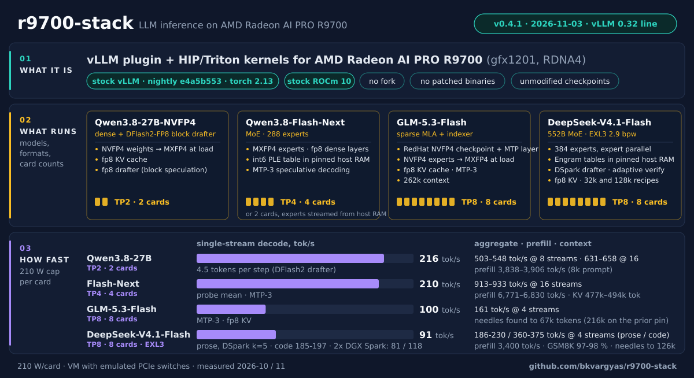
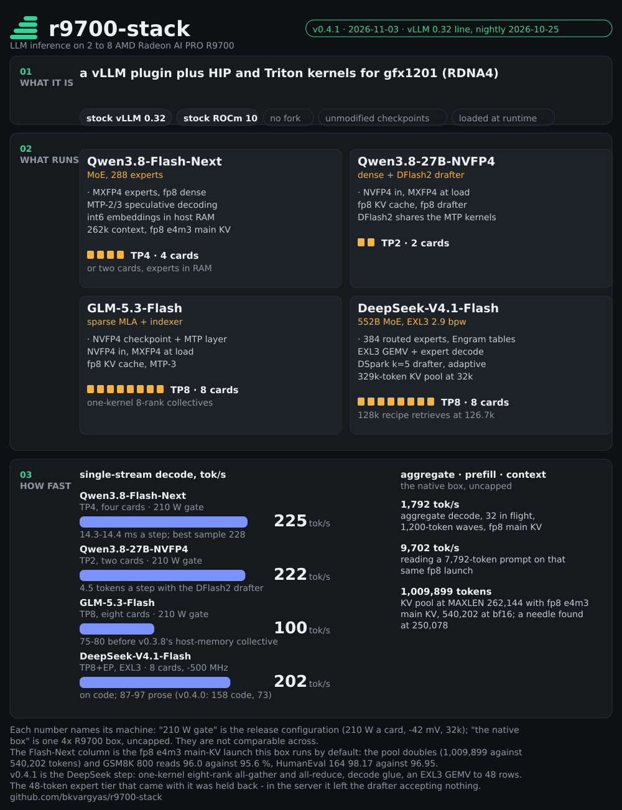
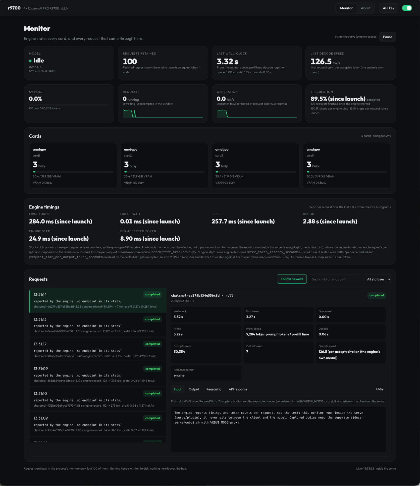

<p align="center">
  <picture>
    <source media="(prefers-color-scheme: dark)" srcset="docs/r9700-stack-lockup-dark.svg">
    
  </picture>
</p>

<div align="center">

**Big open models, fast, on AMD Radeon AI PRO R9700 cards, on stock vLLM and stock ROCm.**

A vLLM plugin and a set of HIP / Triton kernels for gfx1201 (RDNA4). No fork, no patched source, no vendored binaries,
no re-quantised weights: everything loads at runtime through vLLM's own extension points, so vLLM and ROCm update
underneath it.

[](https://github.com/bkvargyas/r9700-stack/releases/latest)


[](LICENSE)


</div>


> [!NOTE]
> Most numbers here were measured on one machine: eight R9700s at a 210 W cap in a KVM guest with emulated PCIe
> switches, on a 120 V feed that holds eight-card runs to a -500 MHz clock offset. The rows tagged **the native box**
> come from a different one: four R9700s, uncapped, no docker, a venv instead of the image. The two are not
> comparable across, and every table names which of them it is. Your rig will differ; the serve scripts carry every
> knob with the reason next to it.



<p align="center">
  <a href="docs/r9700-stack-page.png"></a>
  <br><sub>The release on one page: what the stack is, the four model configurations it runs, and how fast they run --
drawn by <code>docs/summary-page.py</code> from the same numbers the tables below carry, so a figure nobody can
re-draw cannot drift from them. Its canvas is 1000 px against github.com's ~980 px column, so the smallest type on
it lands at 14 px; the tag's own hand-drawn <code>docs/r9700-stack-v0.4.1.svg</code> carries the same claims at
11 px on a 1200-unit canvas, which measures out at 9.0 px in that column -- clicked-to-read, so the generated page
is what this README carries. The picture links to <code>docs/r9700-stack-page.png</code>, the same drawing at
2000 × 2620, for zooming. Rows tagged "210 W gate" are the release configuration, "the native box" is one uncapped
4x R9700 box, and "-500 MHz" is upstream's eight-card gate; the three are not comparable across.</sub>
</p>

<p align="center">
  <a href="#features">What it does</a> · <a href="#what-the-kernels-do">Kernels</a> ·
  <a href="#speed"><b>Speed</b></a> ·
  <a href="#watching-it-the-monitor-and-about-pages">Watching it</a> ·
  <a href="#deploying-it"><b>Deploying it</b></a> · <a href="#license">Licence</a>
</p>

<p align="center"><b>Bring a box up, or check one that already runs this repo:</b><br>
<code>./setup.sh --yes --launch native-flashnext.sh --webui same</code><br>
<sub>It reports the cards with their 32 GB BAR0 actually placed, <code>/dev/kfd</code>, the kernel cmdline,
memlock, docker or the native path, every checkpoint, then builds and starts. Nothing here fetches a wheel or a
checkpoint, and a launch that is already running is left alone. Both paths, image included:
<a href="#deploying-it"><b>Deploying it</b></a>.</sub></p>

## Four cards, the numbers worth knowing

Qwen3.8-Flash-Next (MoE, MXFP4 experts plus fp8 dense) on four Radeon AI PRO R9700, TP4, MTP-3, 31.9 GiB a card:

| | measured | where it came from |
|---|---:|---|
| **decoding, one stream** | **225 tok/s** (best sample 228) | 14.3-14.4 ms a step; release configuration, 210 W cap, 32k |
| **decoding, 32 streams** | **1,823 tok/s** aggregate (best sample 1,836.3) | 1,200-token waves, `bench/probe32.sh`; the native box, uncapped. The fp8 main-KV launch this box now defaults to reads **1,792** (1,789 / 1,796) at the same protocol |
| **reading a prompt** | **9,633 tok/s** | 7,789-token prompt, the native box uncapped (7,141 at the 210 W gate); **9,702** on the fp8 launch, 7,792 tokens |
| **context** | **262,144 tokens**, needle found at 250,078 | the checkpoint's own ceiling, running on this box today; KV pool 1,009,899 tokens with the fp8 main KV the launcher now defaults to, 540,202 at bf16 |
| **decoding, in real work** (not a benchmark) | **162 tok/s** with the box to yourself, **115 tok/s** as a request actually finishes | 1,568 real requests off the fp8 launch's journal over 10.25 h, prompts p50 52,083; the benchmark rows above describe a machine nobody sits on |

<sub>Two different machines, so the rows are not comparable with each other; each one names its own. The last row is
not a benchmark at all — it is what the running serve reported about other people's requests, and it is the row to
believe when asking what a request will feel like. Full protocols,
sample lists and the measurements that were tried and rejected: <a href="#speed">Speed</a>,
<a href="notes/native-4xr9700.md">notes/native-4xr9700.md</a>,
<a href="notes/context-262k.md">notes/context-262k.md</a>.</sub>

## What it does

You run the stock vLLM ROCm image with this plugin installed. From there:

1. **Load.** The plugin registers through vLLM's platform, quantization, model and attention-backend entry points and
   brings its own kernel library (`libr9k`, HIP and Triton). The checkpoints are the published ones, unmodified.
2. **Convert at load.** NVFP4 weights become MXFP4 with MSE-searched block exponents; fp8 dense, drafter and lm-head
   GEMMs take per-token fp8 activations; the KV cache is fp8; large tables (Flash-Next's per-layer embedding as int6,
   DeepSeek's Engram tables) go to pinned host memory; EXL3 trellis weights (2-6 bits) serve through exllamav3's gfx1201
   extension and our own batched expert kernel.
3. **Decode on our kernels.** Grouped MoE GEMMs with routing, activation and top-k sum fused around them; WMMA
   weight-only GEMMs with the activation quant fused in; one fused Gated DeltaNet core per layer; sparse-MLA decode
   on split-K kernels; the hyper-connection seams in one launch; the drafters (MTP, DFlash2, DSpark) on the same kernels,
   all inside HIP graphs.
4. **Talk over plain PCIe.** One-kernel all-reduce and all-gather for two, four and eight cards across four PCIe
   switches (pair stages over P2P, the cross-switch stage through pinned host memory), a compressed 4/6-bit all-reduce
   for prefill-sized messages, RCCL above that.
5. **Gate every release.** Kernel unit gates, the integration gate against the installed vLLM, strict sanity above
   `max_num_seqs`, mixed-length soaks and long-context needles on every configuration before a tag; paired GSM8K
   (McNemar) and HumanEval on the numerics.

Current release: **v0.4.1** (2026-11-03), [release notes](notes/release-v0.4.1.md), [CHANGELOG.md](CHANGELOG.md).
On the four-card native box this fork runs, the main KV cache is fp8 e4m3 by default - see the 262k table below.

## Features

| | |
|---|---|
| 🧠 **Four models, unmodified checkpoints** | **Qwen3.8-27B-NVFP4** with the DFlash2-FP8 block drafter (two cards); **Qwen3.8-Flash-Next** (MoE, 288 experts; four cards, or two with the experts streamed from host RAM); **GLM-5.3-Flash** (sparse MLA + indexer, RedHat NVFP4 with its MTP layer; eight cards); **DeepSeek-V4.1-Flash** (552B MoE, 384 experts, Engram, DSpark) from the published EXL3 2.9 bpw pack (eight cards, tensor + expert parallel). |
| 🧮 **Weight formats handled at load** | NVFP4 → MXFP4 (bit-exact on the 27B), fp8 dense / drafter / lm-head with per-token activations, fp8 KV, int6 and fp8 tables in pinned host RAM, EXL3 trellis with the unshardable pieces dequantized to bf16. |
| ⚡ **Decode kernels** | Fused MoE GEMMs, WMMA weight-only GEMMs, one GDN core per layer, RDNA4-tuned sparse-MLA decode, one-launch hyper-connection seams, fused routing and norms, a multi-row EXL3 GEMV (1-48 rows) and a batched EXL3 expert decode. |
| 🔗 **Collectives over PCIe** | One-shot / two-shot P2P for 2 and 4 cards; an eight-rank all-reduce and all-gather that never cross a root complex (pairs over P2P, the cross stage through pinned host pools); compressed 4/6-bit all-reduce for prefill; RCCL above. |
| 🎯 **Speculative decoding on every family** | MTP-3 (Flash-Next, GLM), DFlash2 (27B), DSpark with adaptive verification (DeepSeek), draft metadata and all-reduces inside the HIP graphs. |
| 📏 **Measured, not guessed** | A per-kernel ledger of the DeepSeek step ([notes/exl3-ledger.md](notes/exl3-ledger.md)) decides what gets built; every serve script's default has its measurement next to it. |
| 🧪 **Gated releases** | Strict sanity above `max_num_seqs`, 15-minute mixed-length soaks, long-context needles, paired GSM8K and HumanEval on every tagged tree ([notes/release-v0.4.1.md](notes/release-v0.4.1.md)). |
| 🧰 **Launchers and benches** | One serve script per configuration (`serve/`), warm-up, sanity, soak, eval and needle tools (`bench/`), kernel unit tests (`tests/`), `R9K_*=stock` to switch any kernel back to vLLM's. |

## Speed

210 W a card, 32k context, single stream unless said otherwise; the full gate tables are in the release notes.

| configuration | single stream | aggregate | prompt processing | KV cache |
|---|---:|---:|---:|---:|
| **Qwen3.8-27B-NVFP4**, 2 cards, DFlash2 | **216-222 tok/s** (4.5 tokens a step) | 527 / 640 at 8 / 16 streams | 3.9k tok/s (8k prompt) | 367k tokens |
| **Qwen3.8-Flash-Next**, 4 cards, MTP-3 | **210-225 tok/s** | 913-944 at 16 streams | 6.8-7.5k tok/s (8k) | ~480k |
| **Qwen3.8-Flash-Next**, 2 cards, experts in host RAM | 122 (Gen3 host) / 143 (Gen5) | 177 / 257 at 8 streams | 2.6k / 3.7k | 221k |
| **GLM-5.3-Flash**, 8 cards, MTP-3 | **93-100 tok/s** | 234 at 4 streams | 2.5-3.4k tok/s | 176-210k |
| **DeepSeek-V4.1-Flash** EXL3 2.9 bpw, 8 cards, DSpark k=5 | **87-97 prose / 202 code** (v0.4.0: 73 / 152) | 179-212 prose / 368 code at 4 streams | 3.4k tok/s | 329k (32k) / 314k (128k recipe) |

Two DGX Sparks on TensorFold serve the same DeepSeek pack at 81 prose / 118 code single stream and 154-166 at four
streams. DeepSeek accuracy on this stack: GSM8K 193-196 / 200, needles 9 / 9 to 28k and retrieval at 126.7k-token
prompts, decode flat to 28k of context. How each number was produced, and what was tried and rejected:
[PROGRESS.md](PROGRESS.md) and `notes/`.

The tables below add the two configurations this fork measures on its own box, and they are **not comparable with
the table above**. The first is the release configuration again (210 W a card, a -42 mV offset, 32k context); the
next two are one native box with the cards uncapped, the same recipe at 32k and then at the checkpoint's full
262,144-token context. Those are all **benchmarks**: fixed prompt lengths, equal `max_tokens` waves, nothing else
arriving while you measure. The last subsection is **not** a benchmark - it is 1,400 real requests that arrived at
the running serve, and its decode numbers are roughly a third of the benchmark ones for reasons that are understood
rather than surprising. Read the benchmark tables for what the kernels can do; read the real-traffic one for what a
user gets.

### The release configuration: four, two and eight cards, 210 W cap, 32k context

**Qwen3.8-Flash-Next (MXFP4 experts, fp8 dense), four cards, TP4, MTP-3**

| | |
|---|---:|
| single-stream decode | **225 tok/s**, 14.3 ms a step (best sample 228) |
| aggregate decode at 1 / 2 / 4 / 8 streams (BetterBench) | 175 / 277 / 410 / 530 tok/s |
| aggregate decode at 8 / 16 streams (probe) | 620 / 944 tok/s |
| time to first token | 70-80 ms |
| prompt processing at 2k / 8k / 16k / 32k | 5,175 / 7,141 / 7,489 / 7,233 tok/s |
| KV cache | 518,481 tokens |

<details>
<summary><b>The same model on two cards, and the 27B on two cards</b></summary>

**Qwen3.8-Flash-Next, two cards, TP2, experts in host RAM**

| | PCIe Gen3 host (test box) | PCIe Gen5 host (production) |
|---|---:|---:|
| single-stream decode | 122 tok/s | 143 tok/s |
| aggregate at 8 / 16 streams | 177 / 163 | 257 / 245 |
| prompt processing at 8k | 2,594 | 3,724 |
| KV cache | 221,184 tokens | |

**Qwen3.8-27B-NVFP4, two cards, TP2, DFlash2 speculative decoding**

| | |
|---|---:|
| single-stream decode | 222 tok/s (4.5 tokens a step), 22 ms a step |
| aggregate at 8 / 16 streams | 527 / 640-658 tok/s (probe; equal-prompt bursts match the previous release) |
| prompt processing at 8k | 3,901-4,143 tok/s |
| KV cache | 367,494 tokens |

</details>

**DeepSeek-V4.1-Flash EXL3 2.9 bpw, eight cards, TP8 + expert parallel, DSpark k = 5 adaptive (eight-card runs at a -500 MHz
clock offset on this box's 120 V feed)**

| | |
|---|---:|
| single-stream decode, prose / code / GSM8K-style | 70-75 / 158 / 114-121 tok/s |
| per-stream decode at four streams, prose / code | 47 / 84 tok/s (187 / 336 aggregate) |
| decode after a 2k / 16k / 28k-token prompt | 82 / 80 / 75 tok/s |
| prompt processing | 2,500 tok/s on one 12k prompt, 3,000 aggregate on four at once, 3,400 on the warm short-prompt probe (the first prompt of a process JIT-compiles four Triton kernels) |
| KV cache | 329k tokens at MAXLEN 32768 (ten 32k requests), 314k at MAXLEN 131072 (`KVMEM=0.8`; one pool, replicated on every card) |
| accuracy | GSM8K 195 / 200 on the release launch (196 and 194 on the Phase 1 / 2 trees; greedy, thinking on); needles 9 / 9 at 8k, 16k, 28k; strict sanity 0 bad of 105 above max_num_seqs |

### The same four cards uncapped, at 32k

The native box below, on the recipe it ran before the context was raised (`MAXLEN=32768 NSEQ=16`, cards uncapped):
19.16 GiB of weights a card, draft acceptance 56.1% (2.68 tokens a step). This is where the prefill and aggregate
numbers in the block at the top of this README come from; [notes/native-4xr9700.md](notes/native-4xr9700.md) has
every sample list and the bands they repeat to.

| | |
|---|---:|
| single-stream decode | 186.7 tok/s, 14.3 ms a step (18.1 / 22.6 ms at 4 / 8 streams) |
| aggregate at 4 / 8 / 16 streams (`bench/bench.py`, 400-token streams) | 372 / 841 / 1,164 tok/s |
| aggregate, 32 in flight, 300-token waves (`bench/probe32.sh`) | 1,600.1 / 1,586.5 / 1,598.0 -> 1,598 tok/s |
| aggregate, 32 in flight, 1,200-token waves | **1,836.3 / 1,808.8 -> 1,823 tok/s** |
| aggregate, 16 in flight, 200-token waves (`bench.py run`, the recorded protocol) | 1,210.9 / 1,231.2 / 1,168.4 / 1,185.9 -> 1,198 tok/s |
| prompt processing at 1,951 / 7,789 / 31,166 tokens | **7,702 / 9,633 / 8,963 tok/s** |
| KV cache | 554,982 tokens |

Note the decode column and the release table above disagree: uncapped, a single stream runs at 186.7 tok/s, while the
210 W cap with a -42 mV offset reads 225 there. That is recorded, not reconciled -- the two boxes differ in host,
pin and clocks, and the 210 W figure has never been re-measured on this one.

### The same four cards uncapped, at the checkpoint's full 262,144 tokens

The native 4x R9700 box: vLLM 0.32.0+rocm723 in a venv, cards uncapped, so compare it against the uncapped numbers
in [notes/native-4xr9700.md](notes/native-4xr9700.md), not against the 210 W tables above. Same model, four cards,
TP4, MTP-3. Except where a row names another launch, this is the launch that runs on this box today —
`MAXLEN=262144 NSEQ=32 NBT=8192`, and until 2026-11-04 also `PREFIX_CACHE=0`, which is why **every number in this
table is a cache-off number**. The prefix cache went on that day, aligned with upstream's default
(notes/prefix-cache-decision.md); rows from before it stay valid for the recipe they were measured on, and
re-measuring them under the cache is owed rather than assumed.

| | |
|---|---:|
| KV cache at MAXLEN=262,144 | **540,202 tokens**; vLLM: `Maximum concurrency for 262,144 tokens per request: 2.06x` |
| the same launch with an **fp8 e4m3 main KV** (the default since 2026-11-03: 12 full-attention layers quantized, the QSA side caches left bf16) | **1,009,899-1,021,931 tokens**, `3.85-3.90x`; attention block size 880 instead of 448; prefill **2,614 / 7,886 / 9,702 / 8,965 / 8,282 tok/s at 485 / 1,976 / 7,792 / 31,131 / 77,733 tokens** (bf16: 2,586 / 7,938 / 9,705 / 8,928 / 8,252 -- flat); 32 in flight, 1,200-token waves **1,789 / 1,796** (bf16 1,817 / 1,831) and 300-token waves 1,511-1,563 (bf16 1,594-1,640), and that 1.5-4% is MTP acceptance under the bench's own traffic (2.55 against 2.61 tokens a step; real traffic on this launch runs 2.33) -- not the kernel, which measures 7-11% faster; GSM8K 800 @8 **96.0 against 95.6**, HumanEval 164 **98.17 against 96.95** (McNemar b=2, c=0, p=0.50), needle intact cold and warm to 250,078 tokens: [notes/kv-fp8-qsa.md](notes/kv-fp8-qsa.md) |
| KV cache at MAXLEN=32,768 (same launch shape) | 497,588 tokens: raising context 8x made the pool **bigger**, because the sizing run is bounded by `NBT`, not by MAXLEN |
| prompt processing at 60k / 120k / 180k | 8,672-8,742 / 8,062-8,064 / 7,416-7,436 tok/s, each tier sent twice back to back with no prefix cache to help it |
| time to first token at 60k / 120k / 180k | 6.87-6.93 / 14.89 / 24.22-24.28 s, needle found at 60,061 / 120,066 / 180,070 tokens |
| the same 60k prefill as the engine measures it | **8,908-8,917 tok/s**: that request's own 60,061 prompt tokens over its own 6.74 s of prefill (the Monitor's per-request row, `FinishedRequestStats`) |
| retrieval ladder, a `PREFIX_CACHE=1` launch: 30,070 / 67,063 / 150,057 / 250,078 tokens | found at every tier (30-70% depth): TTFT 4.25 / 7.73 / 19.32 / **36.52 s**, prefill 7,068 / 8,671 / 7,768 / 6,847 tok/s, and **0.28-0.70 s** for a context the prefix cache has already seen |
| prompt processing at 30k / 250k, prefix cache off | 9,097 (the 8 x 30k wave) / 6,832 (a needle run) tok/s -- **-25% for 8x the context**, which is what 12 of 48 layers attending plus the QSA indexer buys |
| decode at depth (400 tokens inside a 250k context) | 141 tok/s single stream, on a repetitive haystack, so high draft acceptance |
| 32 in flight, 300-token waves (`bench/probe32.sh`) | **1,568.3 / 1,573.7 / 1,587.5 tok/s**; the 32k recipe's band at this protocol is 1,574-1,598 across instances, so the full context costs nothing measurable |
| 32 in flight, 1,200-token waves | 1,799.5 / 1,832.7 (32k band: 1,823) -- `max_tokens` alone moves this protocol by 15%, so a wave length belongs next to every aggregate number |
| 16 in flight, 300-token waves | 1,133.1 / 1,135.8 / 1,142.7 (32k band: 1,107) |
| 32 concurrent 300-token requests, wall clock from one process | 3.7-4.0 s: all 32 running at once, KV pool peak 20.7%, nothing waiting, because 32 x 300 tokens is two 8,192-token steps |
| 8 concurrent 30k prompts | 26.2 s end to end: TTFTs 3.6 -> 26.2 s in 3.3 s steps (one prefill each) with the pool only **11.7%** full |
| 3 concurrent 250k prompts | queue to 36.9 / 73.7 / 109.2 s; no OOM, all three retrieve |
| card power at `gpu_busy_percent` 100 | median **299 W** a card (132 samples, 179-303) |
| standing gate on the launch that runs today | GSM8K **99/100** (33,909 prompt tokens in 40 s), `bench/quality.py` needle 3/3 at 3,828 / 15,196 / 30,354 tokens |
| VRAM per card | 30.3-30.5 of 31.86 GiB at every tier up to 180k, ~1.35 GiB spare |

The limit is not the KV cache. Only 12 of 48 layers do full attention (24 KiB a token, 6.00 GiB per full-length
sequence), so a 262k request needs 586 of 1,230 blocks and the pool holds **2.06** of them -- a residency
ceiling, not the concurrency the box serves: long prefills serialize, so above roughly 30k tokens a prompt
"more than 2 in flight" already means queueing while the pool sits a tenth full. `--long-prefill-token-threshold`
(+ `_adaptive`) measured as a fairness knob, not a speed one: six 30k requests behind a 250k one go 40.3-55.8 s
-> **7.8-27.7 s** at an unchanged wall clock (55.9 vs 56.8 s), while three 250k prefills in parallel push the pool
to 99.1% and cost 22% (109.2 -> 133.6 s), so it stays off. Method, the queue measurements and the metric-reading
traps: [notes/context-262k.md](notes/context-262k.md).

### The same launch with real work on it, not a benchmark

Everything above this line was measured by sending requests on purpose: same prompt lengths, same `max_tokens`, and
nothing else arriving while the meter runs. That is the right way to compare builds, and the wrong way to answer
"what will my request get". The launch that ran that night — the fp8 e4m3 main-KV one, `MAXLEN=262144 NSEQ=32 NBT=8192 PREFIX_CACHE=0 MTP=2`,
started 2026-11-03 15:29 — keeps a **request journal** (`~/logs/requests-8080.jsonl`, one fsynced row per finished
request, added to survive hard resets; timings and token counts only, no request bodies). At the ten-hour mark it
held **1,568 completed requests**: 10.25 h of wall clock, of which **29%** had traffic in them. Prompts p50
**52,083** tokens (p90 149,572, p95 163,513, max **198,073**), generated p50 322 (p95 1,853). Nothing was sent to
make these tables; `tools/watch-live.py` only samples, and the Monitor only reads `/metrics`.

The engine's own counters agree with the journal, which is the cross-check that makes the rest usable: over the same
launch `prompt_tokens_total` is 106,686,448 against the journal's 106,214,313, and `generation_tokens_total`
877,747 against 874,128 — under 0.5%, the gap being requests the journal had not yet flushed.

**The prefix cache, decided against that traffic instead of against a synthetic corpus (2026-11-04).** Every
cache number above was measured on prompts built for the measurement. `tools/prefix-replay.py` replays this box's
own conversation records instead — 6,560 model calls, 581.9M prompt tokens, four days, real arrival order and real
overlap — against the engine's own rules (880-token hybrid blocks, contiguous-prefix reuse, LRU-evictable retained
blocks, a 1,175-block pool). Result: **98.1% of prompt tokens would not be computed, 76,882 s of prefill back over
four days, and no extra queueing at any concurrency tried** (OFF starts queueing at 2x load: 60,706 s at 8x).
The endpoint those same conversations actually talk to reports `cacheRead` for **99.1%** of their prompt tokens, so
the simulation and a live measurement of the identical calls agree to one point. The cost, measured here rather
than simulated: the launch that made it permanent published `977,726` KV tokens against the cache-off launch's
`1,009,899` — 1,242 blocks of 832 instead of 1,175 of 880, so 3.2% of the pool is what caching costs here when
nothing hits, because on a hybrid model the cached unit carries a recurrent state. Verdict and the conditions that would reverse it:
and the live number, ten minutes after the flip: **83.0% of this box's prompt tokens were `local_cache_hit`** (955,136 of 1,150,598), `num_preemptions_total` unchanged at 0, and a 98,541-token prompt taking 0.39 s to first token against a 22.9 s mean an hour earlier. notes/prefix-cache-decision.md — including the 2026-09-25 measurement that turned it off for this model in the first
place (a short-prompt cost: 1,325-token TTFT 563 → 313 ms, 2k-token prefill 2.8k against ~4.7k tok/s, because
"align" mode aligns every prefill chunk end to the block size) and why that does not decide a box whose p99 prompt
is 245,792 tokens. It landed the same day: `: ${PREFIX_CACHE:=1}` in `serve/native-flashnext.sh`, the old number
quoted in the comment so the next person inherits the argument instead of the default, and
and the debt that came with it — `ITEMS=0,66,152 bench/ttft_breakdown.py http://127.0.0.1:8080 cacheon`, re-running
that 2026-09-25 tier on the current stack. It paid: TTFT 37 / 188 / 371 ms at 45 / 1,412 / 3,323 tokens, three times
better than the number that justified turning the cache off, with **1.00 iterations per request** at every tier — the
align-mode extra pass that the old root cause measured no longer happens here.

Each request's own decode rate is `completion_tokens / timings.decode_s` — the engine's own decode span, with
queueing and prefill excluded. Concurrency is rebuilt from the rows' own start and end stamps at 1 Hz, taking the
**maximum** over the request's decode window, not the value at its midpoint:

| how many requests shared the engine during its decode | share of the 10,818 busy seconds | own decode, median |
|---|---:|---:|
| one — the stream had the box to itself | 47.5% | **162.0 tok/s** (585 requests) |
| two | 25.1% | 114.5 tok/s (294) |
| three to four | 24.8% | **41.0 tok/s** (423) |
| five to six | 2.4% | 23.9 tok/s (127) |
| seven to nine | 0.06% | 47.0 tok/s (23) |
| **all 1,525 requests generating ≥40 tokens** | — | **115.4 tok/s** (mean 100.9, p10 17.1, p90 171.1) |

So the honest answer to "how fast does one stream decode" is **two numbers: 162 tok/s alone, 115 tok/s as a request
actually finishes**, and the difference is not decode speed — it is what sharing a prefill-bound engine costs.
Concurrency during traffic ran p50 2, p90 4, max 8; the per-second histogram is 1 → 47.5%, 2 → 25.1%, 3 → 17.1%,
4 → 7.7%, 5 → 2.2%, 6+ → 0.4%.

**The denominator decides any aggregate**, so all four are recorded: **23.7 tok/s** over the whole wall clock (71%
of it an idle box), **80.8 tok/s** over active seconds only, **42.1 tok/s** token-weighted
(`Σgenerated / Σdecode_s`, dragged down because long decodes are the ones that ran while busy), and **115.4 tok/s**
as the median of per-request rates — the last is the shape that answers "what will my request feel like". From the
counters rather than the journal the same two come out at **23.6** and **42.0**.

**Prefill and time-to-first-token in real use**, from the same rows (`prompt_tokens / timings.prefill_s`), bucketed
by prompt size — which is the shape a fixed-length bench cannot show:

| prompt size | requests | prefill, median | p10 | p90 |
|---|---:|---:|---:|---:|
| under 20k | 179 | 8,158 tok/s | 1,102 | 9,909 |
| 20k–80k | 882 | **8,937 tok/s** | 6,891 | 9,382 |
| 80k–160k | 376 | 7,970 tok/s | 7,216 | 8,470 |
| above 160k | 101 | **7,542 tok/s** | 7,048 | 7,690 |

Time to first token over all 1,563: **p50 6.50 s, p95 24.52 s, max 56.1 s** at prompt p50 52,083. The longest
prompt this launch served, **198,073 tokens**, took 27.0 s to its first token at 7,330 tok/s of prefill and then
generated 1,242 tokens. Aggregating the counters the other way — `prompt_tokens_total / request_prefill_time_sum`
— gives **7,949 tok/s per prefill-second**: the request's own scheduled→first-token span summed over requests, so
it carries decode interference as well as prefill work (the step census in
[notes/context-262k.md](notes/context-262k.md) prices a whole-prefill record at 8,079, ~3% higher; long prefills
take the 8,192-token step one at a time, which is why they serialize). The decode side needed a different
denominator than the one first printed in this paragraph: `generation_tokens_total / request_decode_time_sum` is
per **stream**-second — that family accrues one observation per stream-step, so a step two streams share is
counted twice — measured **36.8 tok/s** over the launch's 10.6 h, not an aggregate. The aggregate is 891,750
generated tokens over 10.6 h of wall = **23.4 tok/s**, and the two are one number times the fan-out: 36.8 × 0.64
streams in decode phase at an average instant of a day. The journal's per-request medians (101–115 tok/s) sit above
both because a request's median decode window is mostly unshared — 158 alone, 41 at three-to-four, 23 at
five-to-six.

**What the drafter did over the launch:** 376,433 drafts of 2 tokens (MTP=2 is this launcher's default at TP4),
752,866 draft tokens, **501,271 accepted** — 1.33 accepted per draft, a mean acceptance length of **2.33 tokens a
step**, 66.6% of drafted tokens accepted.

**And the level right now**, as three spans of the engine's cumulative counters (the Monitor's own numbers, taken
2026-11-04 01:49; the spans are deltas, not means of 1 s samples):

| span | generation | prefill while prefilling | per stream | req/min | a step | accepted / draft | KV pool |
|---|---:|---:|---:|---:|---:|---:|---:|
| 1 min | 45.8 tok/s | 4,214 tok/s | 17.2 | 4.7 | 90.7 ms | 1.29 | 28.4% |
| 15 min | 23.7 tok/s | 7,713 tok/s | 12.8 | 2.7 | 100.6 ms | 1.45 | 18.5% |
| 1 h | 26.4 tok/s | 7,737 tok/s | 17.9 | 3.5 | 65.4 ms | 1.48 | 12.6% |

The `per stream` column is per **stream-second**, and it is not comparable to the `generation` column without its
multiplier: on a 15-minute span taken later the same pair read **42.5 tok/s summed** against **17.2 per
stream-second**, `×2.47 streams decoding`, and the two multiply exactly. `request_decode_time_seconds` and
`inter_token_latency_seconds` are both stream-seconds — one observation per stream-step — so a rate built on them
is per stream, whatever the word "aggregate" next to it suggests; and their step interval *contains* the chunked
prefill computed in that step, so it excludes queue and prefill-before-first-token, not prompt chewing
([notes/context-262k.md](notes/context-262k.md) has the census and the arithmetic).

The Monitor's decode card leads with the **summed** figure — generated tokens ÷ wall seconds, the throughput reading
of the box, and the same basis the trend card beside it plots — and keeps the other reading labelled on the note
line with the multiplication that connects them: `152 tok/stream-s ×0.17` = 25 on that burst. The per-stream figure
is what every request row prints (so the note line and the rows agree), and it has no denominator in a window that
was all prefill, which is why it is a number on a note line rather than a waveform. Both are published as separate
fields (`generation_tok_s`, `decode_stream_tok_s`, `decode_streams`), and the harness checks the product. The summed
basis is upstream's own: `vllm/v1/metrics/loggers.py` divides the tokens since its last stat line by the wall
seconds since that line, and every line this boot printed implies 228,295 generated tokens against a counter of
228,333. The log is still the easy way to be fooled, because vLLM writes that line at debug level when the engine is
idle: over one 903 s span it printed 420 s of it, and its lines average 42.4 tok/s where the same tokens over all
903 s are 19.7. So each span also says what its fan-out is made of -- `busy_frac`, the share of the span covered by 5 s gaps in
which the engine's record counter moved (an upper bound at that resolution, not a count of busy seconds; the
engine's own log is coarser at 10 s intervals), and `streams_while_busy` in its title. The fan-out is the exact one
of the three: it comes from counters. The burst
these numbers come from is a live 716 s one: 18,118 generated tokens over 119.1 stream-seconds = **152 tok per
stream-second**, against **25 summed** over the wall seconds of the same window, with the request rows at
160-200 tok/s and `shared ×1.0` (serialized traffic — which is why stream-seconds and the union of decoding seconds
are the same 119.1 s there).

**About lists the configuration, as three sources that are allowed to disagree.** The recipe file (what the launcher
asked for), the engine's own labels (what it resolved: **46 published against the 15 the cards read**, so
`mamba_cache_mode`, `prefix_match_unit`, `prefix_caching_hash_algo` and the rest are at least visible), and the
environment: a **whitelist** of `VLLM_*`/`R9K_*`/`R9700_*`/`WEBUI_*`/launcher names -- not `os.environ`, because
this page is served on every interface of the box. `R9K_` is listed as a whole namespace because those names pick
**which kernel runs**, so they change what a measured number means while staying absent from the engine's config;
`tools/recipe-check.py` compares the same block against the launcher (`ENVRECIPE=1`), which is how the running
test config `R9K_ROUTER_MAX_M=4` got named. Plus the machine-local
`~/.config/r9700-stack/native.env` parsed each poll, so the page agrees with the file an operator just edited. A name that looks like a credential is
listed as `set · value withheld`, in the env block and in the printed command line alike (`--api-key <withheld>`,
flag kept, because a restart line that drops the flag starts a serve nobody can reach). The card says which process
it is describing: a sidecar's `MAXLEN` proves nothing about the engine.

**The gate has three faces now: measured knobs, environment, and launch flags.** Flags are the face the engine
cannot testify to — no `vllm:*` label says whether the serve came up `--language-model-only` — and the merged
plugin publishes the live process's own argv, so the launcher's line and the running process's line get compared
token by token (`--host`, `--port` and `--served-model-name` excluded: box facts and client choices). Presence
counts: a flag whose value is `None` and a flag that is absent are different answers, and the first draft of the
comparison treated them alike, which would have hidden the exact flip it was written for. When the payload carries
no argv (an in-process page older than the comparison), the gate says the flags are **UNPROVABLE** rather than
counting them as matching. The flag that motivated this face is `--language-model-only`: this box is text-only
because a flag says so, not because the weights cannot see — `MM=1` turns images on, they demonstrably work, and
the cost is 3.5% of the KV pool plus 60 s of boot ([notes/multimodal-input.md](notes/multimodal-input.md)).

The 1 min prefill figure is low **because of the metric, not the box**: `prompt_tokens_total` credits a prompt when
its request finishes, so a 60-second span that has long prefills running but not finished credits only what happened
to land inside it. Over spans longer than a request's wall time the same quantity sits at 7,700 — which is what the
counters say too. It is kept here, labelled, rather than dropped.

**Why this collapses at three or four streams while the benchmark holds 57.6 tok/s at thirty-two.** It is not fan-out
and not attention depth — it is that under real traffic most of the engine's seconds sit inside steps that carry a
**prefill chunk**, and a decoding stream advances exactly one acceptance per step no matter what that step costs.
The engine counts its own work: `vllm:iteration_tokens_total` held 229,625 records over this launch summing to
110,983,408 tokens, which is `prompt_tokens_total` plus `generation_tokens_total` to the last token — so **99.2% of
the tokens this box processed were prompt tokens**, one generated token costing 123 prompt tokens. In 8,192-token
units that is 13,439 chunks, **5.9% of records**, and the two unit prices that fall out of the journal's interval
unions (4.97 h with something in flight) are **~1.0 s for a step carrying a chunk and 20.6 ms for one that does
not** — 75% of the box's busy seconds are prefill steps, and one chunk is worth **49 decode steps** (27 of the fat
32-row ones).

| | the bench wave (32 × 1,200-token prompts) | real traffic (prompt p50 52,083) |
|---|---|---|
| prefill work | 38,400 tokens = **4.7 chunk steps**, paid once as a ramp | 6–7 chunk steps per arriving request, ~2.5 arrivals a minute |
| decode steps per stream | ~471 (1,200 generated ÷ 2.55, the bench's own acceptance) | ~138 (median 322 ÷ 2.33) |
| steps polluted by prefill | ~1% | ~4% at three-to-four in flight, ~8% at five-to-six |
| what a stream's step costs | **13.0 ms** alone, **37.1 ms at 32 rows** (bench's own step timing) | **57 ms** at three-to-four, 98 ms at five-to-six |
| rate | **57.6 tok/s a stream** | **41.0**, and 23.9 at five-to-six |

Read it as rates divided by step times and the ordering stops being mysterious. This launch accepts 501,271 of
376,433 drafts — a mean acceptance length of **2.33 tokens a step**, the first term in everything below. A stream
alone runs 2.33 tokens per **14.4 ms** = 162 tok/s, against the 13.0 ms step the bench times for one stream; the
measured 41.0 at three-to-four is 2.33 tokens per **57 ms**, and 57 ms is what **~4% one-second steps** buys
(0.036 × 1.0 + 0.964 × 0.022). Going from one to thirty-two *decode* rows moves a measured step from 13.0 ms to
37.1 ms — a factor 2.9 — while prefill injection moves it 4–7×. The bench's own timing corroborates the share: its median step at 32 rows is 37.1 ms, but 57.6 tok/s at its own 2.55
tokens a step implies a **45.5 ms mean**, and solving `f × 1.0 + (1−f) × 0.0371 = 0.0455` gives **f = 0.9%** — what
4.7 chunk steps against ~471 decode steps says. And the fan-out inside a chunk step is why the wave survives spending
20% of its seconds there while this box spends 75%: a chunk step still advances every decoding stream once, so it
yields 32 × 2.33 = **75 tokens** in the wave but only **3.9** live (382,167 drafts across those 229,625 steps —
1.66 streams decoding per step). What is ruled out, with the counters that say so:
preemption (`num_preemptions_total` 0, all 1,600 journal rows at `preemptions: 0`), the KV pool (15–30% over the
spans, `waiting_by_reason` capacity 0 and deferred 0 — the queue is never a memory wall here), fp8 (paired arms:
1,792 against 1,823 aggregate, 1.55 against 1.60 accepted per draft), acceptance length (1.33 per draft here against
1.55–1.62 in the bench arms, worth a few percent) and context depth (162 alone at 20–80k against 186.7 at 32k uncapped, ~13%). The full census, the arithmetic that
closes it against measurements it was not fitted to, and the trap that makes a 5-second version of this fit wrong:
[notes/context-262k.md](notes/context-262k.md).

- **The cliff is between two and three streams, and it is scheduling, not kernels.** Two to three in flight drops a
  stream from 115 to 41 tok/s, and the step census above is the reason: with `NBT=8192`, a third long prompt
  injects 6–7 one-second steps per arrival (measured on the earlier launch: step p50 951 ms), and every stream is
  credited its accepted tokens once per step however long that step ran. The knob that addresses it is
  `--long-prefill-token-threshold`, not anything in the decode path — see [notes/context-262k.md](notes/context-262k.md).
- **Single-stream decode barely cares about context on this model.** Alone (nothing else sharing the box during its
  decode), generating ≥200 tokens: **182.6 tok/s** under 20k prompt, **164.6** at 20–80k, **150.0** at 80–160k,
  **156.5** above 160k — a 262k context costs one stream ~13%, because decode here streams MoE weights and
  attention's KV read is not the dominant term. (n = 10 / 258 / 99 / 30; the above-160k bucket is the thinnest.)
- **Prefill from real traffic matches the benchmark**, which is the useful cross-check: the ladder measures
  8,672–8,742 tok/s at 60k and 8,062 at 120k on purpose-sent prompts, and real traffic medians are 8,937 at 20–80k
  and 7,970 at 80–160k. Real traffic adds the falloff fixed-length benches cannot show.
- **162 is not a regression against the 225 above.** That figure is MTP-3 with ~3.1 accepted tokens a step; this
  launch runs **MTP=2** at 2.33 a step, on contexts of 20–200k rather than 32k. If single-stream decode is ever
  wanted back, the knob is drafter depth (`MTP=3`), not the attention path.

**The same launch before the fp8 switch**, for comparison — same recipe with a bf16 main KV, 1,400 requests over
13.8 h, prompts p50 **74,381** (p95 173,099, max 240,067), concurrency p50 2, p90 6, max 9: one 32.7% of active
seconds at **157.7 tok/s**, two 18.6% at 119.1, three-four 31.8% at **22.8**, five-six 12.4% at 15.6, seven-nine
4.6% at 17.3, all of it **60.8 tok/s** median (mean 75.7, p10 8.7, p90 163.0); aggregates 16.6 / 45.4 / 24.8 / 60.8.
The two windows are **not** an fp8-vs-bf16 comparison and should not be read as one: the traffic differs
(prompts p50 52,083 against 74,381, and p90 concurrency 4 against 6), and that traffic mix is exactly the variable
the cliff is made of. The controlled fp8 comparison is the paired one in
[notes/kv-fp8-qsa.md](notes/kv-fp8-qsa.md): 1,792 against 1,823 tok/s of 32-stream aggregate, prefill flat to
±0.5%, acceptance 1.55 against 1.60 per draft.

Method, the preemption rows this window produced, and the trap that made the first version of this table wrong
(midpoint concurrency sampled 361 requests as "alone" and reported 137 tok/s): [notes/context-262k.md](notes/context-262k.md).

How each number above was produced, and what was tried and rejected: [PROGRESS.md](PROGRESS.md) and `notes/`.

## What the kernels do

- **MoE experts**: grouped MXFP4 x fp8 GEMMs with the routing, activation, per-token quant and top-k sum fused
  around them; a device LRU expert cache with the experts streamed from pinned host memory for the two-card
  Flash-Next configuration.
- **Dense layers**: fp8 and NVFP4/MXFP4 weight-only GEMMs on WMMA, the activation quant fused into the GEMM at
  decode widths; NVFP4 checkpoints converted to MXFP4 at load.
- **Hyper-connections** (Flash-Next): the down + hc_silu and up + gated-mean GEMMs on fp8 copies of the weights at
  every row count, the bf16 copies freed after quantisation; combine-norm and gate-mix kernels for prefill.
- **Attention and recurrence**: paged attention for prefill, the query-sparse attention indexer and attention
  kernels, one fused Gated DeltaNet decode core per layer (conv update, gating, recurrence, norm), one GDN state
  page per request under speculative decoding. The QSA attention kernel reads an **fp8 e4m3 main KV cache** on
  RDNA4 (`r9k_qsa_attn_f8`): the writer in the installed vLLM already quantized it, so what was missing was three
  dtype guards and the read path, with the K and V descales folded into the softmax scale and the output
  normalizer - half the KV bytes of the twelve full-attention layers, and the attention side caches (the compressed
  keys the top-k selection reads) left in bf16: [notes/kv-fp8-qsa.md](notes/kv-fp8-qsa.md).
- **Communication**: P2P all-reduce and all-gather over PCIe for 2 and 4 cards (one-shot and two-shot, fine-grained
  memory, HIP-graph safe); for eight ranks, an all-gather and an all-reduce that stay inside one kernel and never
  cross a root complex (pairs over P2P, the cross-switch stage through pinned host pools), with the MoE combine
  folded into the collective's first phase; a compressed 4/6-bit all-reduce for prefill-sized messages, RCCL above.
- **Speculative decoding**: MTP (Flash-Next) and the DFlash2 block drafter (27B) on the same kernels, with an int6
  per-layer-embedding table in pinned host memory.
- **Memory**: the KV cache sized from what the model actually uses, not torch.compile's transients; cudagraphs
  only where they pay.

Every default ships gated: the full 1,319-question GSM8K set paired per question against the previous numerics
(McNemar), HumanEval, strict sanity under overload, a 25-minute mixed-length soak on every configuration, the
multi-rank communication tests and the kernel unit gates. v0.3.2 kernels (unchanged in v0.3.3): GSM8K 95.75% (paired
p = 1.00 against v0.3.1), HumanEval 162 / 164; v0.3.3 validation: 0 bad answers in 5,060 strict-sanity checks,
0 errors in 1,224 soak requests.

## How it fits together

```
OpenAI-compatible clients ──▶ stock vLLM (ROCm 10 nightly image) ──▶ model classes, attention backends, quant methods
                                       │                                   registered by r9700_vllm at import
                                       ├──▶ libr9k.so (HIP) + Triton kernels      the decode / prefill / MoE / collective kernels
                                       ├──▶ exllamav3's gfx1201 extension         EXL3 trellis GEMV / GEMM (built into the image)
                                       ├──▶ pinned host memory                     offloaded experts, Engram and PLE tables, collective pools
                                       └──▶ 2 / 4 / 8 R9700s over PCIe switches   P2P pair stages, host-memory cross stage, RCCL above 2 MB
```

The image is the pinned nightly plus the plugin (`docker/Dockerfile`); the plugin tree is mounted at `/opt/r9700`
and its kernels are rebuilt by the serve scripts when a source is newer than the library. Every kernel has a stock
fallback behind an `R9K_*` knob, and the integration gate checks the stock entry points the plugin depends on against
the installed vLLM before a tree is served.

## Quick start

You need 2, 4 or 8 Radeon AI PRO R9700s, ROCm 10 on the host, docker, and the weights under `~/models`:
`Qwen3.8-Flash-Next-MXFP4-FP8-GPTQ`, `Qwen3.8-27B-NVFP4` with `Qwen3.8-27B-DFlash2-FP8`, `GLM-5.3-Flash-NVFP4-RedHat`
(eight cards), and for DeepSeek-V4.1-Flash a directory composed of the EXL3 pack's shards and config plus the base
checkpoint's two Engram shards and tokenizer (`serve/ds41-exl3.sh`'s header has the recipe; about 200 GB of host RAM).

**1. Build the image** (the stock vLLM ROCm 10 nightly plus the plugin; the kernels and exllamav3's extension compile inside):

```sh
docker build -t r9700/vllm:dev docker/
```

The pin (2026-10-25: vLLM 0.32.1rc1, torch 2.13) is in `docker/Dockerfile`; `--build-arg BASE=` picks another nightly.

**2. Serve.** Each script carries the measured defaults with the reason next to every knob:

```sh
bash serve/27b.sh                                                  # Qwen3.8-27B-NVFP4, two cards
GPUS=0,1,2,3 TP=4 OFFLOAD_GB=0 NSEQ=16 bash serve/flashnext.sh     # Qwen3.8-Flash-Next, four cards
bash serve/flashnext.sh                                            # Qwen3.8-Flash-Next, two cards, experts in host RAM
MODEL=/models/GLM-5.3-Flash-NVFP4-RedHat GPUS=0,1,2,3,4,5,6,7 TP=8 OFFLOAD_GB=0 EAGER=0 MTP=3 KVDTYPE=fp8 \
  MAXLEN=32768 NSEQ=4 NBT=8192 PREFIX_CACHE=0 VLLM_ROCM_USE_AITER=1 R9K_AG_MAX_KB=2048 \
  'SPEC_EXTRA="use_local_argmax_reduction": true' 'R9K_FP8_LINEARS=self_attn\.(in_proj_qkvbfg_a|o_proj|f_b_proj|g_b_proj)$' \
  bash serve/serve.sh                                               # GLM-5.3-Flash, eight cards (notes/glm53.md)
bash serve/ds41-exl3.sh                                            # DeepSeek-V4.1-Flash EXL3, eight cards (notes/exl3-plan.md)
```

An OpenAI-compatible API answers on port 8080 (`PORT=`), model name `Qwen3.8` (`DeepSeek-V4.1` for the DeepSeek
launcher). `MAXLEN=131072 KVMEM=0.8` is DeepSeek's 128k recipe.

**3. Check it.**

```sh
python3 bench/warmup.py                     # the first prompts (Triton JITs, the drafter's warm-up)
python3 bench/sanity_stress.py              # strict 8-way sanity under load
python3 bench/soak.py http://localhost:8080 # mixed-length soak
python3 bench/eval.py                       # paired GSM8K; bench/humaneval.py for HumanEval
```

Notes for the host: cards on the same PCIe switch for tensor parallelism, one card per switch for offloaded experts; a
KVM guest with an emulated PCIe switch needs the overlay in `overlay/emulated-switch` (`OVERLAYS=emulated-switch`, the
serve scripts' default) and the guest kernel flags in [notes/mes-timeouts.md](notes/mes-timeouts.md); the two-card
Flash-Next configuration needs about 120 GB of host RAM; eight-card runs on a 120 V feed need a clock offset
(`host/`).

## Watching it: the Monitor and About pages

<p align="center">
  <a href="docs/r9700-stack-monitor.png"></a>
  <br><sub>The Monitor page on the launch that runs today: engine state and the KV pool, generation and speculation,
  every card's busy% and VRAM, the engine's timings over the poll window, and the request list carrying each
  request's own wall clock, token counts and prefill. The frame is 1688 x 1953, shown as wide as the page column;
  click it for the pixels.</sub>
</p>

<p align="center">
  
  <br><sub>The same five cards drawn rather than screenshotted: `docs/monitor-cards.py`, stdlib, drawing one
  recorded `GET /api/status` (the poll itself is committed next to it as `docs/r9700-stack-monitor-cards.json`, so
  the figure can be re-drawn and checked without a serve). `bench/capture-cards.py` caught it 4 seconds into eight
  concurrent ~30,000-token prompts on the standing 262k launch: two prefills run, six wait **for scheduling
  capacity**, none deferred, and the pool is only 10.1% full -- a queue, not a memory wall, and the reason the
  Requests card prints the split. Every rate on the figure says what it was averaged over: the Generation card's
  2.0 tok/s and 14,999-token iteration record are both means of the last 2 s, and that pair is the engine crediting
  whole prefills while its two running streams crawl. (That number is `vllm:iteration_tokens_total`, which calls
  itself "tokens per engine step" and is not one on this build -- a chunked prefill is credited in a single record,
  measured at 29,969 tokens in one record against NBT 8,192. The card says "iteration record" for that reason.)
  Drawn because the screenshot above lands at 0.58 scale inside this
  column and its text is unreadable, and a cropped wide strip would be smaller per panel, not larger: the column
  width is the limit for the whole strip.</sub>
</p>

A stdlib sidecar (`serve/webui.py`: no framework, nothing extra to install) that reads what a running launch already
publishes, `/health`, `/v1/models`, `/metrics`, plus the amdgpu sysfs of every card. Two shapes, and each page says
which one it is:

- **`WEBUI=1`, or `bash serve/webui.sh` against a launch that is already up** (sidecar, port 8081): out of process,
  so it keeps answering after the engine dies, and in `WEBUI_MODE=proxy` it sits between client and serve and
  records every request body. Recording costs a measured 2-3 ms a request, flat in prompt length (+5.3% of a
  76-token request, +0.5% of a 4.4k-token one); the default `observe` mode changes nothing in the inference path.
- **`WEBUI=same`** (merged into the launch, on its own port, `serve/plugin`): hooks vLLM's endpoint and stat-logger
  plugin groups, so the engine hands over each request's own queue / prefill / decode seconds and token counts,
  which no proxy can infer; the price is a page that dies with the launch and never sees a request body. It needs
  `pip install -e serve/plugin` and a `VLLM_PLUGINS` allowlist generated by `serve/webui-plugins.py`, not written
  by hand.

The About page hands out client config that is right where you paste it: the base URL is the address that answered
the page (`/v1` for the OpenAI SDK and LiteLLM, the root for curl), `openai/<served name>` rather than the
checkpoint path, the API key never printed, and the reasoning parser accounted for (`--reasoning-parser qwen3`
makes reasoning tokens count against `max_tokens`, so a small budget returns `content = None`).

Both pages' headers name the build that is answering: the plugin's version, and the branch, commit and dirtiness of
the tree that plugin was loaded from - on the launch running today, `vLLM 0.32.0 · plugin 0.4.0 · 953a3901`, with a
`*` on the commit when the tree has uncommitted edits, and the same facts as a row in About. It is the build that
**answered**, not the build this checkout holds: the tree has since moved to 0.4.1, and the header will say so when
that serve is next restarted. "Is the live serve the new one?" used to cost an ssh and a look at the launch log; now
it is a glance, and the string survives into the screenshot someone sends.

The headline rates default to a **15 minute mean**, not the poll, and the window is selectable (this poll / 1 min /
15 min / 1 h). That is not decoration - on a launch with six streams and 90 k-token prompts a single poll is a coin
toss. Measured: one poll read 9.9 tok/s of generation and no prefill at all, another caught in a gap read 0, while the
quarter hour around them was 51.7 tok/s of generation and 7,893 tok/s of prefill. Each card still carries this poll in
its second line, because "is it stuck right now" is a question a 15 min mean cannot answer. The spans are deltas of the
engine's cumulative counters, not means of the 1 s samples - averaging those would weight an idle second the same as a
second with six streams running - and a span the page has not had time for is labelled with what it actually averaged
(`90s`, `2m`) rather than borrowing the name it asked for. The waveforms get the same treatment: 90 points at one per
poll, or an hour at one point per 15 s, each of those points the rate over its interval rather than a sample of one
poll. Every one of those lines is a **slot**: one line high whatever the engine reports, so a number growing from
`2.0` to `8,481` changes the value and never moves the page. The copy is written to fit the tightest card the layout
can produce (24 characters at 12 px) and the full sentences ride in the element's title.

The decode cards in that row are **counts, not per-stream averages**: the first shows `generation_tokens_total` summed
since the engine started against `prompt_tokens_total` over the same span (today 1.00M out against 129.6M in), and the
waveform next to it plots generated tokens **per iteration record** (2.6–2.8 on the current window), never a per-stream
tok/s. The second decode card divides by **decode time, not wall time**: prompt chewing is not in the denominator, and
the seconds it counts come from `inter_token_latency_seconds_sum` (430,954 observations summing to within 0.08% of
`request_decode_time_seconds_sum`, which is what licenses calling either one decode seconds; the step family is
preferred because it grows every decode step instead of only when a request finishes) — and the prefill rate's numerator is **read** tokens, `prompt_tokens_total − prefix_cache_hits_total`,
because vLLM counts cached prefix tokens as prompt tokens and a rate over them is high by the hit rate (the cache is
off on this recipe, so the two are equal today, and `prefill_tok_s_credited` keeps the difference visible if that
changes — the same subtraction Strata's run average makes with `prompt_tokens − reused`). It reads **166 tok/s** against
`wall 24.4 · 14.7% dec` on its note line — and 24.4 / 166 = 0.147, the share of the span that held a stream in its
decode phase, is printed beside it so the pair reads as a ratio instead of a contradiction. What used to sit in that first slot was the aggregate divided by the running gauge, and it was the most misread
number on the page: the gauge counts a request in the middle of a chunked prefill as running, so the divisor includes
streams that cannot produce a token yet, and readers reasonably asked why "all streams" came out below what one stream
gets alone. It comes out below for reasons the step census in [notes/context-262k.md](notes/context-262k.md) measures
(47.6% of wall seconds hold no request, 5.9% of records carry a ~1 s prefill chunk, 1.62 streams decode per record), and
a count cannot be misread that way. The per-stream rate is still in the payload — the request rows use it, and
`webui.py` documents which of the two histogram families is the honest one — it just no longer gets a headline.

The Requests card splits the waiting queue the way the engine labels it: `N waiting · M for scheduling capacity ·
K deferred`, and the split is the whole point on this model. Eight ~30,000-token prompts measured holding
`running 2 · waiting 6 · capacity 6 · deferred 0` with the KV pool at 8.8-10.2%: the queue is long prefills taking
the step one chunk at a time, not memory, and "waiting" alone would have read like the opposite.

What the pages refuse to invent: vLLM publishes nothing about a request while it is in flight, so there is no
prefill progress bar -- `prompt_tokens_total` is credited when a request ends, and the one live signal during a
long prefill is the KV pool filling (measured: 5.1 -> 32.1% in 3.0% steps for a single 180,066-token prompt).
Cards whose sysfs answers `EBUSY` are shown as unread rather than as 0%. Where every number comes from, and what
cannot be answered per request from outside: [notes/webui.md](notes/webui.md).

The PCIe card follows activity, not history: a chain's error cell prints `45 corr · 0 uncorr` while counters are
moving (this poll, or above one per minute over the trailing span), a drawn i-in-a-circle when the counters exist
but the span rate is at or under 1/min, and a bare dash when nothing has moved since boot; uncorrectable counters
and a link below its rating stay red whatever the rate. **The error cell is a button wherever there are numbers**:
clicking pins a block of text under the grid - the chain, the negotiated link and each port's rating, where the
slot is registered, totals since boot, the counter names, this window's delta, the rate over its span, how long
the calm has run, and the last event - which you can select, `Copy`, and close with `Esc`. A tooltip cannot be
copied, and this is text people paste into vendor reports.

What the page's own JavaScript renders can be checked against a live serve without a browser: `node
tests/render-monitor.mjs` runs `serve/web/monitor.js` unmodified in a stub DOM and prints the cards and the request
rows. That covers the JS and the payloads it is fed (a per-request card borrowing an engine-wide number, a real 0
printed as a dash, a token count scaled wrong); it does not cover CSS, fonts or layout, which need a real browser.
`node tests/render-about.mjs` does the same for the About page -- and on its first run it caught a real difference:
the merged page's new configuration card renders empty sections because the in-process plugin in that serve predates
the card, which is invisible from the source tree.
The figure above is covered too: `tests/test_readme.py` checks that every number in its caption is a number the
drawn figure actually contains, so the caption cannot drift from the poll it claims to describe.

## Deploying it

Requirements: 2x, 4x or 8x Radeon AI PRO R9700, ROCm 10 on the host, the model weights under `~/models`
(`Qwen3.8-Flash-Next-MXFP4-FP8-GPTQ`, `Qwen3.8-27B-NVFP4` with `Qwen3.8-27B-DFlash2-FP8`,
`GLM-5.3-Flash-NVFP4-RedHat` for eight cards; for DeepSeek-V4.1-Flash a directory composed of the EXL3 pack's shards and
config plus the base checkpoint's two Engram shards and tokenizer -- `serve/ds41-exl3.sh`'s header has the recipe -- and
about 200 GB of host RAM for the Engram tables). Two ways to run it: in the image (docker), or with **no docker at
all** (a venv plus a `libr9k.so` built on the host, `serve/native-flashnext.sh`), which is what the box behind
these numbers runs.

0. **Set the box up, or check one that already runs this repo**: `./setup.sh` (bootstrap: it finds a Python 3.10+
   that can make a venv with pip, then runs `setup.py`, which holds the checks). It walks the box and prints the
   file each requirement came from: cards seen with their 32 GB BAR0 actually placed (`/sys/bus/pci/devices/*/resource`,
   not a ReBAR claim), `/dev/kfd`, kernel cmdline, memlock, **docker or the native path**, the pinned image and
   whether its nightly pin moved, the second checkout `serve.sh` mounts, every checkpoint the serve scripts name,
   and the tests that need no GPU.
   ```bash
   ./setup.sh --check                          # report only, changes nothing
   ```
   ```bash
   ./setup.sh --yes --launch native-flashnext.sh --webui same   # check, then start the native launch
   ```
   ```bash
   ./setup.sh --docker --launch 27b            # the container path: asked for, default no
   ```
   ```bash
   ./update.sh                                 # git pull here (refuses on tracked edits), re-check
   ```
   **The native path is the default, and the container path is the one thing asked for, with a default of no**
   (`--docker` takes it, `--no-docker` declines without the prompt, and `--yes` does not answer it). Every later
   step follows that answer: with the container path off the image is not inspected or built, the second checkout
   `serve.sh` mounts is not cloned, the container recipes are labelled in the launch list rather than offered,
   and a checkpoint only they want is a note instead of a warning. The native checks it runs instead: the venv
   importing vLLM/torch/hip with the same `LD_LIBRARY_PATH` `serve/native-flashnext.sh` sets (the ROCm wheels
   need a locally unpacked OpenMPI runtime, no root), and the host-built `libr9k.so` **as freshness, not
   existence** -- its hash, whether the copy `kernels/build.sh` wrote and the copy the launcher loads through
   `R9K_LIB` agree, and whether either is older than the newest `.hip` it is built from (step 1a's build line
   ends in a `cp`, and a build that skipped it is a build that never reached the serve). What it does with a
   launch: a native launch starts inside a `tmux` session -- it has to outlive the ssh session that started it by
   four minutes of loading, there is a pane to attach to while it loads, and the session is then the liveness
   probe (`--no-tmux` keeps the bare detached start and gives all three up), it refuses
   up front when the GPUs are still held by a stopped launch or when `OFFLOAD_GB` wants more pinned memory than
   this box's `RLIMIT_MEMLOCK` allows, it notices a launch that died instead of waiting out the 7-minute
   `/health` window, and it prints that log's last lines plus the `STOP=1` that clears the ranks. Each run
   records the native venv, the `libr9k.so` hash and the launch (recipe, log, session) under
   `.r9700-state/`, so the next run reports drift and answers "did my launch die, and which log do I read" (the
   whole launch method -- what supervises it, what refuses it, the `SIGTERM` fact behind the `STOP=1` -- is
   [notes/launch-methodology.md](notes/launch-methodology.md)). It names the venv/pip/`hipcc` commands rather than
   running them: the ROCm wheels are ~20 GB and are never fetched by a script, and nothing here touches `~/models`,
   the launch caches, or a launch that is already up.
   The host-side BAR0/ACS/PCIe-switch setup is in neither script: that is [host/README.md](host/README.md).

1a. **Native (no docker)**. One-time on the host; `./setup.sh --check` reports each missing piece with the command
   to run (the exact versions and URLs live in [notes/native-4xr9700.md](notes/native-4xr9700.md)):
   ```bash
   python3 -m venv ~/venv-r9700
   ```
   ```bash
   ~/venv-r9700/bin/pip install vllm==0.32.0+rocm723 --extra-index-url https://wheels.vllm.ai/rocm/<pin>/rocm723/
   ```
   ```bash
   pip install -e .                            # the r9700 plugin
   ```
   ```bash
   ~/venv-r9700/bin/pip install -e serve/plugin    # Monitor and About inside the serve (WEBUI=same)
   ```
   ```bash
   cd kernels && HIPCFLAGS=-I$HOME/opt/rocm-dev/opt/rocm/core-10.1/include ./build.sh && cp libr9k.so ../r9700_vllm/kernels/
   ```
   torch 2.13.0+git733fca1 and triton 3.8.0 come with that wheel. The index is per-commit and old pins expire:
   the one this release fetched 404s as of 2026-11-02, and vLLM 0.33 renamed the flavor to `rocm72`. No 0.32-era
   pin is live any more (six checked), so the venv IS the artifact of record -- keep it, don't plan to rebuild it.
   notes/vllm-0.33.md: the 0.33.0 gate result and why we did not move. The build line above is host hipcc, gfx1201,
   all 68 export checks, and it ends in the `cp` because the launcher loads the copy under `r9700_vllm/kernels/`.
   Those ROCm wheels link OpenMPI 4 and the host does not have it: unpack the runtime with `dpkg-deb -x` under
   `~/opt/openmpi` (no root; the deb list is in the note), and the launcher's `OPENMPI=` line puts it on
   `LD_LIBRARY_PATH`. Every serve knob then works exactly as in the container: step 2's block with
   `serve/native-flashnext.sh` in place of `serve/serve.sh`. What this path does not need: dockerd/containerd, an
   image, or the second build checkout `serve.sh` mounts at `/opt/r9700`. Measured on this box with the 262k
   launch up: four `VLLM::Worker_TP*` at 12.5 GiB RSS each, `VLLM::EngineCore` 1.22, API server 1.51, and
   `Mlocked` **0**, because on four cards the experts live in VRAM and nothing is pinned; `MemAvailable` 37.2 of
   93.8 GiB, 39.5 GiB of it reclaimable page cache from reading the checkpoint. The pinned host RAM the two-card
   offload configuration wants (about 120 GB, 38.7 GiB of it the PLE table) is what this path leaves out; it was
   never a docker allowance, and what the container layer itself costs is unmeasured here, since this box has no
   docker binary on it.

1b. **In the image**. Build it once (stock vLLM ROCm 10 nightly plus the plugin; the kernels compile inside):
   ```bash
   docker build -t r9700/vllm:dev docker/
   ```
   The pinned nightly (2026-10-25, vLLM 0.32.1rc1, torch 2.13) is in `docker/Dockerfile` (`--build-arg BASE=` for another);
   the image also builds exllamav3 v1.6.6's extension for gfx1201 (the EXL3 kernels, MIT).
   `serve.sh` runs the image against the second checkout of this repo (default `~/r9700-build/repo`, mounted at
   `/opt/r9700`) so the running plugin is code you can change without rebuilding; `./setup.sh` names it and offers
   to clone it. Container-only recipes are labelled in `setup.py`'s launch list, and asking for one on a run that
   took the native path is refused with the `--docker --launch <name>` command that would take it.

2. **Serve** (the same knobs either way):
   In the image:
   ```bash
   bash serve/27b.sh                                # 27B-NVFP4, two cards
   ```
   ```bash
   GPUS=0,1,2,3 TP=4 OFFLOAD_GB=0 NSEQ=16 bash serve/flashnext.sh    # Flash-Next, four cards
   ```
   ```bash
   bash serve/flashnext.sh                          # Flash-Next, two cards, experts in host RAM
   ```
   ```bash
   MODEL=/models/GLM-5.3-Flash-NVFP4-RedHat GPUS=0,1,2,3,4,5,6,7 TP=8 OFFLOAD_GB=0 EAGER=0 MTP=3 KVDTYPE=fp8 MAXLEN=32768 NSEQ=4 NBT=8192 PREFIX_CACHE=0 VLLM_ROCM_USE_AITER=1 R9K_AG_MAX_KB=2048 'SPEC_EXTRA="use_local_argmax_reduction": true' 'R9K_FP8_LINEARS=self_attn\.(in_proj_qkvbfg_a|o_proj|f_b_proj|g_b_proj)$' bash serve/serve.sh
   ```
   ```bash
   bash serve/ds41-exl3.sh                          # DeepSeek-V4.1-Flash EXL3, eight cards (notes/exl3-plan.md)
   ```
   Native, no container -- what this box runs today: four cards, the checkpoint's full 262k context, and the
   fp8 main KV the launcher now defaults, with Monitor and About on the serve's own port.
   ```bash
   MAXLEN=262144 NSEQ=32 NBT=8192 WEBUI=same bash serve/native-flashnext.sh
   ```
   One box fact is not in that line: the bind address. The launcher's `HOST` default is `127.0.0.1` — upstream's own
   default — and this machine's `0.0.0.0` comes from `~/.config/r9700-stack/native.env`, which the launcher sources
   and names in the log (notes/launch-methodology.md §10). Nothing that changes what a number means goes in that
   file.
   ```
   `serve/native-flashnext.sh` is the container-free launcher for a box with no docker (plugin and vLLM in a venv,
   `libr9k` built with the host `hipcc`, [notes/native-4xr9700.md](notes/native-4xr9700.md)); it takes the same knobs
   as `serve/serve.sh` and, since 2026-11-03, defaults `MAXLEN` to the value in the command above. It used to default
   to 32,768, and that default was a trap: a launch that answered `/health` in 150 s looked healthy while serving
   a fraction of the context the checkpoint declares (`text_config.max_position_embeddings = 262144`), on a box
   whose kept request ledger runs to 262,059-token prompts with a p99 of 245,792. `setup.py` now compares the
   running serve's `max_model_len` against the checkpoint's declared context and says so. That native command is what
   the box is running: at the full
   context the KV cache gets bigger rather than smaller (540,202 against 497,588 tokens) and the 32-stream
   throughput wave stays in the band quoted above.
   OpenAI-compatible API on port 8080 (`PORT=`), model name `Qwen3.8` (`DeepSeek-V4.1` for the DeepSeek launcher). Every serve script carries the measured
   defaults with the reason next to each knob; `R9K_*=stock` or `=0` switches any kernel back to vLLM's.
   `WEBUI=1` on any of them, or `WEBUI=same` to put the pages on the launch's own port: "Watching it" above.
3. **Check it** (what each one proves is next to it; run them in this order):
   ```bash
   ~/venv-r9700/bin/python3 bench/warmup.py         # the launch answers; the lazily-JIT'd kernels are compiled in
   ```
   ```bash
   ~/venv-r9700/bin/python3 bench/quality.py 100 8  # the standing gate: GSM8K + the needle ladder
   ```
   ```bash
   ~/venv-r9700/bin/python3 bench/sanity_stress.py  # strict 8-way sanity above max_num_seqs, under load
   ```
   ```bash
   ~/venv-r9700/bin/python3 bench/soak.py           # mixed-length soak, prompts of a random length
   ```
   ```bash
   ~/venv-r9700/bin/python3 bench/eval.py selftest  # reproducibility first; then `run NAME` / `compare A B`
   ```
   ```bash
   ~/venv-r9700/bin/python3 bench/humaneval.py      # HumanEval
   ```
   ```bash
   ~/venv-r9700/bin/python3 bench/needle_long.py    # retrieval to the checkpoint's own 262k
   ```
   ```bash
   ~/venv-r9700/bin/python3 bench/webui_ab.py       # what the Monitor's relay costs a request (2-3 ms, measured)
   ```
   `needle_long.py` measures its token counts against the checkpoint's tokenizer and plants a nonce every ~40
   sentences, so a prefix cache cannot carry the haystack; it reports per-card VRAM high-water per tier.
   Inside the image, drop the `~/venv-r9700/bin/`. Kernel unit tests are in `tests/`, and
   `bench/bringup-tests.sh` runs the single-GPU set of them.

Notes for the host: cards on the same PCIe switch for tensor parallelism, one card per switch for offloaded
experts; a KVM guest with an emulated PCIe switch needs the overlay in `overlay/emulated-switch`
(`OVERLAYS=emulated-switch`, the serve scripts' default) and the guest kernel flags in
[notes/mes-timeouts.md](notes/mes-timeouts.md); the two-card Flash-Next configuration needs about 120 GB of host RAM,
the four-card one needs no pinned host RAM at all. The release checklist and the upgrade recipe for a newer vLLM
nightly are in [notes/picking-up.md](notes/picking-up.md).

## Build on it

- **Switch a kernel off:** every `R9K_*` knob takes `stock` or `0`; the serve scripts list them. A/B a change against
  vLLM's own path without rebuilding anything.
- **Add a model:** the model classes in `r9700_vllm/models/` show the pattern (subclass stock's class, rewrite the
  weight names at load, install hooks behind knobs); [notes/exl3-plan.md](notes/exl3-plan.md) is the worked example
  from a published pack to a gated release, [notes/exl3-layer-map.md](notes/exl3-layer-map.md) the layer-by-layer map.
- **Add a kernel:** `kernels/build.sh` lists the sources and the exported symbols, `tests/` the unit gates
  (bit-exact against a torch reference, graph replay equal to eager), [notes/kernel-inventory.md](notes/kernel-inventory.md)
  what exists and why.
- **Move the pin:** [notes/picking-up.md](notes/picking-up.md) is the upgrade recipe for a newer vLLM nightly and the
  release checklist; [notes/vllm-0.32.md](notes/vllm-0.32.md) the last move.
- **Measure first:** `bench/ds41/ledger/` is the per-kernel step ledger; [notes/exl3-ledger.md](notes/exl3-ledger.md)
  shows how it reads.

## Documentation

| | |
|---|---|
| [`CHANGELOG.md`](CHANGELOG.md), [`notes/release-*.md`](notes/) | What each release changed, and its full validation record. |
| [`PROGRESS.md`](PROGRESS.md), [`PLAN.md`](PLAN.md) | The running log of what was measured, tried and rejected; where the program is going. |
| [`notes/exl3-plan.md`](notes/exl3-plan.md), [`notes/exl3-ledger.md`](notes/exl3-ledger.md) | DeepSeek-V4.1-Flash from the EXL3 pack: architecture, bring-up, the step ledger, the Phase 4 kernel packages and their results. |
| [`notes/glm53.md`](notes/glm53.md) | GLM-5.3-Flash: the sparse-MLA path, the eight-rank collective, the 32k and long-context recipes. |
| [`notes/kernel-inventory.md`](notes/kernel-inventory.md), [`notes/decode-step.md`](notes/decode-step.md) | Every kernel, what it replaces, and the anatomy of a decode step. |
| [`notes/picking-up.md`](notes/picking-up.md) | The release checklist and the upgrade recipe for a new vLLM nightly. |
| [`notes/native-4xr9700.md`](notes/native-4xr9700.md), [`notes/context-262k.md`](notes/context-262k.md), [`notes/kv-fp8-qsa.md`](notes/kv-fp8-qsa.md) | The second machine: the docker-free 4x R9700 box, the 262,144-token context measured end to end, and the fp8 main KV cache that box now runs by default. |
| [`notes/webui.md`](notes/webui.md) | The Monitor and About pages: where each number comes from, what the pages refuse to invent, and how a page with no browser gets tested. |
| [`CREDITS.md`](CREDITS.md), [`notes/independence.md`](notes/independence.md) | Provenance of the kernel structures and the libraries this grew out of. |
| [`docs/`](docs/) | The release graphics and the script that draws them. |

## Development

```
r9700_vllm/      the plugin: models/ quant/ moe/ attn/ comm/ at the top, the entry points in __init__.py
kernels/         the HIP sources and build.sh (libr9k.so); Triton kernels live next to their Python callers
serve/           one launcher per configuration, serve.sh underneath them
bench/           warm-up, sanity, soak, eval, needle, profiling and ledger tools (bench/ds41/ for DeepSeek)
tests/           kernel unit gates (bit-exact references, graph replay) and the integration gate
docker/          the image: the pinned nightly, the plugin, exllamav3's gfx1201 extension
overlay/ host/   the emulated-switch overlay for KVM guests; host-side clock and power helpers
notes/ docs/     the written record, the graphics
```

Before a tag, every configuration runs the same gate on the same tree and image: the kernel unit gates
(`bench/bringup-tests.sh` runs the single-GPU set in the image), the integration gate, strict sanity above
`max_num_seqs`, a 15-minute mixed-length soak, the long-context needles, and the paired evals. A change that only
improves a benchmark does not ship; three of the last eight releases found their bugs in the soak or the sanity run,
not in the numbers.

## Feedback

Questions, rigs that behave differently, numbers that do not reproduce: [open an issue](https://github.com/bkvargyas/r9700-stack/issues).

## License

Apache-2.0 ([LICENSE](LICENSE), [NOTICE](NOTICE)). The kernel structures' provenance and the libraries this grew out of
are listed in [CREDITS.md](CREDITS.md) and [notes/independence.md](notes/independence.md).
