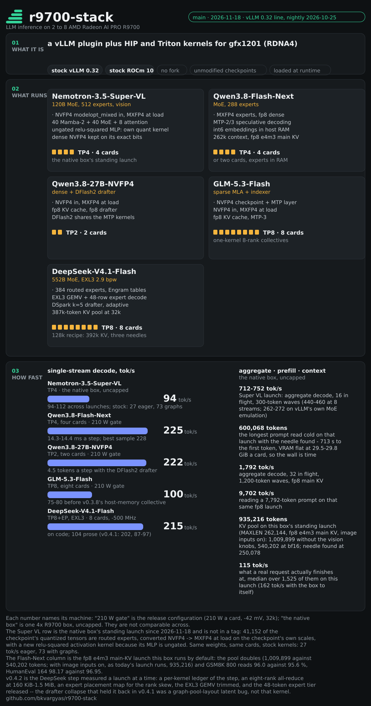
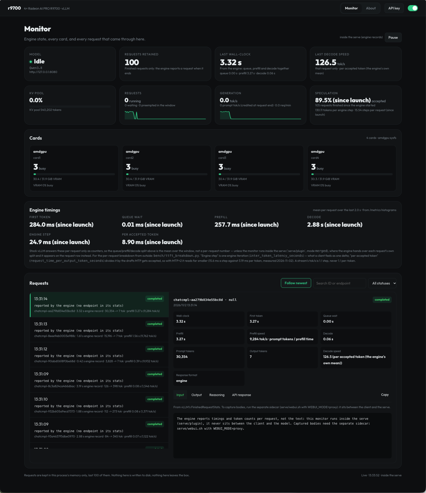
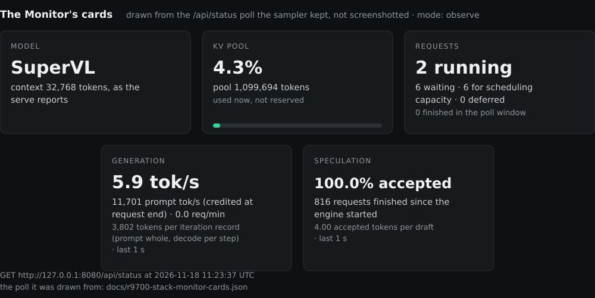

<p align="center">
  <picture>
    <source media="(prefers-color-scheme: dark)" srcset="docs/r9700-stack-lockup-dark.svg">
    
  </picture>
</p>

<div align="center">

**用 stock vLLM 与 stock ROCm，在 AMD Radeon AI PRO R9700 显卡上快速地跑大型开源模型。**

一个 vLLM 插件，外加一组针对 gfx1201（RDNA4）的 HIP / Triton 内核。不 fork、不改源码、不内置二进制、不重新量化权重：
一切都在运行时通过 vLLM 自己的扩展点加载，vLLM 与 ROCm 可以在它底下照常更新。

[](https://github.com/bkvargyas/r9700-stack/releases/latest)


[](LICENSE)


**简体中文 | [English](README.md)**

</div>


> [!NOTE]
> 这里的每个数字都来自两台机器之一，每张表都写明是哪个——但两者不可互相等价。我们自己的实测来自**原生机**：四张
> R9700、Gen5 主机、不用 docker、**不设功耗墙**（实际每卡约 299 W），也就是这个 fork 日常运行的那台机器；每张表的条目都
> 以它领头。另一台是**上游的发版门禁**——**210 W 门禁机**（八张 R9700，每卡 210 W 上限、-42 mV，一个带模拟 PCIe
> 交换机的 KVM 客户机，其 120 V 供电把八卡负载压到 -500 MHz 时钟偏移）；它的数字只保留作对照列，绝不是我们的结果。卡数
> 是部署形态，不是机器；210 W 的数字与不封顶的数字永远不可比。两台机器的完整设定，以及它们唯一互相矛盾的一处，见下文
> <a href="#speed">速度</a>开头。你的机器会不一样；serve 脚本里每个开关都带着它存在的理由。

<p align="center">
  <a href="docs/r9700-stack-page.png"></a>
  <br><sub>一页讲清这次发布：这套栈是什么、它服务的五种模型配置、每条柱标注了数字出自哪台机器，以及它们跑多快——由
<code>docs/summary-page.py</code> 从与下文表格完全相同的数字画出，所以一张谁都能重画的图不会和表格走样——包括每条柱是在
哪台机器上测的。它的画布是 1000 px，对应 github.com 约 980 px 的正文栏宽，所以图上最小字号正好落在 14 px；标签自带的
手绘版 <code>docs/r9700-stack-v0.4.3.svg</code> 在 1200 单位画布上用 11 px 字号写着同样的结论，在那一栏里折合约 9.0
px——必须点开才能读——所以本 README 用的是生成的这页。图片链到 <code>docs/r9700-stack-page.png</code>，同一张图、
2000 × 3912，供放大。每条柱都写明自己的机器：<code>210 W gate</code> 是**上游的**门禁机（每卡 210 W、-42 mV、32k），
在这里只作对照列；<code>210 W gate, -500 MHz</code> 是那台机器的**八卡**负载，其 120 V 供电在功耗墙之上还压出一个时钟
偏移；<code>the native box, uncapped</code> 是这台机器的四张 R9700、不设功耗墙，实际每卡约 299 W——我们的实测，也是
各张表领头的数字。三种口径互不混用。</sub>
</p>

<p align="center">
  <a href="#four-cards"><b>四卡实测</b></a> ·
  <a href="#what">它做什么</a> · <a href="#features">特性</a> ·
  <a href="#kernels">内核</a> ·
  <a href="#speed"><b>速度</b></a> ·
  <a href="#watching">观察它</a> ·
  <a href="#deploying"><b>部署</b></a> · <a href="#license">许可证</a>
</p>

<p align="center"><b>起一台机器，或检查一台已经在跑这个仓库的机器：</b><br>
<code>./setup.sh --yes --launch native-flashnext.sh --webui same</code><br>
<sub>它会汇报显卡及其真正落位的 32 GB BAR0、<code>/dev/kfd</code>、内核命令行、memlock、走 docker 还是原生路径、每个
checkpoint，然后构建并启动。这里不会去拉任何 wheel 或 checkpoint，已经在跑的启动不会被动。两条路径（含镜像）都在下文
<a href="#deploying"><b>部署</b></a>。</sub></p>

<a id="four-cards"></a>
## 四卡实测：值得知道的数字

**2026-11-18 在原生机（四张 R9700、不设功耗墙）上实测：Nemotron-3.5-Super-VL-120B-A12B**（NVIDIA
NVFP4：**512 个专家、每 token 激活 22 个**，40 Mamba-2 + 40 MoE + 8 attention，带视觉）跑在四张卡上，TP4，MTP-4，
每卡 18.5 GiB。它作为常驻启动占卡一天，现在已再次收起——通向那里的工程留了下来，
`launches-available/supervl-32k.json` 一个开关就能把它请回来：

| | 实测 | 与什么对照 |
|---|---:|---|
| **解码，单流** | **94-112 tok/s** | stock vLLM，同样的权重与显卡：**27** eager、**73** 开 graphs——差距来自加载时转换 |
| **解码，8 与 16 流** | **440-460 / 712-752 tok/s** | 同一启动换 vLLM 自己的 MoE 模拟：8 流 **262-272** |
| **质量，转换后 vs stock** | GSM8K **191/200** vs **190/200** | 两边在 30k、150k、250k 都找到 needle |
| **上下文** | 冷读 **600,068 tokens** | 250k 首 token 144 s，600k 首 token 713 s，显存平稳——墙是时间。`CTX=32k \| 256k \| 1m` |
| **图像** | **每张 256-3,328 tokens** | 是 checkpoint 的 patch 预算，不是开关；约占混合波次的 1/3；发裁剪后的图 |

完整记录：[notes/nemotron-super-vl.md](notes/nemotron-super-vl.md)。

Qwen3.8-Flash-Next（MoE，512 专家，MXFP4 专家加 fp8 dense）跑在四张 Radeon AI PRO R9700 上，TP4，MTP-3，
每卡 31.9 GiB——这个 fork 的内核就是为它构建的，也是原生机自 2026-11-18 傍晚以来重新服务的那一个：

| | 实测 | 数字出处 |
|---|---:|---|
| **解码，单流** | 本机 **186.7 tok/s**，不设功耗墙，每步 14.3 ms | 上游的 210 W 门禁机同一形状读到 **225**（最佳样本 228，v0.3.3；此后四次门禁读到 221.4-222.9）——同样的四张卡加了功耗墙；两边不一致，这是如实记录，不是调和 |
| **解码，32 流** | 聚合 **1,823 tok/s**（最佳样本 1,836.3） | 1,200-token 波次，`bench/probe32.sh`；原生机、不设功耗墙。它现在默认的 fp8 主 KV 启动在同一协议下读到 **1,792**（1,789 / 1,796），而 2026-11-08 的常驻启动（vLLM 0.32、router cap 4、util 0.96、`PREFIX_CACHE=0`）读到 **1,767 / 1,780**——落在该散布之内，所以 router cap 在这里测不出代价（notes/bug-router-gemm-oob.md） |
| **读提示词** | **9,633 tok/s** | 7,789-token 提示词，原生机不设功耗墙；上游门禁机在 210 W 下读到 7,141，仅作对照；fp8 启动上为 **9,702**（7,792 tokens） |
| **上下文** | **262,144 tokens**，needle 在 250,078 处找到 | checkpoint 自己的上限，也是本机今天在服务的窗口；常驻启动（`MM_TP_MODE=data`、复制的视觉塔）打印 **797,453 tokens**（`Maximum concurrency for 262,144 tokens per request: 3.04x`）——同样的启动把塔按 rank 切分时打印 **887,983**（3.39x），再之前的一次是 **902,153**（3.44x），所以池子大小是某次启动打印出来的数，不是配置的属性（[notes/context-256k.md](notes/context-256k.md)，塔的代价在 [notes/multimodal-input.md](notes/multimodal-input.md)）——fp8 e4m3 主 KV、图像输入开、`--gpu-memory-utilization 0.96`。0.97 时同一启动带视觉开关读到 935,216、不带读到 1,009,899；bf16 主 KV 为 540,202 |
| **解码，真实工作**（不是基准） | 机器独享时 **162 tok/s**，一个请求实际完成的体感是 **115 tok/s** | fp8 启动的请求日志里 10.25 小时内的 1,568 个真实请求；115 是生成 ≥40 tokens 的 1,525 个请求的中位数，提示词 p50 52,083；上面那些基准行描述的是一台没人坐在这儿的机器 |

<sub>这些表以**我们在这台机器上的实测**领头（原生机，四张 R9700，不设功耗墙，每卡约 299 W）。凡是把一个**上游 210 W
门禁机**的数字与我们并列之处——第一行与第三行的对照格——行内都已写明，两者绝不混用：210 W 的数字与不封顶的数字不可
比。Super VL 那张表只有这台机器。速度一节保留了双卡与八卡形态，它们是上游门禁机的形态，还带着它的 -500 MHz
偏移。最后一行根本不是基准——它是运行中的 serve 就别人的请求报告了什么；要问一个请求的体感，该信的就是这一行。完整
协议、样本清单、以及试过又被否决的测量：<a href="#speed">速度</a>、
<a href="notes/native-4xr9700.md">notes/native-4xr9700.md</a>、
<a href="notes/context-256k.md">notes/context-256k.md</a>。</sub>

<a id="what"></a>
## 它做什么

你跑 stock vLLM ROCm 镜像，装上这个插件。从那里出发：

1. **加载。** 插件通过 vLLM 的 platform、quantization、model 与 attention-backend 入口注册，并带上自己的内核库
   （`libr9k`，HIP 与 Triton）。checkpoint 就是公开发布的那些，未经修改。
2. **加载时转换。** NVFP4 权重变成 MXFP4，块指数用 MSE 搜索；checkpoint 若自带声明的 scale 就直接用（`modelopt_mixed`：
   声明的 41,156 个层条目里 40,960 个是 routed-expert 矩阵）；fp8 dense、drafter 与 lm-head GEMM 吃逐 token 的 fp8
   激活；KV 缓存是 fp8；大表（Flash-Next 的逐层 embedding 以 int6、DeepSeek 的 Engram 表）进锁页主存；EXL3 trellis
   权重（2-6 bits）通过 exllamav3 的 gfx1201 扩展与我们自己的批量专家内核服务。
3. **在我们的内核上解码。** 带路由的 grouped MoE GEMM，把激活与 top-k 求和融合在周围；WMMA weight-only GEMM，激活量化
   融合在内核里；每层一个融合的 Gated DeltaNet 核；sparse-MLA 解码走 split-K 内核；hyper-connection 的接缝一次 launch
   做完；草稿器（MTP、DFlash2、DSpark）走同一套内核，全部在 HIP graphs 之内。
4. **走普通 PCIe 通信。** 跨四个 PCIe 交换机为 2 / 4 / 8 卡做单内核 all-reduce 与 all-gather（对阶段走 P2P，跨交换机的
   一段走锁页主存），prefill 尺度的消息用压缩的 4/6-bit all-reduce，再往上用 RCCL。
5. **每个版本都过门禁。** 内核单元门禁、对已安装 vLLM 的集成门禁、高于 `max_num_seqs` 的严格 sanity、每种配置在打标签
   前的混合长度浸泡与长上下文 needle；数值改动还要配对的 GSM8K（McNemar）与 HumanEval。

当前版本：**v0.4.5**（2026-11-15），[发版说明](notes/release-v0.4.5.md)、[CHANGELOG.md](CHANGELOG.md)。
在这台 fork 跑的四卡原生机上，主 KV 缓存默认 fp8 e4m3——见下文的 256k 表。

<a id="features"></a>
## 特性

| | |
|---|---|
| 🧠 **五个模型，未经修改的 checkpoint** | 带 DFlash2-FP8 块草稿器的 **Qwen3.8-27B-NVFP4**（两张卡）；**Qwen3.8-Flash-Next**（MoE，512 专家；四张卡，或两张卡把专家流式放在主存）；**GLM-5.3-Flash**（288 专家 MoE，sparse MLA + indexer，带 MTP 层的 RedHat NVFP4；八张卡）；来自公开 EXL3 2.9 bpw 包的 **DeepSeek-V4.1-Flash**（552B MoE，384 专家，Engram，DSpark；八张卡，张量 + 专家并行）；来自 NVIDIA NVFP4 `modelopt_mixed` 包的 **Nemotron-3.5-Super-VL-120B-A12B**（120B MoE，512 专家激活 22，Mamba-2 + attention 混合，带视觉；四张卡）。 |
| 🧮 **加载时处理的权重格式** | NVFP4 → MXFP4（在 27B 上逐位一致，NVIDIA 的 `modelopt_mixed` 包按其自己声明的 scale 搬过来），逐 token 激活的 fp8 dense / drafter / lm-head，fp8 KV，锁页主存里的 int6 与 fp8 表，无法分片的 pieces 反量化为 bf16 的 EXL3 trellis。 |
| ⚡ **解码内核** | 融合 MoE GEMM、WMMA weight-only GEMM、每层一个 GDN 核、为 RDNA4 调过的 sparse-MLA 解码、一次 launch 的 hyper-connection 接缝、融合的路由与 norm、多行 EXL3 GEMV（1-48 行）与批量 EXL3 专家解码。 |
| 🔗 **走 PCIe 的集合通信** | 2 卡与 4 卡的 one-shot / two-shot P2P；八 rank 的 all-reduce 与 all-gather，不跨 root complex（成对走 P2P，跨段走锁页主存池）；prefill 用的压缩 4/6-bit all-reduce；更大消息用 RCCL。 |
| 🎯 **每个家族都有投机解码** | MTP-3（Flash-Next、GLM）、DFlash2（27B）、带自适应验证的 DSpark（DeepSeek），草稿元数据与 all-reduce 都在 HIP graphs 之内。 |
| 📏 **先测量，不拍脑袋** | DeepSeek 每步的逐内核账本（[notes/exl3-ledger.md](notes/exl3-ledger.md)）决定先做什么；每个 serve 脚本的默认值旁边就是它的测量。 |
| 🧪 **门禁式发版** | 高于 `max_num_seqs` 的严格 sanity、15 分钟混合长度浸泡、长上下文 needle、每个打了标签的树上配对的 GSM8K 与 HumanEval、每次 DeepSeek 启动后的草稿器自检（[notes/release-v0.4.2.md](notes/release-v0.4.2.md)）。 |
| 🧰 **启动器与基准** | 每种配置一个 serve 脚本（`serve/`）、暖机、sanity、浸泡、评测与 needle 工具（`bench/`）、内核单元测试（`tests/`）、`R9K_*=stock` 把任意内核切回 vLLM 自己的。 |

<a id="speed"></a>

## 速度

这些表格背后有两种功耗设定，其中设了上限的那一档横跨两台主机——但只有一台是我们的，表格也按这个顺序排列。既没写机器、也没写功耗的行，是不可用的行：

| | **原生机——我们的** | **210 W 门禁机——上游的发版门禁** |
|---|---|---|
| 它是什么 | 本 fork 的日常机器：四张 R9700，Gen5 x16 主机，不用 docker，venv 里的 vLLM 0.32.0+rocm723 | 上游的发版门禁机器：八张 R9700 在 KVM 客户机里，带模拟的 PCIe 交换机，钉死的官方 ROCm 10 镜像，vLLM 0.33.0 |
| 一次启动用几张卡 | 4 | 2、4 或 8 |
| 单卡功耗 | **不设功耗墙**——`gpu_busy_percent` 100 时中位 **299 W**（132 个采样，179-303） | **每卡封顶 210 W**，另加 -42 mV 偏移 |
| 时钟 | 默认 | 它的 120 V 供电把**八卡**运行的 SCLK 压在 **-500 MHz** 偏移 |

门禁行还有一件事要说：从 v0.4.x 起，上游在 **VM100**——上面那台八卡客户机——上跑门禁。对照小节里仍被引用的 v0.3.2 和 v0.3.3 行，门禁跑在更老的**四卡 Gen3 测试机**上，同样是 210 W 和 -42 mV；而二卡那一行是在两台主机上并排测的——同样的功耗上限，不同的 PCIe——所以它印出 122 和 143 两个数字，而不是一个。

本文件说到**这台机器**或**我们的机器**时，指的都是原生机。由此得出三条规则，下面每张表格都遵守它们。**卡数是部署形态，不是机器**：同样的 4 卡启动，上游在 210 W 下跑过门禁，在这台机器上则不设功耗墙，两者不一致——这台机器上单流不设墙跑 **186.7** tok/s，门禁那边是 **225**——我们如实记录而不强行调和，因为主机、供电引脚和时钟都不同，而且 210 W 这个数字从未在原生机上重新测过。**210 W 下的任何数字都不可以与不设墙下的任何数字相提并论。** 并且每个八卡数字除了功耗上限还带着 -500 MHz 偏移。

开宗明义的四个小节是**我们在原生机上自己测的**：这台机器 11 月跑过的第二个模型（Super VL）、32k 配方、checkpoint 完整的 262,144 token 上下文、以及真实流量。前三组是**基准测试**——固定提示长度、等长 `max_tokens` 波次、测量期间没有别的东西插进来——真实流量那一组**不是**；它的解码数字大约是基准数字的三分之一，原因是可解释的、并不意外，而且要想知道用户实际得到什么，应该读这一组。它们之后是**上游的发版门禁记录**，210 W——这台机器不跑的四 / 二 / 八卡形态——保留为对照列，方便同一批构建并排阅读，但绝不与我们的数字混成同一个数。

### 我们的原生机上的第二个模型：Nemotron-3.5-Super-VL-120B-A12B，512 专家，四卡，不设功耗墙

这台机器在 2026-11-18 跑了一天——现在已停用，其中没有一项被回退。这个权重包是 `modelopt_mixed` 的 MIXED_PRECISION，其 `hf_quant_config.json` 声明的 41,156 个层条目里有 **40,960 个是路由专家**；插件从未见过这种量化，而 ROCm 上的原版 vLLM 会**逐专家反量化**。同样的权重、同样的卡，波次噪声 ±10%：

| 改了什么 | 单流 | 8 流波次 |
|---|---:|---:|
| 原版 vLLM，`--enforce-eager`，原版 NVFP4 MoE 模拟 | 26.9-27.5 | - |
| + HIP graphs | 73.0-73.4 | 306-328 |
| + libr9k MXFP4 grouped experts，MTP-2 | 86.2-89.6 | 442-462 |
| + 原生 dense NVFP4，MTP-4，16 流 | **94-112** | **440-460**（16 流时 **712-752**） |

| 必须造出来的东西 | |
|---|---|
| `quant/modelopt.py` | 注册原版的名字，并把专家走现有的 NVFP4 → MXFP4 转换，用**checkpoint 自带的 scale** 而不是重新推导的。坑在于：ModelOpt 乘 `scale_2` 而我们的辅助函数除，所以要喂给它 `1 / scale_2`——一个探针点明了差别：相对精确反量化，误差 11% 对 2.4e11% |
| `r9k_relu2_quant_fp8` | 这个家族的 MLP 不带门控（`relu²`，每个专家一个矩阵），而 libr9k 的 MoE 拒绝它；新内核的 fp8 字节在四种形状上与 vLLM 自己的 `RELU2_NO_MUL` 参考实现一致 |
| graph sizes | 一个解码步携带 `NSEQ x (k+1)` 行：8 流 MTP-4 是 40 行，而捕获列表原本止步于 32，于是每一步都被填充到 48。现在是 40、80、160 |
| 回退开关 | `R9K_DISABLE=nvfp4` 让模型用同样的权重退回原版内核 |

质量是测出来的，不是想当然的：GSM8K-200 **191/200 对 190/200**（3.8 对 7.1 分钟），两组在 30k、150k 和 250k 都找到了大海捞针——n=200 只能分辨 ±3 题，所以针的一致性才是真正有分量的部分。

16 流时单步已压到封底（约 70 ms）：grouped MoE GEMM 16.5 ms，MoE 非 GEMM 5.2，Mamba 6.1，all-reduce ≤5.3，其余是注意力、草稿器、lm-head、采样器和间隙。**剩下的部分没有任何一项的天花板高于约 5 ms，所以这个模型不再写新内核**——`tuning/decode_mamba_probe.py` 和 `tuning/decode_moe_glue_probe.py` 最先证实了这一点。独立构图计时的探针是这里唯一管用的仪器：torch profiler 会在 MTP 中途停掉一个 worker。

图片不管多少像素，进来都是 **256-3,328 个 token**（checkpoint 的 patch 预算），小字在预算处糊掉，四张图约占一次解码波次的 35%，而纯 prefill 对照组约 28%。上下文冷读到 **600,068 个 token**，显存平稳在 29.5-29.8 GiB；1M 只有在关掉图像时才启动，因为编码器缓存预算跟着窗口走。`CTX=32k | 256k | 1m` 是启动配方，32k 是常驻启动（256k = 262,144 tokens；这个标签以前写的是 "262k"，那是按十进制四舍五入出来的计数，而 `CTX=262k` 仍然可用，会打印改名提示）。那些花掉好几个小时的坑（`hf_quant_config.json` 不是可选的；插件在 `register()` 里注册 `modelopt_mixed`，于是一个坏的 import 会悄无声息地改喂原版内核）：[notes/nemotron-super-vl.md](notes/nemotron-super-vl.md)。

### 我们的原生机：四卡、不设功耗墙、32k

同样四张卡不设墙，跑提升上下文之前这台机器用的配方（`MAXLEN=32768 NSEQ=16`，vLLM 0.32.0+rocm723）：每卡权重 19.16 GiB，草稿接受率 56.1%（每步 2.68 个 token）。本 README 顶部那块里的 prefill 与聚合数字就出自这里；每一列采样和它们重复到的区间在 [notes/native-4xr9700.md](notes/native-4xr9700.md)。

| | |
|---|---:|
| 单流解码 | 186.7 tok/s，每步 14.3 ms（4 / 8 流时 18.1 / 22.6 ms） |
| 4 / 8 / 16 流聚合（`bench/bench.py`，400-token 流） | 372 / 841 / 1,164 tok/s |
| 聚合，32 个在飞，300-token 波次（`bench/probe32.sh`） | 1,600.1 / 1,586.5 / 1,598.0 -> 1,598 tok/s |
| 聚合，32 个在飞，1,200-token 波次 | **1,836.3 / 1,808.8 -> 1,823 tok/s** |
| 聚合，16 个在飞，200-token 波次（`bench.py run`，有记录的协议） | 1,210.9 / 1,231.2 / 1,168.4 / 1,185.9 -> 1,198 tok/s |
| 1,951 / 7,789 / 31,166 tokens 的提示处理 | **7,702 / 9,633 / 8,963 tok/s** |
| KV 缓存 | 554,982 tokens |

请注意这一行与下面保留的上游 210 W 门禁表不一致：不设墙时，一个单流在这台机器上跑 **186.7 tok/s**，而那边带 -42 mV 偏移的上限读出 **225**（来自 v0.3.3 的门禁，那个数字出自那一次运行；此后的门禁读 221.4-222.9）。这是如实记录，不是调和——两台机器在主机、供电引脚和时钟上不同，而且 210 W 这个数字从未在这台机器上重新测过。

### 我们的原生机：四卡、不设功耗墙、按 checkpoint 完整 262,144 tokens

原生机（四张 R9700，**不设功耗墙**，venv 里的 vLLM 0.32.0+rocm723），所以这些数字应当对照其他原生机的行来比较，而不是对照下面保留的上游 210 W 门禁表。同一模型，TP4，MTP-3。除非某行另有说明，这就是这台机器今天跑的启动：`MAXLEN=262144 NSEQ=32 NBT=8192`，`--gpu-memory-utilization 0.96`——0.97 会向一张 31.86 GiB 的卡要 30.90 GiB，而开机时的空闲读数在 30.87-31.22 GiB 之间浮动，所以在 0.32 和 0.33 上只要读数落在低位它就会拒绝——那是掷硬币，不是回归；0.96 用大约 4-5% 的池换来了对这台机器见过的最差读数约 0.3 GiB 的余量。直到 2026-11-04 它还跑着 `PREFIX_CACHE=0`，这就是**本表每个数字都是关缓存数字**的原因：前缀缓存在那天打开，与上游默认值对齐（[notes/prefix-cache-decision.md](notes/prefix-cache-decision.md)），早于那天的行保留它们测量时的配方，在新缓存下重测是欠着的账，不能想当然。

| | |
|---|---:|
| MAXLEN=262,144 时的 KV 缓存 | **540,202 tokens**，`Maximum concurrency for 262,144 tokens per request: 2.06x`——util 0.97 下 bf16 主 KV 的启动，留作 bf16 基线；下面的 fp8 行才是这台机器在跑的，而这台机器的常驻启动在 util 0.96、图像开着时读出 **902,153**，同一命令之后一次启动读出 **887,983** |
| 同一启动换 **fp8 e4m3 主 KV**（2026-11-03 起的默认：量化了 12 个全注意力层，QSA 侧缓存留 bf16） | **1,009,899-1,021,931 tokens**，`3.85-3.90x`；注意力块大小从 448 变为 880 |
| ——那次 fp8 启动上的 prefill | **2,614 / 7,886 / 9,702 / 8,965 / 8,282 tok/s，对应 485 / 1,976 / 7,792 / 31,131 / 77,733 tokens**（bf16：2,586 / 7,938 / 9,705 / 8,928 / 8,252——持平） |
| ——那次 fp8 启动上的解码 | 32 个在飞，1,200-token 波次 **1,789 / 1,796**（bf16 1,817 / 1,831），300-token 波次 1,511-1,563（bf16 1,594-1,640）；那 1.5-4% 是基准自身流量下的 MTP 接受率（每步 2.55 对 2.61 个 token；这个启动上的真实流量跑 2.33）——不是内核，内核量出来反而快 7-11% |
| ——质量，配对 | GSM8K 800 @8 **96.0 对 95.6**，HumanEval 164 **98.17 对 96.95**（McNemar b=2，c=0，p=0.50），大海捞针冷态和热态到 250,078 tokens 都完好：[notes/kv-fp8-qsa.md](notes/kv-fp8-qsa.md) |
| MAXLEN=32,768 时的 KV 缓存（同一启动形态） | 497,588 tokens：上下文放大 8 倍反而让池**更大**，因为定容那次运行由 `NBT` 封顶，而不是由 MAXLEN |
| 60k / 120k / 180k 的 prefill 与 TTFT | 8,672-8,742 / 8,062-8,064 / 7,416-7,436 tok/s，对应首 token 6.87-6.93 / 14.89 / 24.22-24.28 秒；大海捞针在 60,061 / 120,066 / 180,070 都找到，每档背靠背发两次，没有前缀缓存可帮它 |
| 完整上下文下的聚合 | 32 个在飞，300-token 波次 **1,568.3 / 1,573.7 / 1,587.5**（32k 的区间跨实例是 1,574-1,598，所以完整上下文没有可测的代价），1,200-token 波次 1,799.5 / 1,832.7（32k 区间 1,823）——光是 `max_tokens` 就能把这个协议挪动 15%，这就是每个聚合数字旁边必须写明波长短的原因 |
| 每卡显存 | 直到 180k 的每一档都是 30.3-30.5 / 31.86 GiB，约余 1.35 GiB |

**墙不是 KV 缓存。** 48 层里只有 12 层做全注意力（每 token 24 KiB，每个满长序列 6.00 GiB），所以一个 256k 请求要占池 1,230 个块中的 586 个，而池装得下 **2.06** 个——这是驻留上限，不是这台机器服务的并发：长 prefill 会串行化，所以超过约 30k tokens 之后，“2 个以上在飞”已经意味着排队，而池才装了十分之一。`--long-prefill-token-threshold` 实测是公平性旋钮而不是速度旋钮，保持关闭。到 250,078 tokens 的检索阶梯、排队和 250k-prefill 的测量、这个启动上的常驻门禁、`gpu_busy_percent` 100 时每卡约 299 W 的中位数，以及读指标的坑：[notes/context-256k.md](notes/context-256k.md)。

### 我们原生机上的真实流量，不是基准测试

这一行以上的一切都是靠主动发请求测出来的：固定提示长度、等长 `max_tokens`、计量期间没有别的东西插进来。那是比较构建的正确方式，也是回答“我的请求会得到什么”的错误方式。下面是后者：来自 fp8 主 KV 启动自身请求日志的 **1,568 个完成的请求**（`~/logs/requests-8080.jsonl`，每个完成的请求一行、每次 fsync；只有计时和 token 计数，没有正文），原生机四卡不设墙，`MAXLEN=262144 NSEQ=32 NBT=8192 PREFIX_CACHE=0 MTP=2`，2026-11-03 15:29 启动，跨 **10.25 小时**，其中 **29%**（10,818 秒）有流量。各行区间并集更大——10.62 小时跨度里 **4.97 小时，47%**——因为请求在排队期间也算在飞，而下面步数运算用的就是这个并集。提示 p50 **52,083** tokens（p90 149,572，p95 163,513，最大 **198,073**），生成 p50 322（p95 1,853）。这些数字没有任何一个是为了它们而发的请求；`tools/watch-live.py` 只采样，Monitor 只读 `/metrics`。引擎的计数器与日志交叉核对误差小于 0.5%：`prompt_tokens_total` 106,686,448 对日志的 106,214,313，`generation_tokens_total` 877,747 对 874,128。

**两个数字回答“一个流解码有多快”，两个都诚实：机器归你自己时 162 tok/s，一个请求实际完成时 115 tok/s。** 差距不在解码速度——在于与一台 prefill 吃满的引擎共享的代价。并发由每行自己的时间戳按 1 Hz 重建，并取该请求解码窗口内的**最大值**，而不是取中点：

| 它的解码期间有几个请求共享引擎 | 占 10,818 个忙碌秒数的份额 | 它自己的解码，中位数 |
|---|---:|---:|
| 1 个——这个流独占机器 | 47.5% | **162.0 tok/s**（585 个请求） |
| 2 个 | 25.1% | 114.5 tok/s（294） |
| 3 到 4 个 | 24.8% | **41.0 tok/s**（423） |
| 5 到 6 个 | 2.4% | 23.9 tok/s（127） |
| **所有 1,525 个生成 >=40 token 的请求** | — | **115.4 tok/s**（均值 100.9，p10 17.1，p90 171.1） |

**任何聚合都由分母决定**，所以四种口径都记录在案：整段墙上时间 **23.7 tok/s**（其中 71% 机器空闲），仅活跃秒 **80.8**，按 token 加权 **42.1**（`Σgenerated / Σdecode_s`），以及每请求速率的中位数 **115.4**——最后这个口径才回答“我的请求感觉起来什么样”。改用计数器而不是日志，同样的两个数是 **23.6** 和 **42.0**。

**时间花在哪：这台机器处理的 token 里 99.2% 是提示 token**（每生成一个 token 对应 123 个提示 token），所以它大部分秒数都在跑携带 prefill 块的步——每步约 **1.0 秒**，而不带的步是 **20.6 ms**——而一个解码中的流无论那一步跑了多久，每步只记一次接受。因此两个流和三个流之间有悬崖，这是调度而不是内核：旋钮是 `--long-prefill-token-threshold` 和步的形状，不是解码路径。用自证的计数器排除掉的项：抢占（整个启动全部 1,600 行日志里 `num_preemptions_total` 为 0）、KV 池（15-30%，`waiting_by_reason` 容量 0、deferred 0——这里的队列从来不是内存墙）、fp8（配对两组聚合 1,792 对 1,823）、接受长度（1.33 对 1.55-1.62 个被接受的草稿 token）、上下文深度（提示不足 20k 时单独跑 182.6 tok/s，80-160k 时 150.0：**256k 上下文对一个流的代价约 13%**）。

**这里的 162 相对于下面上游门禁表里的 225 也不是回归。** 那个是 210 W 门禁机上 32k 上下文、MTP-3、每步约 3.1 个被接受 token；这个启动是 MTP=2、每步 2.33 个，上下文在 20-200k。想把单流解码找回来，旋钮是草稿器深度（`MTP=3`），不是注意力路径。

这轮之前的 bf16 启动（13.8 小时 1,400 个请求，提示 p50 74,381，p90 并发 6）读出单独跑 157.7 tok/s，三到四个并发时 22.8，整体 **60.8**——这两个窗口**不是** fp8 对 bf16 的比较：流量构成不同，而构成正是悬崖的原料。受控的 fp8 比较是 [notes/kv-fp8-qsa.md](notes/kv-fp8-qsa.md) 里的配对两组。

方法、四个分母、按提示大小分层带 p10/p90 的 prefill 表、排队与 250k-prefill 的测量、草稿器贯穿整个启动的账目，以及让这张表第一版算错的那个坑（按中点取并发，把 361 个请求采样成“独占”，报出 137 tok/s）：[notes/context-256k.md](notes/context-256k.md)。

### 对照：上游的发版门禁 —— 每卡 210 W、32k 上下文、四 / 二 / 八卡

本小节的一切都是**上游的发版门禁记录**，在 210 W 门禁机上测得，这里只作为对照列保留；没有一项在这台机器上测过。这些行是发版门禁，背后的记录是最后一次完整跑门禁的 tag——[notes/release-v0.4.3.md](notes/release-v0.4.3.md)；[notes/release-v0.4.4.md](notes/release-v0.4.4.md) 和 [notes/release-v0.4.5.md](notes/release-v0.4.5.md) 都明说了它们没有重跑。

每行写明它跨越的 tag，加粗的数字是最近一次门禁。这里没有一项是单次运行：同一配置每次发版都重新过门禁，而一个从 v0.3.3 跨到 v0.4.3 的区间，是跨镜像钉版、`KVMEM` 预算、以及 GLM 还有一次测量仪器变更的区间。

| 配置，以及该行跨越的门禁 | 单流 | 聚合 | 提示处理 | KV 缓存 |
|---|---:|---:|---:|---:|
| **Qwen3.8-27B-NVFP4**，2 卡，DFlash2 — v0.3.3-v0.4.3 | **217.1 tok/s**（各次门禁 217-222；每步 4.5 个 token） | 8 / 16 流 514 / 655 | 3,822 tok/s（8k 提示） | 367,494 tokens |
| **Qwen3.8-Flash-Next**，4 卡，MTP-3 — v0.3.3-v0.4.3 | **222.9 tok/s**（各次门禁 221-225） | 8 / 16 流 469 / 912 | 6,743 tok/s（8k） | 472,025 tokens |
| **Qwen3.8-Flash-Next**，2 卡，专家放主存 — v0.3.2 | 122（Gen3 测试机）/ **143**（Gen5） | 8 流 177 / 257 | 2.6k / 3.7k | 221,184 tokens |
| **GLM-5.3-Flash**，8 卡，MTP-3 — v0.4.0-v0.4.3 | **97.5 tok/s**（88.1 / 93.2 / 95.1 / 97.5，仅解码中位数；v0.3.8 的门禁在探针上读出 **100.0**，那不是同一个仪器） | 四流先 173 后 231 | 2.5-3.4k tok/s | `KVMEM 2.65` 下 **284,829**（v0.4.2 为 203,329，v0.4.1 为 176,443） |
| **DeepSeek-V4.1-Flash** EXL3 2.9 bpw，8 卡，DSpark k=5 — v0.4.2-v0.4.3 | **104 散文 / 215-222 代码**（v0.4.1：87-97 / 202） | 4 流 192-229 散文 / 413-422 代码，8 流 313-317 / 529-555 | 3.6k tok/s | 387,069（32k）/ 392,289（128k 配方） |

唯一横跨两边的是 4 卡 Flash-Next 那一行：这台机器自己的同一启动不设墙读数是单流 **186.7**（上面的 32k 表），与门禁的 221-225 并排放置，作为有记录的记录不一致，而不是作为能下结论的比较。**单流**列在 Qwen 各行是门禁探针在四种提示类型（代码 / 散文 / json / 数学，在门禁机上跑而不是从本仓库发起）上的均值，从 v0.4.0 起 GLM 是**仅解码中位数**——那次仪器变更而不是回归，正是 v0.3.8 的 GLM 读 100.0 而 v0.4.0 读 88.1 的原因。KV 列随 `KVMEM` 和 `UTIL` 移动，与模型无关，所以每行引用最近一次门禁的预算。八卡的行在 210 W 上限之上还带着 VM100 的 -500 MHz 时钟偏移；四卡和二卡的行是同一台机器的 0-3 号和 0-1 号卡。

这里唯一一条第三方数字，用作参照：两台 TensorFold 上的 DGX Spark 服务同一个 DeepSeek 权重包，单流 81 散文 / 118 代码，四流 154-166。DeepSeek 在本栈上的精度：GSM8K 193-196 / 200，大海捞针到 28k 全部 9 / 9，126.7k token 提示的检索，解码到 28k 上下文都平稳。每个数字怎么来的，以及试过又被否掉的：[PROGRESS.md](PROGRESS.md) 和 `notes/`。

**同一门禁背后的发版配置：Qwen3.8-Flash-Next（MXFP4 专家、fp8 dense），四卡，TP4，MTP-3**——v0.3.3 的热缓存门禁，保留它是因为本 README 顶部那块引用的对照数字出自这一次运行；v0.4.3 的门禁在 VM100 同样的四张卡上读 222.9 tok/s，池为 472,025 tokens。

| | |
|---|---:|
| 单流解码 | **225 tok/s**，每步 14.3 ms（最佳采样 228） |
| 1 / 2 / 4 / 8 流聚合解码（BetterBench） | 175 / 277 / 410 / 530 tok/s |
| 8 / 16 流聚合解码（探针） | 620 / 944 tok/s |
| 首 token 时间 | 70-80 ms |
| 2k / 8k / 16k / 32k 的提示处理 | 5,175 / 7,141 / 7,489 / 7,233 tok/s |
| KV 缓存 | 518,481 tokens |

<details>
<summary><b>同一模型的两卡版，以及 27B 的两卡版</b></summary>

**Qwen3.8-Flash-Next，两卡，TP2，专家放锁页主存**——v0.3.2 门禁，在两台 210 W 主机上测：

| | PCIe Gen3 主机（测试机） | PCIe Gen5 主机（生产机） |
|---|---:|---:|
| 单流解码 | 122 tok/s | 143 tok/s |
| 8 / 16 流聚合 | 177 / 163 | 257 / 245 |
| 8k 提示处理 | 2,594 | 3,724 |
| KV 缓存 | 221,184 tokens | |

**Qwen3.8-27B-NVFP4，两卡，TP2，DFlash2 投机解码**——v0.3.3 热缓存门禁（v0.4.3 重跑读 217.1 tok/s，池仍是同一个 367,494 tokens）：

| | |
|---|---:|
| 单流解码 | 222 tok/s（每步 4.5 个 token），每步 22 ms |
| 8 / 16 流聚合 | 527 / 640-658 tok/s（探针；等提示长度的突发与上一版一致） |
| 8k 提示处理 | 3,901-4,143 tok/s |
| KV 缓存 | 367,494 tokens |

</details>

**DeepSeek-V4.1-Flash EXL3 2.9 bpw，八卡，TP8 + 专家并行，DSpark k = 5 自适应**——**210 W 门禁机，带 -500 MHz 时钟偏移**，`NSEQ 4`。门禁数字就是上面的门禁表：单流 104 散文 / 215 代码，四流 199-221 散文 / 422 代码，八流 317 / 555，`KVMEM 2.0` 下 **387,069 tokens** 的 KV 池。把这条路走通的调通启动列在 [notes/exl3-serving.md](notes/exl3-serving.md)（v0.4.0 / v0.4.1，`KVMEM 1.7`：单流 70-75 散文 / 158 代码，四流 187 / 336，KV 329,008，GSM8K 195 / 200，大海捞针到 28k 全部 9 / 9）。把两者当作它们本来的样子读：解码的差距是 Phase 4 的内核包（代码 158 -> 202 -> 215 tok/s），不是时钟——两组都在带偏移下测——KV 的差距只是 `KVMEM`（1.7 = 329,008 对 2.0 = 387,069，1.0 在 128k 下 = 392,289）。

<a id="kernels"></a>

## 内核做了什么

- **MoE 专家**：grouped MXFP4 x fp8 GEMM，把路由、激活、逐 token 量化和 top-k 求和融合在周围；带设备端 LRU 专家缓存，专家从锁页主存流式送入——用于 Flash-Next 的两卡配置。
- **Dense 层**：WMMA 上的 fp8 与 NVFP4/MXFP4 weight-only GEMM，解码宽度下激活量化融进 GEMM；NVFP4 checkpoint 在加载时转换为 MXFP4。
- **Hyper-connections**（Flash-Next）：任何行数下都在权重的 fp8 副本上跑 down + hc_silu 与 up + gated-mean GEMM，量化后释放 bf16 副本；prefill 用 combine-norm 和 gate-mix 内核。
- **注意力与递归**：prefill 用 paged attention，query-sparse attention 索引器与注意力内核，每层一个融合的 Gated DeltaNet 解码内核（conv 更新、门控、递归、norm），投机解码下每请求一个 GDN 状态页。QSA 注意力内核在 RDNA4 上读取 **fp8 e4m3 主 KV 缓存**（`r9k_qsa_attn_f8`）：安装好的 vLLM 里的写入端早已把它量化了，缺的只是三处 dtype 守卫和读取路径，K 与 V 的 descale 折进 softmax 缩放和输出归一化——十二个全注意力层一半的 KV 字节，而注意力侧缓存（top-k 选择读的压缩 key）保持 bf16：[notes/kv-fp8-qsa.md](notes/kv-fp8-qsa.md)。
- **通信**：2 卡和 4 卡走 PCIe 的 P2P all-reduce 与 all-gather（one-shot 和 two-shot、细粒度内存、HIP-graph 安全）；八个 rank 时，一个 all-gather 和一个 all-reduce 留在单个内核之内、绝不穿过根联合体（配对走 P2P，跨交换机的一段经锁页主存池），MoE combine 折进集合通信的第一阶段；prefill 尺寸的消息用压缩的 4/6-bit all-reduce，再往上是 RCCL。
- **投机解码**：MTP（Flash-Next）与 DFlash2 块草稿器（27B）用同一批内核，配一张锁页主存里的 int6 逐层嵌入表。
- **内存**：KV 缓存按模型实际用量定容，而不是按 torch.compile 的瞬态；cudagraphs 只在划算的地方用。

每个默认值都带着门禁出厂：完整的 1,319 题 GSM8K 与上一套数值逐题配对（McNemar）、HumanEval、超载下的严格 sanity、每种配置 15 分钟混长浸泡（`bench/soak.py` 默认 `--seconds 900`）、多 rank 通信测试和内核单元门禁。最后一次在打了 tag 的树上跑完整八卡门禁的是 v0.4.3：GSM8K 195 / 200，`max_num_seqs` 之上的 105 项严格 sanity 里 0 个坏答案，浸泡 187 个请求 0 错误（[notes/release-v0.4.3.md](notes/release-v0.4.3.md)）。v0.4.4 和 v0.4.5 在各自的说明里明说了没跑那道门禁。

<a id="architecture"></a>

## 整体结构

```
OpenAI-compatible clients ──▶ stock vLLM (ROCm 10 image, v0.33.0) ──▶ model classes, attention backends, quant methods
                                       │                                   registered by r9700_vllm at import
                                       ├──▶ libr9k.so (HIP) + Triton kernels      the decode / prefill / MoE / collective kernels
                                       ├──▶ exllamav3's gfx1201 extension         EXL3 trellis GEMV / GEMM (built into the image)
                                       ├──▶ pinned host memory                     offloaded experts, Engram and PLE tables, collective pools
                                       └──▶ 2 / 4 / 8 R9700s over PCIe switches   P2P pair stages, host-memory cross stage, RCCL above 2 MB
```

镜像就是钉版的官方镜像加插件（`docker/Dockerfile`）；插件树挂载在 `/opt/r9700`，源码比库新时由 serve 脚本重建内核。每个内核背后都有一个 `R9K_*` 旋钮控制的官方回退，且在任何一个树被服务之前，集成门禁会核对插件所依赖的官方入口与安装好的 vLLM。

<a id="quick-start"></a>

## 快速开始

你需要 2、4 或 8 张 Radeon AI PRO R9700，主机上的 ROCm 10，权重放在 `~/models` 下。Docker 是可选的：镜像路线会构建它，而**这台机器实际走的原生路线不需要它**（见下文*部署*）。checkpoint 是 `Qwen3.8-Flash-Next-MXFP4-FP8-GPTQ`、`Qwen3.8-27B-NVFP4` 配 `Qwen3.8-27B-DFlash2-FP8`、`GLM-5.3-Flash-NVFP4-RedHat`（八卡）、`NVIDIA-Nemotron-3.5-Super-VL-120B-A12B-NVFP4`（四卡，**把 `hf_quant_config.json` 留在快照里**——草稿器从那个文件而不是 `config.json` 读它的量化配置），DeepSeek-V4.1-Flash 则用 EXL3 权重包的分片与配置加上基础 checkpoint 的两个 Engram 分片和 tokenizer 拼成的目录（配方在 `serve/ds41-exl3.sh` 的文件头；约 200 GB 主存）。这些是 checkpoint 本来的名字；它们在 `~/models` 下落到哪个目录由运维者定，而 `~/.config/r9700-stack/native.env` 里的 `MODEL=` 指向它（这台机器把 Nemotron 包放在 `~/models/Nemotron-Super-VL-120B-NVFP4`）。

**1. 构建镜像**（官方 vLLM ROCm 10 镜像加插件；内核和 exllamav3 的扩展在里面编译）：

```sh
docker build -t r9700/vllm:dev docker/
```

钉版（`vllm/vllm-openai-rocm:v0.33.0-rocm100`：vLLM 0.33.0，torch 2.13）在 `docker/Dockerfile` 里；`--build-arg BASE=` 可以换别的镜像或 nightly。

**2. 起服务。** 每个脚本都携带实测的默认值，每个旋钮旁边写着理由：

```sh
bash serve/27b.sh                                                  # Qwen3.8-27B-NVFP4，两张卡
GPUS=0,1,2,3 TP=4 OFFLOAD_GB=0 NSEQ=16 bash serve/flashnext.sh     # Qwen3.8-Flash-Next，四张卡
bash serve/flashnext.sh                                            # Qwen3.8-Flash-Next，两张卡，专家放锁页主存
MODEL=/models/GLM-5.3-Flash-NVFP4-RedHat GPUS=0,1,2,3,4,5,6,7 TP=8 OFFLOAD_GB=0 EAGER=0 MTP=3 KVDTYPE=fp8 \
  MAXLEN=32768 NSEQ=4 NBT=8192 KVMEM=2.65 PREFIX_CACHE=0 VLLM_ROCM_USE_AITER=1 R9K_AG_MAX_KB=2048 \
  'SPEC_EXTRA="use_local_argmax_reduction": true' 'R9K_FP8_LINEARS=self_attn\.(in_proj_qkvbfg_a|o_proj|f_b_proj|g_b_proj)$' \
  bash serve/serve.sh                                               # GLM-5.3-Flash，八张卡（notes/glm53.md）
bash serve/ds41-exl3.sh                                            # DeepSeek-V4.1-Flash EXL3，八张卡（notes/exl3-plan.md）
bash serve/native-flashnext.sh                                     # 这台机器，不用 docker：用 native.env 点名的 checkpoint
```

OpenAI 兼容的 API 在 8080 端口应答（`PORT=`），模型名 `Qwen3.8`（DeepSeek 启动器是 `DeepSeek-V4.1`）。这台机器的原生启动**一次只应答一个名字**——今天是 `Qwen3.8`，另一个 checkpoint 持卡那天是 `SuperVL`——并且是有意不设别名：`bench/` 和 `tools/` 里的工具去问 `/v1/models`，而不是记住某一个（`bench/served_model.py`、`tests/test_served_names.py`）。`MAXLEN=131072 KVMEM=0.8` 是 DeepSeek 的 128k 配方。

在机器本地文件里设了 `GATEWAY_PORT` 的机器上，8080 归 `serve/gateway.py`：它按路径路由到引擎（`/v1/chat/completions`、`/metrics`）、CPU 的 embedding 与 rerank 服务（`/v1/embeddings`、`/v1/rerank`）和 Monitor（`/monitor`），它前置的一切只绑 loopback。穿过它的实测：小请求 +0.8 ms，引擎 ITL 不变（并发 1 时 13.0 -> 12.8 ms）——它读请求行、管道传字节，因为一个解析请求体的代理要价 2-3 ms。`tests/test_gateway.py` 守着这个承诺；数字和重启顺序在 [notes/embed-sidecar-box-test.md](notes/embed-sidecar-box-test.md)。

这条管道也是整个拓扑上唯一同时握着一个请求**和**它的应答的东西，这就是 Monitor 的每请求正文捕获挂在它上面的原因：`GATEWAY_CAPTURE=<bytes>` 加上请求头 `X-R9K-Capture: 1`，把该请求每侧的前 N 个字节存进一个最近 50 行的环形缓冲，放在内存里，从 `/api/capture` 读——带密钥、从不公开，因为那些行是提示文本。没提出要求的请求只付一个头部正则的代价，且哪里都不存。没有它时，详情面板只能说自己没有什么：引擎的 `FinishedRequestStats` 记录携带计时、token 计数，不带正文——连路径或模型名都没有。

最后那个从句正是“把门当作做决定的地方”的理由，而自 2026-11-19 起有两个决定住在那儿。它**不转发引擎的控制面**——23 条路径（`/sleep`、`/reset_prefix_cache`、`/collective_rpc`、权重更新一族），vLLM 自己的 `--api-key` 从未守卫过它们：`GUARDED_PREFIX` 是 `/v1`、`/v2`、`/inference`、`/cohere`，这也让 `/tokenize` 和 `/classify` 无人看守。它们在门这里应答 404，引擎根本不会被联系；`GATEWAY_ADMIN=1` 把它们转发给一个 loopback 对端。而 `GATEWAY_KEY` 按路径给**模型流量**设密钥——敞开：`/health`、`/metrics`、Monitor 及其数据端点；设密钥：一切能到达模型的东西，外加 `/api/notify`——只对远端对端的请求校验，因为本地进程反正已经能到 `127.0.0.1:8180`。它出厂时和门禁一样**只观察**：在 `/api/gate` 上计数并点名一个密钥本来会拒绝的东西，`GATEWAY_KEY_ENFORCE=1` 是那个独立开关。`serve/native-flashnext.sh` 干脆拒绝把引擎绑到可路由地址上（要反对就大声说出来：`ALLOW_LAN_ENGINE=1`），而 `tools/recipe-check.py` 报告我们的哪些插座面向局域网，而不是信任那个以前写着 `HOST=0.0.0.0` 的机器本地文件。

引擎前面它还跑一个**准入门**，自 2026-11-16 起**只观察不动手**：`GATE_POLICY=observe` 读引擎的伤害信号——`num_preemptions_total` **在动**（从运行中的请求手里收回块）或池到达 `GATE_KV_HIGH=0.92`——保留环形缓冲、计数器和 Monitor 上的那一行，而**不放**、不拒、不延迟任何东西。它之前的两次干预都被测成纯延迟，来自两个不同下午的数字：v1 把 14 个请求扣住、9 个在等，耗满了 25 s 上限 [notes/admission-gate.md](notes/admission-gate.md) §6，v2 扣住 28 个、25 个在等，耗满它的 5 s——**穿过门 5.019 s，直达引擎 0.002 s**——而这些新来的在等的 KV，正被已经在跑的请求握着（§7）。它还把类别搞反了：那天把 902,153 token 的池填满的四行声明的正文各约 1.2 KB（`max_tokens` 没设，所以它们的承诺是 262,144 token 窗口的剩余部分），从小正文出口通过了；而 973 个长提示请求——94.8% 命中前缀缓存，每个 7-37 s——一次都没被抢占过。observe 计数而不动手的内容：`gated_seen`、按声明大小的拆分、`arrived_shut`（一个策略本来会对其行动的新请求）、以及 `shut`——历史环上伤害信号处于开启的比例和最长的连续段，这是进度条上 900 个点说不出的数字（环的 0.71，339 s，还在继续）。`GATE_POLICY=hold` 重新武装干预，`GATE_DISABLE=1` 把读取也一并去掉。它的状态——理由、仪表、计数器、占空比和一条 900 次轮询的历史带——在 Monitor 的 Recent 屏上，也在 `GET /api/gate`。

**3. 检查它。**

```sh
python3 bench/warmup.py                     # 最初几条提示（Triton JIT、草稿器热身）
python3 bench/quality.py 100 8              # 常驻门禁：GSM8K + 大海捞针阶梯
python3 bench/sanity_stress.py              # 负载下的严格 8 路 sanity
python3 bench/soak.py http://localhost:8080 # 混长浸泡
python3 bench/eval.py                       # 配对 GSM8K；HumanEval 用 bench/humaneval.py
```

这是按最短顺序排列的短清单。完整清单、每次运行证明了什么写在旁边，在*部署*的第 3 步。

主机注意事项：张量并行用同一个 PCIe 交换机下的卡；卸载专家用每个交换机一张卡；带模拟 PCIe 交换机的 KVM 客户机需要 `overlay/emulated-switch` 里的覆盖层（`OVERLAYS=emulated-switch`，serve 脚本的默认值）和客户机内核参数，见 [notes/mes-timeouts.md](notes/mes-timeouts.md)；两卡 Flash-Next 配置需要约 120 GB 主存；120 V 供电上的八卡运行需要时钟偏移（`host/`）。

<a id="watching"></a>

## 观察它：Monitor 与 About 页面

页面分四个屏，按问题被问出的顺序排（2026-11-15，由运维者复述、由 `tests/test_webui.py` 钉住）：

- **Now**——引擎的计数器和四个速率，同一行状态带里有两行一句话的状态（`Answering / Loading / Gone / Wedged` 和 `Door open / Door held`），计数器下面、这一屏的第二行，是 embedding 与 rerank 服务的两行。它们搬到这里，是因为“embedding 在服务吗”和四个速率是同一口气问出来的；每个服务行的内存那一半仍然对照第四屏的卡网格来读，而“第二行”只由测试钉住——第 1 行和第 3 行写在同一条断言里，正是这让断言意味着第二行。
- **Recent**——活动波形、准入门 15 分钟历史和计数器、最后一个请求的数字，以及 vLLM 只以平均值汇报的每请求均值。
- **Requests**——列表，每行只说一行该有的东西：时间、它自己的 prefill 与解码 tok/s、`prompt → output` tokens、首 token 与整请求秒数、它的 id。以秒计的跨度在详情面板里，状态只在不是它该有的样子时才打印，拥挤标记只在超过 1.5 流时才出现。
- **Hardware**——卡与每张卡背后的链路，下面是引擎状态和驱动故障在哪些东西上。告警行在这里，因为读它是为了对卡做决定，而不是对请求；有一项读数必须留在速率旁边的，是引擎状态——因为 2026-11-15 那天，`/health` 沉默之后，四个标题速率又打印了 26 分钟貌似合理的数字，而三个 rank 各握着约 29 GiB。服务停摆横幅（`the serve behind this page is not answering — here is the command to bring it back`）悬在第一屏上方，以前请求列表把它挤在下面三屏之外。

Requests 屏顶部放着回答**一个上下文值多少钱**的那张卡，因为这个 serve 不强加任何长度策略，而这是一个选择、不是遗漏：一个端口、一个池，`--max-model-len` 是唯一的硬边界，前门唯一的长度相关规则是一次头部读取。所以上下文的大小是**客户端**的决定，页面打印代价，而不是让服务器多出一条上限。两张直方图共用它们的分档——`prompt_tokens`，和 `prompt_tokens - cached_tokens`——因为提示大小是流量，差值才是工作。构建时在原生机上测得：一个 186,739 token 的上下文代价是**冷 26.3 s、热 0.69 s**，三个约 165k 的冷 prefill 会**串行**（最后一个的首 token 在 22 s、47 s、70 s；聚合解码 17 → 19 → 22 tok/s），而旁边的短请求等了 **0.8 s、23 s、45 s**——全程池最高只到 **18%**，零抢占。这对“设上限”意味着什么：启动时打印 `GPU KV cache size: 902,153 tokens, Maximum concurrency for 262,144 tokens per request: 3.44x`，而一个封顶在 128k 的客户端把同样的内存变成 6.88x，同时把每请求最坏承诺减半。改引擎的 `--max-model-len` 换不来内存（32k 是 497,588 tokens，256k 是 902,153——池是空闲 HBM 和 `--max-num-batched-tokens` 决定的，不是 MAXLEN），所以上限应该在客户端。缺失的 `cached_tokens` 单独计数，而不是读成 miss；秒数估计从各行自己的 `prefill_s` 测得，只用大到能成为吞吐受限的行（7,220-8,314 tok/s——所有行一起除同一件事读出 1,600-3,050，会把一个冷上下文高估 2-5 倍）。列表实时跟随引擎的日志；启动时一次性回放 ATTACHED 日志，曾让它在每秒都在动的数字下面旧了 8.9 小时。

把上下文归属给某个*调用者*是另一个问题，而且是实测不是想当然出来的：所有请求都来自同一个地址，因为流量经过 LiteLLM；而客户端或代理配置能发的一切里，唯一能到达这台机器的是 `litellm_params.extra_headers`——请求体里的 `user` 字段、模型别名、自定义客户端头和客户端的 bearer token 全被丢掉，vLLM 自己的 finished-request 记录也没有可以挂 user 的字段。所以句柄是一个 header：[notes/who-sent-it.md](notes/who-sent-it.md)，代理版本变动时用 `tools/litellm-spy.py` 重测。

<p align="center">
  <a href="docs/r9700-stack-monitor.png"></a>
  <br><sub>今天运行的启动上的 Monitor 页面：引擎状态与 KV 池、生成与投机、每张卡的 busy% 与显存、轮询窗口上的引擎计时，以及携带每请求自己墙上时间、token 计数与 prefill 的请求列表。画框是 1688 x 1953，按页面栏宽显示；点击查看原始像素。拍摄于 2026-11-05 之前，所以它还带着后来被移除的独立 PCIe 面板——现在每张卡上只剩一个词的链接（`Gen5 ×16`），下文说明。</sub>
</p>

<p align="center">
  
  <br><sub>同样五张卡，画出来的而不是截图：`docs/monitor-cards.py`，只用标准库，画一次记录在案的 `GET /api/status`（轮询本体作为 `docs/r9700-stack-monitor-cards.json` 存在它旁边，所以这张图不需要 serve 就能重画并核对）。`bench/capture-cards.py` 在这台机器常驻的 Super VL 启动（窗口 32,768）上，八个并发约 12,000 token 提示开始后 3 秒抓下它：两个在跑，六个**在等调度容量**等待，没有 deferred，池只装了 4.3%——是队列，不是内存墙，这也是 Requests 卡打印这个拆分的原因。Model 卡的上下文那一行现在取自 serve 自己的窗口，而不是取自一份从来不带窗口的启动记录。图上的每个速率都写明它对什么取了平均：Generation 卡的 5.9 tok/s 和它那条 3,802-token 的 iteration 记录都是最近 1 秒的均值，而这对数字是引擎在两个运行中的流被积压挡住时把整个 prefill 记在账上——那个窗口进去了 11,701 prompt tok/s。（这个数字是 `vllm:iteration_tokens_total`，它自称为 "tokens per engine step"，在这个构建上并不是——一次 chunked prefill 被记进单条记录，实测一条记录 29,969 个 token，而 NBT 是 8,192。卡因此写着 "iteration record"。）Speculation 卡读出 100.0% 接受、每次草稿 4.00 个被接受 token：那是对少数几次草稿的一秒窗口，不是对草稿器的测量——这个启动长时间运行下 MTP-4 每次草稿约接受 4.0 个 token。画它是因为上面那张截图在这个栏宽里落在 0.58 缩放，文字读不出来，而裁一条宽的横带对每个面板只会更小不会更大：栏宽就是整条带的上限。</sub>
</p>

两种形态，每个页面都说明自己是哪一种：

- **`WEBUI=1`，或对已经起来的启动跑 `bash serve/webui.sh`**——一个标准库 sidecar（`serve/webui.py`：没有框架、什么都不用额外装）在自己的端口上，读一个运行中启动本来就发布的东西（`/health`、`/v1/models`、`/metrics`，加上每张卡的 amdgpu sysfs）。它在进程外，所以引擎死了它还在应答；在 `WEBUI_MODE=proxy` 里它坐在客户端和 serve 之间并记录每个请求体——实测代价是每个请求 2-3 ms，与提示长度无关（76-token 请求 +5.3%，4.4k-token 请求 +0.5%）。默认的 `observe` 模式对推理路径什么都不改。
- **`WEBUI=same`**——并进启动里，在自己的端口上（`serve/plugin`）：挂 vLLM 的 endpoint 与 stat-logger 插件组，于是引擎交出每个请求自己的排队 / prefill / 解码秒数和 token 计数——这些任何代理都推断不出来；代价是页面与启动同生共死，且永远见不到请求体。它需要 `pip install -e serve/plugin` 和一个由 `serve/webui-plugins.py` 生成、而不是手写的 `VLLM_PLUGINS` 白名单。

两者都不是默认：不带 `WEBUI=` 的启动根本不起页面。这台机器的常驻启动是**合并**的那个，因为每请求的排队 / prefill / 解码秒数正是请求列表的原料——**但自 2026-11-15 起前门从一个独立 sidecar 出这些页面**（机器本地 env 文件里的 `PAGES=http://127.0.0.1:8181`，`JOURNAL_ATTACH` 指向引擎自己的请求日志只读挂载）：必须报告卡死启动的那个页面，不能是造成卡死的那个进程——而卡死的 serve 会把 `:8180/monitor` 一起带走，这正是 2026-11-15 那次卡死 26 分钟无人察觉的原因。引擎活着时 `:8180/monitor` 仍然应答，并且它仍是唯一能展示引擎**已解析**配置的页面：sidecar 没有 HTTP 途径能读到它（vLLM 不服务 `/api/config`），所以它的 About 卡点名配方行和 `tools/recipe-check.py`，而不是编数字。那张卡列出三个允许互相不一致的来源——配方文件（启动器要的东西）、引擎自己的标签（它解析出的：46 个公开，卡读到 15 个）、以及一份 `VLLM_*`/`R9K_*`/`R9700_*`/`WEBUI_*`/启动器名字的**白名单**而不是 `os.environ`，因为页面在机器的每一个接口上被服务；`R9K_` 作为整个命名空间列入，因为那些名字决定**跑哪个内核**，于是不出现在引擎配置里的同时改变一个实测数字的含义。一个看起来像凭据的名字列为 `set · value withheld`，在环境块和打印的命令行里都如此（`--api-key <withheld>`，标志保留——一条丢掉标志的重启行会起一个谁都够不着的 serve），启动标志与活进程自己的 argv 逐 token 比对，payload 一个都没带时改标 **UNPROVABLE**。[notes/webui.md](notes/webui.md) 完整承载这一面，包括它当初为之外写的那个多模态标志：图像自 2026-11-05 起默认打开（`MM=0` 是回去的路），它们从来不是做不到，而没有任何一个 `vllm:*` 标签会说 serve 是不是带着 `--language-model-only` 起来的——这就是为什么代价记录在 [notes/multimodal-input.md](notes/multimodal-input.md)（977,726 → 935,216 KV tokens，−4.35%，启动时间不变）而不是被推断出来。自 2026-11-21 起，那一段争论的上限是一个轮次预算而不是单图预算，而且是一个**带**、两端都实测：`MM_MAX_PIX` 把最后提交的那个轮次的图片**合计**的代价封顶在 4,194,304 px ≈ 4,096 图像 token，`MM_MIN_PIX` 给每张图下面垫了 1,048,576 px ≈ 1,024 token 的地板。这些是模型的数字，不是机器的：低于约 1,024 token 时一张图进来就是笔画糊（`i il i il i`，同一张图在 3,062 token 时读得出机器学习模型识别——那就是一个对粘贴图片做缩放的客户端塞进来的东西，在 450-800 token），超过约 4,096 这个 checkpoint 开始重复自己刚写过的。**这件事的笔画糊那一半后来被追到完全不同的东西上**（当天测出）：视觉塔被按四个 TP rank 切分——vLLM 默认的 `--mm-encoder-tp-mode weights`——每个 rank 四分之一张 Qwen3-VL ViT 对它在数值上并不等价，于是 `MM_TP_MODE=data`（复制塔、切分图片）把同一个请求从 CER 32.3% 带到 **0.0% 且无塌陷**，代价是每 rank 0.65 GiB 的 KV。地板仍然出厂；它现在看起来不必要，在动它之前应当用 checkpoint 自己的 `shortest_edge` 重测。llama.cpp 把同一个地板作为建议打印，而用 GGUF 服务同一个基础模型的引擎把一张图封顶在 4,096 token，并测得 300-token 上限下 CER 12.1%、1,024 时 1.66%。k ≥ 2 张超大图按每张约预算/k 分享预算，所以 k=4 恰好把每张落在地板上而不是地板下（`R9K_MM_TOTAL_PIX` 可覆盖）。旧的 16,777,216 px 天花板——checkpoint 自己的——是最坏情况的 4 倍，实测并不更好；把编码器可持有的量减半，在启动那一行就收回了成本：**16,384 → 8,192 tokens**。`r9700_vllm/compat/mm_last_turn.py` 在底下强制最后一轮规则，于是历史图片在任何东西测量它们之前就被丢掉——同一天加了一个例外，因为那条规则在悄无声息地吃掉一个真实用例：当被回答的那一轮**完全不**带图（客户端重放截图，跟进的问题是纯文本）时，最新重放的那张图留下——默认 `R9K_MM_HISTORY_IMAGE=1`，`0` 回到严格规则——每一条丢了一张图的消息现在都会用文字说明。是测出来的，不是设计出来的：同一张截图和同一个问题，一条消息里是 232 个提示 token，晚一轮再问是 **84** 个——即提示里根本没有图——于是模型要么明说，要么发明一个同族的字形。（那一段里更早的每图 4,194,304 px 上限**不是**截图上中文小字读不出来的原因——同样的字在 16 px 和 256 px 画出来一样读不出来，扫描在 [notes/multimodal-input.md](notes/multimodal-input.md)；这个 checkpoint 读得好的是 14 px 的一行拉丁文，以及一个字给它四选一和拼音——只是转写不出来。）

自 2026-11-15 起，页面还回答三个在关键时刻设备故障排查答不出的问题（[notes/bug-causal-conv1d-oob.md](notes/bug-causal-conv1d-oob.md) §18）：**每个 rank 拥有哪张物理卡**——从内核驱动每进程的记录读，不从 `/proc/<pid>/fd`（每个 rank 为了 P2P 把四个 render node 全开着，fd 列表什么都认不出），也不从启动顺序读——运维者测试“故障跟着 rank 还是跟着卡”时调换的恰恰就是它；**驱动对每张卡记了多少次 `[gfxhub]` 缺页**，按屏上这次启动计数而不是按开机以来，日志读不出时报告 `unknown` 而不是零；以及**流量是否还在构造会故障的步形状**——完成的请求里提示越过 GDN 路由边界的比例，连同那个边界的名字一起打印，因为如果没人知道大的 prefill 还在进来，“改动之后没有故障”一文不值。与它们一起：包含 **`wedged`** 的四态引擎状态，因为“`/health` 沉默而各 rank 继续各握着约 30 GiB”是一个有修法的状态。

About 页面交出的客户端配置，粘到哪里都对：每个端口应答的模型家族一列（chat、embeddings、rerank），每个配置字段一行，读者在做的那个比较就是一行从左读到右——三个家族、一台主机，唯一不同的是深度。每个家族有自己的模型名和自己的 curl，因为一个 URL 由三个进程应答，把 chat 的名字粘进一个 embeddings 请求买到的是一份列出读者从未见过的名字的 404。base URL 是应答了这个页面的地址，API key 永远不打印，reasoning parser 有交代（`--reasoning-parser qwen3` 让 reasoning token 计入 `max_tokens`，所以小预算会返回 `content = None`），而一个没东西可复制的 Copy 按钮明说，而不是写一个空字符串。两个页面的页头点名**应答了**的那个构建，而不是这个 checkout 持有的——在今天运行的启动上是 `vLLM 0.32.0 · plugin 0.4.4 · a3d1e53e*`，`*` 是 sidecar 启动时树不干净——这正是要点：以前“线上 serve 是新的吗”要花一次 ssh 和一次看启动日志。

标题速率默认是 **15 分钟均值**而不是单次轮询，窗口可选（本次轮询 / 1 分钟 / 15 分钟 / 1 小时），因为在一个六流、90k-token 提示的启动上，单次轮询是掷硬币——notes/webui.md 有一对读出 9.9 和 0 tok/s 的轮询，前后一刻钟里是 51.7 tok/s 的生成和 7,893 的 prefill。跨度是引擎累计计数器的差分，不是 1 s 采样的平均（平均会把一个空闲秒和一个六流在跑的秒一视同仁），页面还没来得及攒够的跨度按它实际平均了多久标注（`90s`、`2m`）。解码卡是**计数，不是每流均值**：第一张打印引擎启动以来求和的 `generation_tokens_total`，对照同一段的 `prompt_tokens_total`；第二张除以**解码时间而不是墙上时间**——`inter_token_latency_seconds_sum`，它求和到 `request_decode_time_seconds_sum` 的 0.08% 以内——而 prefill 速率的分子是**读进**的 token，`prompt_tokens_total − prefix_cache_hits_total`，因为 vLLM 把命中的前缀 token 计作提示 token，除以它们得出的速率高出命中率那么多。以前坐在第一格的是聚合除以 running 仪表，那是页面上被误读最多的数字：那个仪表把一个正处于 chunked prefill 中间的请求计为运行中，所以分母包含了还产不出 token 的流，读者自然会问为什么“所有流”比一个流单独跑还低——[notes/context-256k.md](notes/context-256k.md) 的步数普查量出了它为什么低，而一个计数不会被这样误读。每流数字仍在发布（`generation_tok_s`、`decode_stream_tok_s`、`decode_streams`，乘积由测试台核对），仍是每条请求行打印的东西；只是不再坐在标题位。Requests 卡按引擎自己的标签拆分队列——`N waiting · M for scheduling capacity · K deferred`——在这个模型上这个拆分就是全部要旨：八个约 30,000 token 的提示测出 `running 2 · waiting 6 · capacity 6 · deferred 0`，KV 池在 8.8-10.2%，是排队的长 prefill 一次一块地占着步，而不是内存墙。

页面拒不编造的东西：vLLM 对一个在飞的请求什么都不发布，所以没有 prefill 进度条——`prompt_tokens_total` 在请求结束时才入账，一次长 prefill 期间唯一的活信号是 KV 池在填满（实测：单个 180,066-token 提示，从 5.1% 到 32.1%，以 3.0% 的台阶）。sysfs 回答 `EBUSY` 的卡显示为读不出，而不是 0%。一张卡用一个词说明自己的链路（`Gen5 ×16`）：Monitor 自己的 PCIe 面板在 2026-11-05 被移除，因为这台机器上普通的权重加载就会让计数器一分钟动几十次，而每个端口都稳在自己的 32.0 GT/s 满速，按那个频率亮的颜色就不再有人读了——但计数器仍然每轮询都读，随 payload、日志和 `tools/journal-pcie.py` 一起走，点击一张卡的徽标会钉下一份可复制的链路账目：每个端口的额定值、开机以来的累计和这个窗口的差分（tooltip 没法粘进厂商报告）。离开页面的是告警，不是证据。

页面自己的 JavaScript 渲染出来的东西，可以不用浏览器对活 serve 核对：`node tests/render-monitor.mjs` 和 `node tests/render-about.mjs` 在一个桩 DOM 里原封不动地运行 `serve/web/monitor.js` 和 `about.js`，打印卡片和请求行——合并页面的空配置区块就是这样被发现的（那次 serve 里的进程内插件早于那张卡，源码树看不出来）。`tests/test_webui.py` 钉住 payload 的身份和四屏顺序，`tests/test_readme.py` 核对上面图注里的每个数字都是画出来的图里真正包含的数字。这些都不覆盖 CSS、字体和布局——那需要一个真实浏览器。两个页面上每个数字出自哪里，以及哪些东西无法从外部按请求回答：[notes/webui.md](notes/webui.md)。

<a id="deploying"></a>

## 部署

要求：2、4 或 8 张 Radeon AI PRO R9700，主机上的 ROCm 10，模型权重放在 `~/models` 下（`Qwen3.8-Flash-Next-MXFP4-FP8-GPTQ`、`Qwen3.8-27B-NVFP4` 配 `Qwen3.8-27B-DFlash2-FP8`、八卡的 `GLM-5.3-Flash-NVFP4-RedHat`；DeepSeek-V4.1-Flash 用 EXL3 权重包的分片与配置加上基础 checkpoint 的两个 Engram 分片和 tokenizer 拼成的目录——配方在 `serve/ds41-exl3.sh` 的文件头——外加 Engram 表约 200 GB 主存）。两种跑法：在镜像里（docker），或**完全不用 docker**（一个 venv 加一台在主机上构建的 `libr9k.so`，`serve/native-flashnext.sh`）——后者就是产出这些数字的那台机器的跑法。

0. **把机器设好，或检查一台已经在跑这个仓库的机器**：`./setup.sh`（引导：先找到一个能建带 pip 的 venv 的 Python 3.10+，然后跑 `setup.py`，检查都在它手里）。它把机器走一遍，并打印每条要求出自哪个文件：看到的卡及其真正落位的 32 GB BAR0（`/sys/bus/pci/devices/*/resource`，不是 ReBAR 声明）、`/dev/kfd`、内核命令行、memlock、**docker 或原生路线**、钉住的镜像以及它的 nightly 钉版有没有动过、`serve.sh` 挂载的第二个 checkout、serve 脚本点名的每个 checkpoint，以及不需要 GPU 的测试。
   ```bash
   ./setup.sh --check                          # 只报告，什么都不改
   ```
   ```bash
   ./setup.sh --yes --launch native-flashnext.sh --webui same   # 检查，然后启动原生启动
   ```
   ```bash
   ./setup.sh --docker --launch 27b            # 容器路线：需要被要求才走，默认不走
   ```
   ```bash
   ./setup.sh --config                         # 启动问题只回答一次，并把答案写下来
   ```
   ```bash
   ./setup.sh --config 256k                    # 从现在起：启动那个存下的配置
   ```
   **启动的选择是一个文件，所以光跑 `./setup.sh` 什么都不问**：配方、页面、容器还是原生、用不用 tmux、以及启动器的环境，都存在 `~/.config/r9700-stack/launches/` 下、与 `native.env` 相邻，理由也相同——这些是关于这台机器和这个运维者的事实，不是关于仓库的。那里只有一个文件时，它加载并启动，不问任何问题；有好几个时它列出并问选哪个（`--config NAME` 点一个；没接键盘时它拒绝而不是猜）。`--config` 在答案不同的时侯重新问并写一个**新**文件；`--save-config NAME` 记录旗标说的内容，脚本就是这样设置的。这一次运行里手敲的旗标赢过文件，**赢这一次且不重写它**——一个下午手敲的实验不能悄悄变成这台机器明天的启动——而文件里的 `MAXLEN=` 压过 shell 里过期的 `export MAXLEN=`，并且大声说出它压过了（[notes/launch-methodology.md](notes/launch-methodology.md) §12 说明为什么这比看上去重要）。
   ```bash
   ./update.sh                                 # 在这里 git pull（有被跟踪的修改就拒绝），重新检查
   ```
   ```bash
   ./stop.sh                                   # 唯一一条退路：监视器、门、sidecar、引擎——并且它会数清都关了什么
   ```
   **原生路线是默认；容器路线是唯一需要开口要的，且默认回答不要**（`--docker` 接受它，`--no-docker` 不经提示直接拒绝，`--yes` 不代答它）。后面每一步都跟着这个答案走：容器路线关掉时，镜像不被检查也不被构建，`serve.sh` 挂载的第二个 checkout 不被 clone，容器专属配方在启动列表里被标注而不是被提供，只有它们想要的 checkpoint 只是一条说明而不是警告。它转而在原生侧检查：venv 在 `serve/native-flashnext.sh` 设置的那个 `LD_LIBRARY_PATH` 下能否 import vLLM/torch/hip（ROCm wheel 需要一个本地解包的 OpenMPI 运行时，不需要 root），以及主机构建的 `libr9k.so`——**按新鲜度而不是按存在与否**——它的哈希、`kernels/build.sh` 写出的那份拷贝与启动器经 `R9K_LIB` 加载的那份拷贝是否一致，以及任何一份是否比它出自的最新的 `.hip` 更旧（1a 步的构建行以一条 `cp` 结尾就是这个原因）。它对一次启动做的事：在 `tmux` 里启动它（它必须比 ssh 会话多活四分钟的加载时间，加载期间有窗格可以 attach，会话随后就是存活探针；`--no-tmux` 三者全部放弃），在 GPU 还被一个已停止的启动握着时、或 `OFFLOAD_GB` 要的主存锁定量超过 `RLIMIT_MEMLOCK` 时事先拒绝，注意到一个死掉的启动而不是干等 7 分钟的 `/health` 窗口，并打印那份日志的最后几行加上清场用的 `STOP=1`。每次运行把 venv、`libr9k.so` 哈希和启动（配方、日志、会话）记录在 `.r9700-state/` 下，于是下一次运行报告会漂移到哪，并回答“我的启动死了吗，该读哪个日志”——整套方法，包括 `STOP=1` 背后的 `SIGTERM` 事实，都在 [notes/launch-methodology.md](notes/launch-methodology.md)。它点名 venv/pip/`hipcc` 命令而不是替你去运行：ROCm wheel 约 20 GB，永不由脚本抓取，而且这里什么都不碰 `~/models`、启动缓存或一个已经起来的启动。主机侧的 BAR0/ACS/PCIe 交换机电机在两个脚本里都没有：那在 [host/README.md](host/README.md)。一次死亡留下的是一个文件，不是一段记忆：`.r9700-state/faults.jsonl` 每次死亡得到一行 fsync 的记录——裁决、签名、运行时长、前门的在飞与门禁计数器、驱动的缺页事件及其 PCI 功能与故障形状、重启决定——写在任何重启**之前**，于是一个自己回来的 serve 事后不能声称什么都没发生；`tools/fault-report.py` 之后读它，得到每天的死亡数、之间的中位运行时长、哪些卡和哪些故障形状占主导。每卡的比率自成一桩声明：一个 PCI 功能在 `HW_ALERT_WINDOW_S` 内出现 `HW_ALERT_N` 次缺页事件（默认 3 / 7 天）会立起一份常驻的 `ALERT.json`，追加 `alerts.jsonl`，经 About 页面配置的 webhook **呼一次手机**，并把 Monitor 的故障卡从一个计数变成一条指令——*这张卡、这么多次，跟隔壁换一下看故障跟不跟着搬*。送达是声明的一部分：告警文件记录机器人答了什么，卡上写 `pinged` 或 `NOT pinged`，`tools/fault-report.py --alert-test` 重新问一遍而不触发任何告警，因为钉钉对一个错关键词回的是 HTTP 200 加一个 JSON `errcode`——“POST 返回了 200”不是有人被告知了的证据。`WATCH_RESTART=1` 让一个低概率崩溃自己重置而不是等人来，由 `RESTART_WINDOW_S` 内的 `RESTART_MAX` 封顶，并在 PCIe 链路低于额定速率运行时拒绝重启进去——重启进一块正在退化的 GPU，会把一台可修的机器变成一场没人解释得了的停摆。整条链，以及为什么是呼手机而不是刷仪表盘：[notes/supervision.md](notes/supervision.md)。

1a. **原生（不用 docker）**。在主机上一次性做完；`./setup.sh --check` 会报告每件缺的东西和该跑的命令（确切的版本和 URL 在 [notes/native-4xr9700.md](notes/native-4xr9700.md)）。**先读代码块下面的说明：0.32 时代的 wheel 索引一个都不在线了，这些行记录的是这台机器当初怎么建起来的——它们不是今天从零重建 venv 的办法。**
   ```bash
   python3 -m venv ~/venv-r9700
   ```
   ```bash
   ~/venv-r9700/bin/pip install vllm==0.32.0+rocm723 --extra-index-url https://wheels.vllm.ai/rocm/<pin>/rocm723/
   ```
   ```bash
   pip install -e .                            # r9700 插件
   ```
   ```bash
   ~/venv-r9700/bin/pip install -e serve/plugin    # Monitor 与 About 装进 serve 里（WEBUI=same）
   ```
   ```bash
   cd kernels && HIPCFLAGS=-I$HOME/opt/rocm-dev/opt/rocm/core-10.1/include ./build.sh && cp libr9k.so ../r9700_vllm/kernels/
   ```
   torch 2.13.0+git733fca1 和 triton 3.8.0 随那个 wheel 一起来；索引是按 commit 的，旧钉版会过期（这个发布抓的那个截至 2026-11-02 已经 404，vLLM 0.33 把风味改名为 `rocm72`，而且没有任何 0.32 时代的钉版还在线——查了六个），所以 **venv 才是留档的正身：留着它，别指望重建**。[notes/vllm-0.33.md](notes/vllm-0.33.md) 有两次 0.33.0 门禁——容器线在 v0.4.3 移到了 `v0.33.0-rocm100` 发布镜像，而这个 venv 的配对重测欠着，不能跟着就走。上面的构建行是主机 `hipcc`、gfx1201、全部 68 个导出检查，并且以 `cp` 结尾，因为启动器加载的是 `r9700_vllm/kernels/` 下面那份拷贝。那些 wheel 链接 OpenMPI 4，而主机没有：把运行时用 `dpkg-deb -x` 解包到 `~/opt/openmpi`（不需要 root；deb 清单在说明里），启动器的 `OPENMPI=` 那一行把它放进 `LD_LIBRARY_PATH`。之后每个 serve 旋钮都与容器里完全一样地工作——第 2 步的那个代码块，把 `serve/serve.sh` 换成 `serve/native-flashnext.sh`——而这条路线不需要的东西是 dockerd/containerd、一个镜像、或 `serve.sh` 挂到 `/opt/r9700` 的第二个 checkout。256k 启动上的主存（四个 worker 各 12.5 GiB RSS，`Mlocked` 为 0，因为在四卡上专家住在显存里），以及两卡卸载配置要的东西（约 120 GB，其中 38.7 GiB 是 PLE 表——绝不是 docker 配额），都在 [notes/native-4xr9700.md](notes/native-4xr9700.md) 里实测过；容器层本身的代价在这里没有量过，因为这台机器上根本没有 docker 这个二进制。

1b. **在镜像里**。构建一次（官方 vLLM ROCm 10 nightly 加插件；内核在里面编译）：
   ```bash
   docker build -t r9700/vllm:dev docker/
   ```
   钉版（`vllm/vllm-openai-rocm:v0.33.0-rocm100`）在 `docker/Dockerfile` 里（要换别的用 `--build-arg BASE=`），镜像还会构建 exllamav3 v1.6.6 的 gfx1201 扩展（EXL3 内核，MIT）。自 2026-11-09 起 `serve.sh` 传入**与原生启动器相同的多模态默认值**——在那之前容器路线是纯文本的那一条（默认 `--language-model-only`）而原生机器接受图片，这正是两个启动器会招来的那种漂移。`serve.sh` 让这个镜像对着本仓库的第二个 checkout 跑（默认 `~/r9700-build/repo`，挂在 `/opt/r9700`），于是运行中的插件是你可以改的代码而无需重新构建；`./setup.sh` 点名它并提议 clone。容器专属配方在 `setup.py` 的启动列表里被标注，而一次走了原生路线的运行要其中一个，会被拒绝并附上能改走它的 `--docker --launch <name>`。

2. **起服务**（两边同样的旋钮）：
   在镜像里：
   ```bash
   bash serve/27b.sh                                # 27B-NVFP4，两张卡
   ```
   ```bash
   GPUS=0,1,2,3 TP=4 OFFLOAD_GB=0 NSEQ=16 bash serve/flashnext.sh    # Flash-Next，四张卡
   ```
   ```bash
   bash serve/flashnext.sh                          # Flash-Next，两张卡，专家放锁页主存
   ```
   ```bash
   MODEL=/models/GLM-5.3-Flash-NVFP4-RedHat GPUS=0,1,2,3,4,5,6,7 TP=8 OFFLOAD_GB=0 EAGER=0 MTP=3 KVDTYPE=fp8 MAXLEN=32768 NSEQ=4 NBT=8192 PREFIX_CACHE=0 VLLM_ROCM_USE_AITER=1 R9K_AG_MAX_KB=2048 'SPEC_EXTRA="use_local_argmax_reduction": true' 'R9K_FP8_LINEARS=self_attn\.(in_proj_qkvbfg_a|o_proj|f_b_proj|g_b_proj)$' bash serve/serve.sh
   ```
   ```bash
   bash serve/ds41-exl3.sh                          # DeepSeek-V4.1-Flash EXL3，八张卡（notes/exl3-plan.md）
   ```
   原生、无容器，而且光秃秃一条启动命令就是全部：checkpoint 来自 `~/.config/r9700-stack/native.env` 的 `MODEL=`，所以一个脚本服务这台机器当下在用的任何一个。今天又是 **Qwen3.8-Flash-Next**；2026-11-18 有一天曾是 **Nemotron-3.5-Super-VL-120B NVFP4**，现在停在 `~/.config/r9700-stack/launches-available/supervl-32k.json`。启动器里每个家族块都带着那个 checkpoint 实测过的形态（Super VL 是：`MAXLEN=32768 NSEQ=16 NBT=8192 MTP=4`，cudagraph 尺寸到 160，`nemotron_v3` 推理，`pythonic` 工具调用，以及 `--mm-processor-kwargs {}`，因为那个处理器拒绝 Qwen 的 `size` 关键字），所以什么都不必靠人记。
   ```bash
   bash serve/native-flashnext.sh                          # native.env 的 MODEL，带上那个家族实测过的旋钮
   ```
   上下文深度是一个具名配方，因为这些深度不同的地方不止那个数字——**常驻是 32k**。`CTX=256k` 图像开着，而且违反直觉地让 KV 池*更大*（2,846,376 tokens 对 1,099,694：定容由 `NBT` 封顶，不是 `MAXLEN`）。`CTX=1m` 是 checkpoint 自己的 `max_position_embeddings`，它**自己把图像关掉**：编码器缓存预算跟着窗口走，在那个深度起来是 1,046,529 tokens，会在 init 弄死一个 worker——所以这个配方丢掉编码器、以 `NSEQ=1` 启动，池 3,482,333 tokens。两个深度都不受内存限制（冷大海捞针从 30k 到 600k 都能命中而显存平稳）；墙是时间。完整记录：[notes/nemotron-super-vl.md](notes/nemotron-super-vl.md)。未知的 `CTX` 以退出码 2 结束，而不是悄悄落到 32k。
   ```bash
   CTX=256k bash serve/native-flashnext.sh                 # 262,144 窗口，图像开着，16 流
   ```
   以及 checkpoint 自己的 1,048,576——图像关闭，一次一个请求：
   ```bash
   CTX=1m bash serve/native-flashnext.sh                   # 1,048,576：图像关，NSEQ=1
   ```
   serve **一次只应答一个名字**——今天是 `Qwen3.8`，120B 持卡那天是 `SuperVL`——并且有意不设从一到另一个的别名：还在发这台机器不跑的模型名的客户端，相信自己接到的是一个它其实没接的东西，而 vLLM 的拒绝（`The model \`X\` does not exist.`，不带它服务什么的清单）是这条错觉诚实的终点。每个 bench 和工具都靠读 `/v1/models` 来问（`bench/served_model.py`），`MODEL=<name>` 是对第二个引擎做 A/B 时的覆盖；名字从不记在源文件里（`tests/test_served_names.py`）。
   ```bash
   curl -s localhost:8080/v1/models | jq -r '.data[].id'   # 该问什么，直接问 serve
   ```
   那次启动——四张卡、checkpoint 完整的 256k 上下文、启动器如今默认的 fp8 主 KV、Monitor 和 About 挂在 serve 自己的端口——是常驻启动（`256k.json`，从 `262k` 改名，因为 262,144 就是 256 × 1024）；Super VL 的配置停在它旁边，所以仓库里仍然恰好只有一个常驻启动。
   ```bash
   MODEL=$HOME/models/Nemotron-Super-VL-120B-NVFP4 bash serve/native-flashnext.sh   # 120B 回来：家族块设置它的旋钮
   ```
   那行命令里没有的一条机器事实是绑定地址。启动器的 `HOST` 默认是 `127.0.0.1`——上游自己的默认——而这台机器的 `0.0.0.0` 来自 `native.env`，启动器把它当默认值 source（`serve/lib/localenv.sh` 是唯一 source 它的地方，五个启动器都是），并在日志里点名它。任何会改变一个数字含义的东西都不进那个文件（notes/launch-methodology.md §10）。
   `serve/native-flashnext.sh` 是无容器的启动器（插件和 vLLM 在 venv 里，`libr9k` 用主机 `hipcc` 构建，[notes/native-4xr9700.md](notes/native-4xr9700.md)）；它接受与 `serve/serve.sh` 相同的旋钮，并且自 2026-11-03 起把 `MAXLEN` 默认成完整上下文。它过去默认 32,768，而那个默认是个坑：一个 150 秒内应答 `/health` 的启动看起来很健康，实际只服务 checkpoint 声明的一小部分（`text_config.max_position_embeddings = 262144`），而这台机器的留档账本跑到了 262,059-token 的提示、p99 是 245,792——所以现在 `setup.py` 会把运行中 serve 的 `max_model_len` 与 checkpoint 对照并说出来。
   OpenAI 兼容 API 在 8080 端口（`PORT=`），模型名 `Qwen3.8`（DeepSeek 启动器是 `DeepSeek-V4.1`）。每个 serve 脚本都携带实测的默认值，每个旋钮旁边写着理由；`R9K_*=stock` 或 `=0` 把任何内核切回 vLLM 自己的。任何脚本上 `WEBUI=1`，或 `WEBUI=same` 把页面挂到启动自己的端口上：见上面的“观察它”。

3. **检查它**（每一项证明了什么写在旁边；按这个顺序跑）：
   ```bash
   ~/venv-r9700/bin/python3 bench/warmup.py         # 启动在应答了；延迟 JIT 的内核在这一步编译
   ```
   ```bash
   ~/venv-r9700/bin/python3 bench/quality.py 100 8  # 常驻门禁：GSM8K + 大海捞针阶梯
   ```
   ```bash
   ~/venv-r9700/bin/python3 bench/sanity_stress.py  # max_num_seqs 之上、负载之下的严格 8 路 sanity
   ```
   ```bash
   ~/venv-r9700/bin/python3 bench/soak.py           # 混长浸泡，随机长度的提示
   ```
   ```bash
   ~/venv-r9700/bin/python3 bench/eval.py selftest  # 先验证可复现；然后是 `run NAME` / `compare A B`
   ```
   ```bash
   ~/venv-r9700/bin/python3 bench/humaneval.py      # HumanEval
   ```
   ```bash
   ~/venv-r9700/bin/python3 bench/needle_long.py    # 检索到 checkpoint 自己的 256k
   ```
   ```bash
   ~/venv-r9700/bin/python3 bench/webui_ab.py       # Monitor 的中继每个请求要价多少（实测 2-3 ms）
   ```
   `needle_long.py` 用 checkpoint 的 tokenizer 量它的 token 计数，并且每约 40 句埋一个 nonce，于是前缀缓存带不动干草堆；它按档位报告每卡显存高水位。在镜像里跑时，把 `~/venv-r9700/bin/` 去掉。内核对测试在 `tests/`，`bench/bringup-tests.sh` 跑其中单 GPU 的那组。

主机注意事项：张量并行用同一个 PCIe 交换机下的卡；卸载专家用每个交换机一张卡；带模拟 PCIe 交换机的 KVM 客户机需要 `overlay/emulated-switch` 里的覆盖层（`OVERLAYS=emulated-switch`，serve 脚本的默认值）和客户机内核参数，见 [notes/mes-timeouts.md](notes/mes-timeouts.md)；两卡 Flash-Next 配置需要约 120 GB 主存，四卡那套完全不需要锁页主存。发布检查单和把更新的 vLLM nightly 接上来的升级配方在 [notes/picking-up.md](notes/picking-up.md)。

## 在其上开发

- **关掉一个内核：** 每个 `R9K_*` 旋钮都接受 `stock` 或 `0`；serve 脚本列出它们。不用重建任何东西就能与 vLLM 自己的路径做 A/B。
- **加一个模型：** `r9700_vllm/models/` 里的模型类展示套路（继承官方的类，在加载时改写权重名，把钩子装在旋钮后面）；[notes/exl3-plan.md](notes/exl3-plan.md) 是从公开发布的权重包到通过门禁的发布的完整实例，[notes/exl3-layer-map.md](notes/exl3-layer-map.md) 是逐层地图。
- **加一个内核：** `kernels/build.sh` 列出源文件和导出符号，`tests/` 是单元门禁（对 torch 参考实现逐位一致，图重放与 eager 相等），[notes/kernel-inventory.md](notes/kernel-inventory.md) 是现有什么以及为什么。
- **挪钉版：** [notes/picking-up.md](notes/picking-up.md) 是更新的 vLLM nightly 的升级配方和发布检查单；[notes/vllm-0.33.md](notes/vllm-0.33.md) 是最近一次挪动（挪到 v0.33.0 发布镜像），[notes/vllm-0.32.md](notes/vllm-0.32.md) 是再上一次。
- **先测量：** `bench/ds41/ledger/` 是逐内核的步账本；[notes/exl3-ledger.md](notes/exl3-ledger.md) 展示怎么读它。

## 文档

| | |
|---|---|
| [`CHANGELOG.md`](CHANGELOG.md)、[`notes/release-*.md`](notes/) | 每个发布改了什么，以及它的完整验证记录。 |
| [`PROGRESS.md`](PROGRESS.md)、[`PLAN.md`](PLAN.md) | 测过什么、试过什么、否掉什么的过程日志；这个项目要去哪里。 |
| [`notes/exl3-plan.md`](notes/exl3-plan.md)、[`notes/exl3-ledger.md`](notes/exl3-ledger.md) | DeepSeek-V4.1-Flash 从 EXL3 包起步：架构、调通、步账本、Phase 4 的内核包及其结果。 |
| [`notes/glm53.md`](notes/glm53.md) | GLM-5.3-Flash：sparse-MLA 路径、八 rank 集合通信、32k 与长上下文配方。 |
| [`notes/nemotron-super-vl.md`](notes/nemotron-super-vl.md) | Nemotron-3.5-Super-VL-120B：`modelopt_mixed` 的 NVFP4 专家在加载时转成 MXFP4、无门控 MLP 的激活内核，以及那个藏起 3 倍的标志。 |
| [`notes/kernel-inventory.md`](notes/kernel-inventory.md)、[`notes/decode-step.md`](notes/decode-step.md) | 每个内核、它替代了什么，以及一个解码步的解剖。 |
| [`notes/picking-up.md`](notes/picking-up.md) | 发布检查单和新 vLLM nightly 的升级配方。 |
| [`notes/native-4xr9700.md`](notes/native-4xr9700.md)、[`notes/context-256k.md`](notes/context-256k.md)、[`notes/kv-fp8-qsa.md`](notes/kv-fp8-qsa.md) | 第二台机器：不用 docker 的 4x R9700、端到端量完的 262,144-token 上下文，以及那台机器如今默认在跑的 fp8 主 KV 缓存。 |
| [`notes/webui.md`](notes/webui.md) | Monitor 与 About 页面：每个数字出自哪里，页面拒不编造什么，以及一个没有浏览器的页面怎么被测。 |
| [`CREDITS.md`](CREDITS.md)、[`notes/independence.md`](notes/independence.md) | 内核结构的出处，以及本项目生长自哪些库。 |
| [`docs/`](docs/) | 发布图形和画它们的脚本。 |

## 代码结构

```
r9700_vllm/      the plugin: models/ quant/ moe/ attn/ comm/ at the top, the entry points in __init__.py
kernels/         the HIP sources and build.sh (libr9k.so); Triton kernels live next to their Python callers
serve/           one launcher per configuration, serve.sh underneath them
bench/           warm-up, sanity, soak, eval, needle, profiling and ledger tools (bench/ds41/ for DeepSeek)
tests/           kernel unit gates (bit-exact references, graph replay) and the integration gate
docker/          the image: the pinned stock vLLM image, the plugin, exllamav3's gfx1201 extension
overlay/ host/   the emulated-switch overlay for KVM guests; host-side clock and power helpers
notes/ docs/     the written record, the graphics
```

打 tag 之前，每种配置在同一棵树和同一个镜像上跑同一道门禁：内核对测试（`bench/bringup-tests.sh` 在镜像里跑单 GPU 那组）、集成门禁、`max_num_seqs` 之上的严格 sanity、15 分钟混长浸泡、长上下文大海捞针，以及配对评估。一个只让基准变好看的改动不出厂；最近八个发布里有三个是在浸泡或 sanity 那一步发现自己 bug 的，不是在数字里。

## 反馈

提问、表现不同的机器、复现不出来的数字：[开一个 issue](https://github.com/bkvargyas/r9700-stack/issues)。

<a id="license"></a>

## 许可证

Apache-2.0（[LICENSE](LICENSE)、[NOTICE](NOTICE)）。内核结构的出处和本项目生长自哪些库，列在 [CREDITS.md](CREDITS.md) 和 [notes/independence.md](notes/independence.md)。
